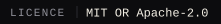
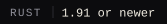

<h3 align="center">Universal instant code search and persistent code intelligence, in one Rust binary.</h3>

<p align="center">
  <a href="#licence"></a>
  <a href="#install"></a>
  <a href="#status-010"></a>
</p>

<p align="center">
  <a href="https://scrutate.github.io/playground/">
    <picture>
      <source media="(max-width: 600px)" srcset="docs/assets/cta-playground-phone.svg">
      
    </picture>
  </a>
</p>

<p align="center">
  <a href="#install"><b>Install</b></a>&nbsp;&nbsp;&middot;&nbsp;&nbsp;<a href="#quick-start"><b>Quick start</b></a>&nbsp;&nbsp;&middot;&nbsp;&nbsp;<a href="#benchmarks"><b>Benchmarks</b></a>&nbsp;&nbsp;&middot;&nbsp;&nbsp;<a href="#documentation"><b>Documentation</b></a>&nbsp;&nbsp;&middot;&nbsp;&nbsp;<a href="docs/FAQ.md"><b>Questions</b></a>&nbsp;&nbsp;&middot;&nbsp;&nbsp;<a href="https://scrutate.github.io/playground/"><b>Playground</b></a>&nbsp;&nbsp;&middot;&nbsp;&nbsp;<a href="https://scrutate.github.io"><b>Website</b></a>
</p>

<p align="center">
  <picture>
    <source media="(max-width: 600px)" srcset="docs/assets/hero-phone.svg">
    
  </picture>
</p>

<p align="center"></p>

## Two engines, one binary

<p align="center">
  <picture>
    <source media="(max-width: 600px)" srcset="docs/assets/engines-phone.svg">
    
  </picture>
</p>

Scrutate is an open-source code search tool for the terminal, editors and AI coding agents: two
independent engines behind one CLI ([questions and answers](docs/FAQ.md)).

**Engine A, universal instant search.** No index, no parsers, no background process. Literal,
regex (linear-time, size-limited), identifier (all casings), fuzzy, multiline, whole-word and
inverted matching over every readable file, with `.gitignore` rules, a parallel walk, streaming,
cancellation, and colour or JSON Lines. Built on ripgrep's own `grep-*` and `ignore` crates, and
differentially tested against ripgrep.

**Engine B, code intelligence.** A persistent, incremental index (SQLite and memory-mapped
segments): tree-sitter symbols from 61 grammars (74 with `--features extra-langs`), keyword
heuristics for the rest, call edges, imports, BM25 postings, semantic vectors, a LightGBM ranker,
and a trigram text index that answers grep queries with Engine A's exact output. It answers the
questions in [What it does](#what-it-does), and what a git diff touches.

[How the engines work and why](docs/ARCHITECTURE.md)

<p align="center"></p>

## Quick start

Build the binary ([Install](#install)), or try both engines first in the
[playground](https://scrutate.github.io/playground/), which runs scrutate in your browser. Every
command, option and exit code: [docs/CLI.md](docs/CLI.md).

### Search any folder, no index (Engine A)

```sh
scrutate grep "refresh_token" .                 # Engine A: instant, index-free, ignore-aware search
scrutate grep --ident refreshToken .            #   one spelling finds refresh_token / RefreshToken / REFRESH_TOKEN
scrutate grep --fuzzy=1 "shortest_pth" .        #   approximate matching (Myers bit-parallel)
scrutate grep --fuzzy-regex=1 '(get|set)_valu'  #   a regex within N edits
scrutate grep -P '(?<=self\.)cache\b' .         #   PCRE2: look-around, backreferences
scrutate grep -z "TODO" dist/                   #   inside zip/tar archives and compressed files
```

### Index the repository (Engine B)

```sh
scrutate index && scrutate grep --index "PM_RESUME"   # Engine B text index: the same answer, from a trigram index
scrutate search "where do we renew expired tokens"   # Engine B: ranked search by meaning, learned ranker
scrutate callers refresh_token                  #   call graph, definitions, references, outline
scrutate read --symbol refresh_token            #   one whole definition, or a file's lines
scrutate refs Graph --def networkx/classes/graph.py   # references resolved through imports and scopes
scrutate dupes                                  #   exact and near-duplicate functions
scrutate dead                                   #   definitions nothing uses, entry points left out
scrutate tsquery python '(class_definition name: (identifier) @c)'   # structural search (tree-sitter)
scrutate impact --base main...                  #   what my diff changes, who calls it, which tests to run
scrutate files srch.rs                          #   a file by a misspelt name, files read lately first
```

### Serve agents and editors

```sh
scrutate serve --watch                          # MCP server for AI coding agents, index kept fresh
scrutate lsp                                    # language server for editors (VS Code, JetBrains)
```

<p align="center"></p>

## What it does

<table>
<tr>
<td width="33%" valign="top"><br><b>Regex</b><br>Literal, regex in linear time, and PCRE2 (<code>-P</code>).</td>
<td width="33%" valign="top"><br><b>Any casing</b><br>One spelling finds snake, camel and upper case (<code>--ident</code>).</td>
<td width="33%" valign="top"><br><b>Fuzzy</b><br>Matches within N edits, also for a regex (<code>--fuzzy</code>).</td>
</tr>
<tr>
<td valign="top"><br><b>Archives</b><br>Inside zip and tar files and compressed files (<code>-z</code>).</td>
<td valign="top"><br><b>Text index</b><br>A trigram index, Engine A's exact output (<code>grep --index</code>).</td>
<td valign="top"><br><b>Ranked</b><br>By meaning, name or identifier, with a learned ranker (<code>search</code>).</td>
</tr>
<tr>
<td valign="top"><br><b>Call graph</b><br>Definitions, callers, callees, outlines, imports (<code>callers</code>).</td>
<td valign="top"><br><b>References</b><br>Each name resolved through imports and scopes (<code>refs</code>).</td>
<td valign="top"><br><b>Duplicates</b><br>Exact and near copies of a function, similar code (<code>dupes</code>).</td>
</tr>
<tr>
<td valign="top"><br><b>Structure</b><br>tree-sitter queries on the syntax tree (<code>tsquery</code>).</td>
<td valign="top"><br><b>Kept fresh</b><br>An incremental index that follows edits (<code>watch</code>).</td>
<td valign="top"><br><b>Many repos</b><br>Search other repositories too (<code>search --also</code>).</td>
</tr>
<tr>
<td valign="top"><br><b>MCP server</b><br>Tools for AI coding agents, on stdio (<code>serve</code>).</td>
<td valign="top"><br><b>Editors</b><br>A language server: definitions, references, symbols (<code>lsp</code>).</td>
<td valign="top"><br><b>Python</b><br>Streamed grep with the GIL released, and the index (<a href="#python">bindings</a>).</td>
</tr>
</table>

<p align="center"></p>

## Benchmarks

Every number comes from scripts in `bench/` you can rerun.

<p align="center">
  <picture>
    <source media="(max-width: 600px)" srcset="docs/assets/bench-walltime-phone.svg">
    
  </picture>
</p>

[docs/LEADERBOARD.md](docs/LEADERBOARD.md) is generated from the raw results in `bench/results/`:
30 runs per contender, 95% intervals. On the development Mac (Apple M3 Pro, shared with other
work, so not a publishable #1 claim), Engine A is significantly fastest in all 37 warm-cache
benchmarks and all 5 cold-cache ones. Its lead over the next tool:

- Linux kernel tree: 15 to 30% on 12 of 13 text searches, 45% on the one with 1.3 million matching
  lines.
- LLVM: 15 to 30% on five of six rows. 200,000 small files: 24 to 26%. A 211-file repository: 17
  to 24%. A 740 MB file: 43 to 58%. Cold cache: 23 to 28%.

Structural search is 6 and 14 times faster than ast-grep with scrutate's capture cache filled, so
it parsed no file while ast-grep parsed every file.

<p align="center">
  <picture>
    <source media="(max-width: 600px)" srcset="docs/assets/bench-index-phone.svg">
    
  </picture>
</p>

Against Zoekt the text index builds 25 times faster, is a tenth of the size, answers in 0.37 of the
median time and serves 1.2 times the queries per second, leading all eight indexed metrics.

In a 5-CPU Linux virtual machine on the same Mac, Engine A is significantly fastest on all 14
Linux-tree benchmarks and all 4 cold-cache ones, and the text index leads Zoekt and livegrep on
all 8 indexed metrics.

More: [docs/BENCHMARKS.md](docs/BENCHMARKS.md), [docs/dashboard.html](docs/dashboard.html),
[docs/COMPETITIVE.md](docs/COMPETITIVE.md) and [docs/QUALITY.md](docs/QUALITY.md) (see
[Documentation](#documentation)).

<p align="center"></p>

## For AI agents and editors

`scrutate serve` is an MCP server on stdio, started inside a repository or given `--root`;
`--watch` also updates the index from filesystem events.

```sh
scrutate --root /path/to/repo serve --watch
```

### Set up your agent

`scrutate setup` adds one entry that runs this binary by its absolute path, and keeps every other
line of the agent's file:

```sh
scrutate setup claude          # also codex, opencode, cursor, gemini
scrutate setup cursor --project   # the repository's .cursor/mcp.json instead of the user's file
scrutate setup claude --hook   # also answer Claude Code's Grep with scrutate's search
scrutate setup claude --uninstall   # take back exactly what setup wrote, the hook included
```

`--dry-run` writes nothing. Only `--instructions` touches `CLAUDE.md`, `AGENTS.md` and
`GEMINI.md`. `scrutate hook stats` shows the bytes the hook sent against Grep's. Details:
[docs/CLI.md](docs/CLI.md#setup-and-the-grep-hook).

`scrutate lsp` is a Language Server Protocol server on stdio: definitions, references and symbols
from the index.

```sh
scrutate --root /path/to/repo lsp
```

Client set-up: [MCP clients](integrations/mcp/README.md), [VS Code](integrations/vscode/README.md),
[Neovim](integrations/neovim/README.md), [JetBrains](integrations/jetbrains/), and CI and
pre-commit in [integrations/](integrations/).

<p align="center"></p>

## Install

From source, with Rust 1.91 or newer (`rust-toolchain.toml` pins 1.99.1):

```sh
cargo build --release -p scrutate --locked      # target/release/scrutate
```

No release archive is published yet. When a version is tagged, `.github/workflows/release.yml`
builds archives, checksums, Sigstore attestations, musl binaries and wheels for every platform
([docs/INSTALL.md](docs/INSTALL.md)).

<p align="center"></p>

## Python

`pip install` the wheel maturin builds from `crates/scrutate-py`:

```python
import scrutate
for m in scrutate.grep("TODO", ["."], mode="literal"):      # streamed, GIL released
    print(m.path, m.line, m.text)
repo = scrutate.Repo("."); repo.index()
print(repo.search("parse a date string", k=5))
```

<p align="center"></p>

## Status: 0.1.0

The first release, **not** declared production-ready:
[docs/RELEASE_READINESS.md](docs/RELEASE_READINESS.md) says what is and is not verified.

**Platforms.** All six are supported: macOS arm64 and x86_64, Linux aarch64 and x86_64 (static musl
binaries too), Windows x86_64 and ARM64. macOS arm64 and Linux are built and tested here, and
macOS x86_64 and Windows x86_64 are cross-built here. On GitHub's runners (CI run 43408907893, commit
`8f60af9`) every job passed: the Rust tests, and a wheel built, installed and tested for CPython 3.13
and free-threaded 3.14, on all six platforms, and the editor integrations
([docs/INSTALL.md](docs/INSTALL.md)). CI run 43382848665 (commit `08cd9fa`) was the first such run
of the Rust tests.

**Tests.** The last recorded run ([docs/TEST_RESULTS.md](docs/TEST_RESULTS.md), 2026-11-11)
passed 122 Rust tests (unit, 60-language snapshot, robustness, property, end-to-end CLI and MCP,
incremental parsing), the Python and bindings tests, fuzz regressions and a reproducible-build
check; the ranking pins and quality floor came later, and CI runs both. Engine A agrees with
ripgrep on 2,000 random corpora and patterns, run as shipped, with the parallel walk forced, and
with every file searched in ranges.

**Engine B.** Its models train on rows it writes itself. A test pins its features and scores bit
for bit, and CI fails when its ranking quality falls below a recorded floor. On held-out code in
Python and five more languages the learned ranker beats its lexical layer for function and type
answers on every query type but one, which ties ([docs/QUALITY.md](docs/QUALITY.md)).

**Code checks.** `cargo clippy -D warnings` and `cargo fmt` are clean; `cargo audit` reports no
vulnerabilities; an SBOM is generated.

<p align="center"></p>

## Documentation

<table>
<tr>
<td width="50%" valign="top"> <a href="docs/README.md"><b>Documentation hub</b></a><br>Where to start, and a map of every document</td>
<td width="50%" valign="top"> <a href="docs/CLI.md"><b>CLI</b></a><br>Every command, option, exit code, environment variable, config file</td>
</tr>
<tr>
<td valign="top"> <a href="docs/FAQ.md"><b>Questions</b></a><br>What scrutate is, and the questions people ask first</td>
<td valign="top"> <a href="docs/INSTALL.md"><b>Install</b></a><br>Build it, the platforms, the package definitions</td>
</tr>
<tr>
<td valign="top"> <a href="docs/ARCHITECTURE.md"><b>Architecture</b></a><br>How the engines work and why</td>
<td valign="top"> <a href="docs/LEADERBOARD.md"><b>Leaderboard</b></a><br>The benchmark leaderboard: every tool, every benchmark, confidence intervals, statuses (generated)</td>
</tr>
<tr>
<td valign="top"> <a href="docs/BENCHMARKS.md"><b>Benchmarks</b></a><br>Latency, CPU, memory, start-up, concurrency and index metrics against grep-class tools (generated)</td>
<td valign="top"> <a href="docs/QUALITY.md"><b>Quality</b></a><br>Ranking quality on held-out code (MRR, hit@k)</td>
</tr>
<tr>
<td valign="top"> <a href="docs/LANGUAGES.md"><b>Languages</b></a><br>Verified language capability registry (generated)</td>
<td valign="top"> <a href="docs/SECURITY.md"><b>Security</b></a><br>Threat model, controls, evidence, residual risks</td>
</tr>
<tr>
<td valign="top"> <a href="docs/TRACEABILITY.md"><b>Traceability</b></a><br>Every mission requirement to implementation to evidence to PASS/PARTIAL/BLOCKED</td>
<td valign="top"> <a href="docs/RELEASE_READINESS.md"><b>Release readiness</b></a><br>What 0.1.0 is, remaining defects and incomplete requirements</td>
</tr>
<tr>
<td valign="top"> <a href="docs/COMPETITIVE.md"><b>Competitive</b></a><br>Evidence-based positioning against existing tools</td>
<td valign="top"> <a href="docs/NAMING.md"><b>Naming</b></a><br>How the name was chosen and what was (not) checked</td>
</tr>
<tr>
<td valign="top"> <a href="docs/TEST_RESULTS.md"><b>Test results</b></a><br>Every quality gate with its command and output (generated)</td>
<td valign="top"> <a href="docs/DELIVERY.md"><b>Delivery</b></a><br>Where each deliverable lives, and the release artifacts with their hashes</td>
</tr>
<tr>
<td valign="top"> <a href="docs/RELEASING.md"><b>Releasing</b></a><br>The release checklist</td>
<td valign="top"> <a href="docs/dashboard.html"><b>Dashboard</b></a><br>Every benchmark run so far, charted (generated)</td>
</tr>
<tr>
<td valign="top"> <a href="GLOSSARY.md"><b>Glossary</b></a><br>The words this codebase uses for its own concepts</td>
<td valign="top"> <a href="integrations/"><b>Integrations</b></a><br>VS Code, Neovim, JetBrains, GitHub Action, GitLab, Bitbucket, MCP, pre-commit</td>
</tr>
<tr>
<td valign="top" colspan="2"> <b>Also</b><br><a href="docs/DEPENDENCIES.md">DEPENDENCIES</a>, <a href="docs/ROADMAP.md">ROADMAP</a>, <a href="docs/RESEARCH.md">RESEARCH</a>, <a href="CHANGELOG.md">CHANGELOG</a>, <a href="CONTRIBUTING.md">CONTRIBUTING</a></td>
</tr>
</table>

<p align="center"></p>

## Sponsor and hire

Scrutate is free. To fund it,
[sponsor the maintainer on GitHub](https://github.com/sponsors/crisnahine) or
[buy a coffee](https://buymeacoffee.com/crisnahine). The maintainer also takes paid work:

- a commercial licence or other terms, where a company's policy needs them
- paid support
- sponsored features
- work for hire on code search and code intelligence

To ask, use the [GitHub profile](https://github.com/crisnahine) or
[open an issue](https://github.com/scrutate/scrutate/issues/new?title=Commercial%20inquiry)
titled "Commercial inquiry" with no details: the maintainer answers with a private channel.

<p align="center"></p>

## Licence

Scrutate is licensed under either of

- the MIT licence ([LICENSE-MIT](LICENSE-MIT))
- the Apache License 2.0 ([LICENSE-APACHE](LICENSE-APACHE))

at your option (SPDX: `MIT OR Apache-2.0`). That covers the code, the models, the documents and
images, the integrations and packaging, the benchmark harness and its results, and the tests. The
vendored walker in `vendor/ignore` (the crate `scrutate-ignore`) keeps its upstream terms,
`Unlicense OR MIT`.

Every crate compiled into the binary has a licence compatible with both (MIT, Apache-2.0, BSD,
ISC, Zlib, Unlicense, 0BSD, Unicode-3.0 or CC0-1.0). Their licence and notice files are in
`THIRD_PARTY_NOTICES.txt` (`tools/third_party_notices.py`), included in release archives, wheels
and the `.deb` and `.rpm` packages.

Contributions are accepted under the [contributor licence agreement](CLA.md) and offered under
the same two licences. The name and the logo are covered by the [trademark policy](TRADEMARKS.md).
