<!-- Head written by tools/gen_doc_assets.py: edit its table, then run it. -->
<p align="center">

</p>

# Architecture

[Documentation](README.md) &nbsp;·&nbsp; Next: [Languages](LANGUAGES.md)

**Contents**: [Engine A: universal instant search](#engine-a-universal-instant-search-cratesscrutatesrcinstantrs) &nbsp;·&nbsp; [Engine B: code intelligence](#engine-b-code-intelligence-indexrs-lexrs-parsers-langsrs-searchrs-intelrs) &nbsp;·&nbsp; [Unified layer](#unified-layer-opsrs-librs-clirs-mcprs-cratesscrutate-py) &nbsp;·&nbsp; [Models](#models-models-modelsrs) &nbsp;·&nbsp; [Design rules for the next decade](#design-rules-for-the-next-decade)

<!-- End of head. -->

Scrutate is one binary with two independent engines and a thin unifying layer.

```
                 scrutate (CLI, MCP server, Python bindings)
                 ┌──────────────────────────────────────────┐
  query ───────► │ unified layer: `find` picks the engine,  │
                 │ `grep --symbols` and `refs` combine them  │
                 └───────┬───────────────────────┬──────────┘
                         │                       │
        ┌────────────────▼──────┐   ┌────────────▼────────────────────────┐
        │ ENGINE A  instant.rs  │   │ ENGINE B  index.rs lex.rs search.rs  │
        │ no index, no parsers  │   │ persistent, incremental index        │
        │ ignore-aware parallel │   │ tree-sitter symbols + call graph +   │
        │ walk, regex/literal/  │   │ imports; BM25 postings; semantic     │
        │ identifier/fuzzy,     │   │ vectors (IVF); LightGBM ranker;      │
        │ streaming, cancel     │   │ dupes/similar/outline/deps/tsquery   │
        └───────────────────────┘   └──────────────────────────────────────┘
```

## Engine A: universal instant search (`crates/scrutate/src/instant.rs`)

<p align="center">

<br><sub>Engine A's path for one search. A file's first read picks how it is searched; the bullets below give each path's limits and measurements.</sub>
</p>

Built on the `grep-searcher`, `grep-regex`, `grep-matcher` and `ignore` crates, the published
components ripgrep itself is assembled from (their crates.io pages describe them as ripgrep's
searching, regex, matcher-trait and ignore-aware directory-walking libraries). Scrutate adds the
capabilities those crates do not provide rather than re-implementing what they already do:

- **Matching modes**: regex (Rust `regex`: linear time, no backtracking, size-limited), literal,
  **identifier** (one spelling matches every casing: `refreshToken` ≡ `refresh_token` ≡
  `REFRESH_TOKEN`; digits and acronyms are parts), **fuzzy/approximate** (Myers' bit-parallel
  edit-distance matcher, counted in characters: one 128-bit word for patterns up to 128, 64-bit
  blocks with carries up to 4096, with a pigeonhole prefilter so only candidate lines pay for the
  DP; `-i` folds case as a regex does), multiline, inverted, whole-word, smart case. A
  case-insensitive literal (`-i`, `-F -i`, `-S`) finds candidate lines without the regex engine:
  it scans for two bytes of the needle, each in either case form, at a fixed distance inside a
  stretch whose characters keep one byte length under case folding (`k` and `s` end such a
  stretch, as KELVIN SIGN and LONG S are longer), checks that stretch, and the regex then
  confirms each candidate line. The scan is safe slice code over 64-byte blocks that the compiler
  turns into NEON or SSE2, compiled a second time for AVX2 and chosen at run time on x86_64. On
  one thread over a 740 MB file that is 63 ms of user time for `pm_resume` where the regex
  engine took 101, and 48 ms for `KÖNIG` where it took 96.
- **Traversal**: the `ignore` parallel walker (work-stealing across threads, `.gitignore` /
  `.ignore` / global excludes, hidden files off by default, symlink loop detection, max depth and
  size filters, type globs derived from the language registry). The crate is vendored
  (`vendor/ignore`) with nine changes, all listed in the workspace `Cargo.toml`; four of them
  shape a walk's speed. The global git excludes path is read from `~/.gitconfig` by
  a small parser instead of a regex compiled for each run (0.4 ms of a 6 ms search). An idle walker
  thread first waits 10 µs, doubling up to the original 1 ms, before it looks for work again; with a
  fixed 1 ms, a walk of a few hundred files spent whole milliseconds asleep (598 files: 12.3 ms to
  9.3 ms). Gitignore lines of three shapes (`**/` and a name with `*` or `?`, `**/` and a literal
  path, `/` and a name with `*` or `?`) are matched by a byte loop instead of a `GlobSet` regex,
  whose build cost 100 to 400 µs per file, more than the whole walk of a small repository; a
  randomized test checks it against `GlobSet`. Trying each such glob on every path is slow for a
  file with many of them used on many paths (the Linux tree's root `.gitignore`: over 100 globs,
  95,000 paths, 7.8% of the search's CPU), so a matcher compiles all its globs into one `GlobSet`
  once the tries have cost about what the build costs; a small repository never reaches that. And
  a parallel walk can start more threads while it runs (`grow_threads`); their visitors are built
  at the start and stay idle until then.
- **Thread count**: the cores (at most 12), except on macOS, where a walk uses as many threads as
  performance cores: there, more threads opening and reading files at once wait on each other in
  the kernel (the Linux tree on an M3 Pro: 977 ms on 11 threads, about 845 ms on 5). The open and
  read time of small files tells the page cache from the disk (macOS: about 25 µs a file against
  160 µs or more; Linux: under 15 µs against 30 µs or more). When it is the disk, the walk adds
  a thread for every 16 slow reads, because the disk serves many reads in flight: up to 64
  threads on Linux (the Linux tree cold on 5 CPUs: 1.22 s on 5 threads, 0.37 s this way),
  elsewhere up to twice the cores, at most 24 (macOS: 2.7 s on 5 threads, 1.3 s on 22; 48 gained
  5% there on one tree and lost 4% on another). Threads come one at a time because starting one
  costs about a slow read, which a small tree never earns back (231 files cold on Linux: 5.8 ms
  this way, 8.3 ms with a thread per slow read). `-j` overrides all of it.
- **Searches at the same time (macOS)**: the kernel there serves about four file-reading threads
  at full speed across all processes, so four searches on five threads each are slower than four
  on one (py-big: 244 ms against 189 ms). A walk of directories adds 1 to a System V semaphore
  kept per user when it starts (`running.rs`), with `SEM_UNDO` so the kernel takes it back
  however the process dies. Its share is the default thread count divided by the searches
  running: it starts that many threads, looks at the value again once after its first four
  files (searches started together each saw fewer of the others than there are) and, past
  1,000 files, every 64 files; the threads over the share pause between directories (`pause` in
  the vendored walker) until the share rises again. A paused thread sleeps a thirty-second of
  the time it has been paused, at most 1 ms: the walk cannot end before it wakes, and a sleep
  of 1 ms cost a 13 ms search more than a millisecond. Two at once on py-big: 113 ms to 91 ms;
  four: 244 ms to 185 ms; eight: 482 ms to 413 ms. Four at once on the ripgrep sources, 250
  files: 14.7 ms to 13.3 ms, where GNU grep takes 14.5 ms and `-j1` 13.1 ms. One alone makes
  three system calls for it; a search of one directory without subdirectories makes none. A process leaves the count while a write to a pipe or a
  terminal may block and while it is stopped from its terminal: the SIGTSTP handler, installed
  only while a search is counted and only when nothing else handles the signal, takes the process
  out, stops it with the default action, and puts it back when it continues. On Linux the cores
  are the limit and splitting them never won (py-big on 5 CPUs, four at once: 53 ms on 5 threads
  each, 60 ms on 1), so nothing is counted there.
- **One large file, every core**: a file of 64 MB or more is cut into ranges of whole lines (8 MB
  each). A first pass counts each range's newlines for the line numbers and stops at a NUL byte,
  which sends the file back to the single pass so binary handling is unchanged. The second pass
  searches one window of ranges per thread at a time and writes the windows' output in file order,
  so the output held in memory stays bounded. Context lines, `--max-count`, `--max-results`, `-l`,
  multiline and a byte-order mark keep the single pass. A file with no line break before its
  last byte goes into one buffer of its exact size and is searched there: the threads fill it in
  1 MiB pieces in file order, and the first line break or NUL byte sends the file to the stream,
  so lines too long for the probes to see (100 MB of 4 MB lines) hold 15 to 18 MB where they
  held the whole file. The time is the kernel copying pages, which spreads as far as opening files does (100 MB
  on an M3 Pro: 12.6 ms on one thread, 4.0 ms on the five performance cores, 6.7 ms on all
  eleven).
  A plain `-F` literal, when only plain output or a count is wanted, does not read such a file
  whole: a first pass reads it in 256 KiB pieces, a buffer per thread on up to 8 threads, to find
  the literal and to make sure the file holds no NUL byte and no inner line break, and a
  matching line is read from the file again as it is written. On a 100 MB line that is 3 to
  5 MB of peak memory where the buffer held 103 MB, and less CPU time: a read into a small
  buffer that stays in the cache costs 7 ms of system time for 100 MB where fresh memory costs
  12 ms on one thread and more on several, which fault on it at once.
  On one thread a file is never split, but one with no line break at its probe points is still
  read into a buffer of its size: the stream reader grows its buffer to 3^k times 64 KiB, which
  held 141 MB for one 100 MB line where the exact buffer holds 103 MB. The newline count of a
  split file reads 256 KiB at a time per thread (1 MiB each held 14.3 MB on a 740 MB file,
  6.1 MB now).
- **Memory of a walk**: a search thread keeps its output buffer from one file to the next, a
  queued walk entry is 96 bytes where it was 144 (its rare ignore error is boxed), and a walk on
  one thread queues its entries in a plain vector (LLVM with `-j1`: 9.4 to 8.3 MB of peak
  memory). What `-j1` still holds over GNU grep on a large tree, 1 to 3 MB, is mostly memory the
  system allocator has freed and not given back (its per-CPU magazines, as the walk thread moves
  between cores), the ignore matchers, and whole directories read at once. Output that is not
  plain (colour, `--json`, a caller's iterator) goes through a queue of at most 64 batches: a
  search thread that fills it waits for the thread that formats, so the hits held do not grow
  with the matches. A file searched in ranges keeps a window of ranges at a time, as before.
- **Roots without directories**: when no root holds a directory the walk would enter, a sequential
  walk with the same rules runs first on the calling thread, and three threads search the files
  as it finds them; when those files turn out to come from the disk, it adds threads. The first
  file waits for a second before any thread starts, so a tree of one file is searched with no
  thread at all (four threads cost about 1 M instructions, a third of a one-file search past
  process start). Past 256 files the walk stops, and the parallel walk takes over, skipping the
  files already searched. For three large files this beats
  the parallel walk (40.6 ms against 41.9). Any directory to enter sends the search straight to the
  parallel walk: one thread reading every directory held up the searches (the ripgrep repository,
  60 directories: 5.6 ms in parallel against 6.0).
- **Start-up** (`lazy_bind.rs`, `cli.rs`): a search of a few hundred files is mostly process
  start. Two costs were ours. dyld binds every imported symbol before `main`, about 3.3 µs each for
  symbols that come through libSystem (a C program importing 121 more of them starts 0.4 ms
  later); the executable imported 210, and a search calls about 75. On macOS arm64 the other 133
  are defined in the executable as private stubs that look the function up with `dlsym` on the
  first call and jump to it, keeping every argument register and the stack; `fork` binds all of
  them first, so a child never does a lookup. And clap builds every subcommand's argument
  definitions before parsing, so `scrutate grep` uses a definition of that subcommand alone.
  Start-up went from 2.4 ms to 1.9 ms (a Rust hello-world: 1.5 ms). Counted in instructions, a
  search of a one-file directory then cost 21.1 M against GNU grep's 20.8 M in the C locale (a
  Rust hello-world: 14.8 M), and on macOS each `open` or `getcwd` is 150 to 200 thousand of them.
  So the global git excludes file is read the first time a walk meets a repository (reading git's
  configuration and compiling the file cost 0.5 M in every walk outside one), the walk takes the
  current directory the command line already has for `.`, a search without the index does not
  resolve the repository root, and a tree of one file starts no thread: 19.2 M. Then the pages:
  that search took 459 page reclaims against 307 for GNU grep and 291 for a Rust hello-world,
  most of them pages of the executable's own code. `scrutate grep` reads arguments of the plain
  shapes by hand and gives anything else to clap (a property test holds the two to the same
  answer; a configuration file, or a variable clap reads for grep, also sends them to clap),
  `-F` with one literal is a substring search that builds no regex engine, 14 more
  system functions bind on first use, and on macOS the linker drops the unused libiconv and
  puts the functions a small search runs side by side from `crates/scrutate/startup.order`
  (`tools/order_file.py` runs the release links under lldb with a breakpoint on every function
  of the link map, so the standard library's functions are listed too, and checks how many of
  the names a release link still has; a name the link no longer has is passed over). With
  ThinLTO, ld64 passes over most of those functions: the `.llvm.N` ones it promoted and the
  local ones several objects hold. So the release profile links one object (fat LTO, one
  codegen unit). A search of a one-file directory touches 36 pages of the executable's
  `__TEXT` where it touched 75: 17 M instructions, 328 page reclaims and 2.6 MB of peak memory
  where it was 19.3 M, 459 and 4.8 MB (GNU grep: 308 and 2.05 MB), and the CPU time of GNU
  grep. A release build takes 3 to 5 minutes from scratch where it took under 2. The order
  file is for macOS on Apple silicon; the other targets link as before. Measured and left
  alone: the
  binary's 37,000 pointer fix-ups (applied lazily by the kernel, no cost), its code-signature page
  size (no difference), and its 85 MB size (0.05 to 0.2 ms).
- **What bounds a search on macOS**: opening a file. On APFS `open` costs 8 to 11 µs for a file
  that was opened recently and about 19 µs when the tree is large enough that the kernel's data for
  it left the CPU caches; `close` costs 0.5 µs, a read of the whole file 1.3 µs, `stat` 1 to 2 µs.
  Opens scale to the performance cores and no further (the Linux tree, open and read only: 1.95 s
  on one thread, 0.56 s on five, 0.71 s on six, 0.95 s on eleven; the same for processes as for
  threads), which is why the default thread count is the performance cores. A search of that tree
  takes 0.66 s, so about 0.1 s of it is ours.
- **Reading a file**: the first read asks for 64 KB and one byte. A short read is the whole file,
  searched in the thread's buffer with no call for its size (a `statx` per file otherwise: 96,000
  on the Linux tree). A larger file goes to the stream reader, up to 1 MB with a searcher made
  for that file, so the thread's own searcher keeps its buffer size (where a NUL byte after the
  first fill stops the output depends on that size). Reading such files whole had every thread
  keep a buffer as large as the largest one it met: 12.6 MB peak resident memory on py-big with
  five threads against 8.2 MB streamed (ripgrep: 8.5 MB), for 0.2% to 1.5% fewer instructions on
  macOS and 1% to 3% less CPU time on the Linux tree in a Linux VM. A NUL byte or a byte-order
  mark in the first read sends the file to the stream reader too, whose binary and encoding
  handling is unchanged. Files of the kernel's pseudo filesystems give their size as 0 and answer a first
  read short (4 KB of the 7.3 MB `/proc/kallsyms`), so on Linux one `statfs` per root, and per
  directory named `proc` or `sys` the walk meets, finds procfs, sysfs, debugfs, tracefs,
  securityfs, configfs and cgroup, and their files are read until the kernel has no more. On Linux, where opening a file is cheap, this and the matcher change above took the
  Linux-tree search from 144 ms to 120 ms in the test VM (ripgrep: 135 ms), with 316,000 system
  calls against ripgrep's 526,000.
- **One way in**: `instant::search` takes a `Query` (the `Pattern`, invert, the report: lines,
  counts or files, context, limits, the shape of records), a `Files` (the roots of a walk with its
  rules, or a list of files under a root, and the threads) and the caller's cancel flag, which it
  reads and never sets. Results leave as `Record`s, each of one kind (match, context, count, file,
  note), or as plain lines the search threads write (`Output::Plain`), which makes no record. A
  record is 104 bytes, the size one result had when a flag and a sentinel line number told its kind.
- **One run, one translation**: every file search of a run shares a `Run` (matcher, query, file set,
  counters, stop flag, output target). The pattern is translated once (`Pattern::translate`:
  the form its mode means, and whether case is folded), and both the matcher and the text index's
  trigram condition are built from that, so a file the index lets through is judged by the same
  pattern. Smart case counts only letters that stand for themselves (`\S` is not uppercase), as
  ripgrep does.
- **Files without line breaks**: a large file whose ranges cannot be cut at a newline is read once
  into a buffer of its exact size (checked for NUL bytes as it is read, so binary handling is
  unchanged) and searched as a slice; the stream reader would grow its buffer by doubling.
- **Line anchors**: the regex is always built in multi-line mode, so `^` and `$` mean line start and
  end and the searcher can scan a whole buffer at once; without it, patterns using them were run
  one line at a time.
- **Line-start literals**: when every match of a regex starts a line and begins with one of at most
  64 literals (`^(a|aa)+$`, `^#include`), the candidate lines are the line starts followed by one
  of them, and each is decided by a search anchored there. A match that would cross a line break
  is passed to grep-regex's matcher, which cannot match one.
- **Suffix literals**: when a regex has no literal prefix but every match ends in one of at most 64
  literals of 3 bytes or more (`\w+_(suspend|resume)\(`), candidate lines are found with an
  Aho-Corasick search for those literals and the regex runs only on those lines. Without it the
  regex engine scanned every byte for such patterns (ripgrep, built from the same crates, shows the
  same cost).
- **Streaming**: matches are batched per file and sent over a channel to the caller's sink while
  other threads keep searching; a stop flag ends the walk between files (Ctrl-C → exit 130,
  `--max-results`, broken pipe): the caller's cancel flag, or the search's own. Plain piped output skips the channel: each thread formats a
  file's lines and hands them to one shared sink (`PlainSink`). Output that follows other output
  within a millisecond waits there in a 64 KB buffer, so the lines of many files leave in one
  write; a write per matching file wakes the reader of a pipe every time (88,000 writes for
  `return` in the Linux tree; on Linux 302 ms to 190 ms). Output after a quiet spell leaves at
  once, and threads let held output go between files, so nothing waits longer than a millisecond
  or the longest file being searched.
- **Output**: path:line:text, `-c`, `-l`, context, colour, deterministic `--sort`, and JSONL
  (`--json`, schema version 1: `match`, `context`, `count`, `file`, `summary`, `symbol_group`).
- **No dependency on Engine B**: `grep` never opens the index. `grep --symbols` is the one
  opt-in bridge (group matches by the enclosing function using the index if one exists).

## Engine B: code intelligence (`index.rs`, `lex.rs`, `parse.rs`, `langs.rs`, `search.rs`, `intel.rs`)

<p align="center">

<br><sub>One index update, from the walk to the commit. Parsing, Storage and its Lifecycle below describe each step.</sub>
</p>

### Parsing (`parse.rs`, `langs.rs`)
Three tiers so every file yields something useful (see docs/LANGUAGES.md): tree-sitter grammars
driven by a **data-driven rule registry** (per language: which node kinds are definitions, how the
name is found, what a call is, how imports look); a keyword heuristic tier; and overlapping line
windows. Each definition becomes a *chunk* with fields name / qualified name / signature /
documentation / body / path, plus call edges and imports. A definition's documentation is the
comment block right above it, with no blank line between; attributes, decorators, annotations
and type specs (Rust `#[...]`, `@Get(...)`, `@override`, Elixir `@spec`, Erlang `-spec`) may
stand between them. The documentation is the lines of those comment nodes, whatever marks its
lines carry (a GNU style C block, an Elm `{-| -}`, a Lua `--[[ ]]`), and no window repeats
them; a comment a blank line above a definition is in a window. Elixir's `@doc` and `@moduledoc`, a Julia docstring and Haskell haddock
comments count as documentation, and in Python and Starlark the docstring after that comment
does too. A Haskell or Elm function starts at its type signature, and the
comment above the signature is its documentation. Adding a language is a registry entry
and a sample file, not new code. A chunk's text and body keep at most 200 lines (40 for a
container such as a class) and 32 KiB, cut at a character boundary, and a chunk ends on the last
line that holds its text. Every line no chunk keeps (past those caps, outside the definitions, or
only in a constant) is in overlapping 50-line windows named after the definition that holds it,
the file's stem outside them, so ranked search reads every line of an indexed file; a line of
only brackets or a closing word (`end`, `fi`, `done`, `esac`) is in a window only next to other
lines. A window is no symbol: `symbol`, `refs --def`, `outline` and the language server never
return one, and a window's location given to `symbol`, `callers` or `refs --def` is answered
with "these lines are outside every definition". `callers` does list a window, or the module
chunk, as the caller of a call written outside every definition, and `callees` and `similar`
take a window's location. In Rust, PHP, JavaScript, TypeScript, Java, Kotlin, Scala,
Groovy, Dart, Swift, Elixir and Gleam a definition starts at the attribute lines right above it
(`#[...]` or `@...`), as a Python definition starts at its decorators. On the Linux kernel tree
the windows add 8.9% chunks and 11.9% to the code index (the text index is not touched). The parser hands over byte ranges; the index cuts each chunk's text
from the source when it stores that chunk, one chunk at a time, so a file of thousands of nested
definitions never holds all their copies at once. A `.h` file is parsed as C++ or Objective-C
when its text shows it (docs/CLI.md lists the signs), as C otherwise. A method's qualified name uses its owner's bare type (`Stack.push` for
`impl<T> Stack<T>`), and qualified names keep at most 32 segments. The tree walk keeps its own
list of ancestors and visits children with a cursor, so a deeply nested or a very wide file
indexes in linear time. A call's name is read from the two ends of its target: the last
separator inside the target is found by a binary search over the offsets of that separator in
the file, gathered once per file, so a chain of calls costs time linear in its length. Constants (`const`, `static`, enum members, `#define` values and the
like) are chunks of kind `constant` that get no postings and no vectors: name lookups find them,
ranked search never sees them. A JavaScript or TypeScript object literal's methods are owned by
the name that holds the literal (`api.get`), so `callers` treats them as methods, never as free
functions.

### Tokens (`text.rs`)
Index and query use one tokenizer, in both engines. An ASCII word is split at `_` and case
changes, lowercased and stemmed (Snowball English); a compound identifier also gives its joined
form. A word with other characters is normalised to NFC first: runs of a script written without
spaces (Han, kana, Thai, Lao, Tibetan, Myanmar, Khmer, the Tai scripts, Balinese and Javanese)
give overlapping character bigrams (a lone character itself), and any other script gives one
lowercased token per word, with the final sigma folded. A Tibetan run ends at the tsheg that
closes each syllable. Before the bigrams are cut, every Han character with a simplified form is
replaced by it (Unihan `kSimplifiedVariant`, the table `crates/scrutate/data/han_fold.txt` that
both engines read), in index and query alike, so traditional and simplified text meet. The fold
applies to every Han run, Japanese included; names and stored text keep their own characters. A
text that
is all ASCII gives the tokens it gave before Unicode words were added, so its postings did not
change. Names are compared through a key that ignores case and `_`, in NFC with the final sigma
folded, so two spellings of one accented name are one name.

### Storage (`index.rs`, `lex.rs`)
- **SQLite** (bundled, WAL, `synchronous=NORMAL`): `files` (size, mtime, status-change time
  `ctime_ns`, SHA-1 content hash), `chunks` (metadata + zlib-compressed text), `refs` (call
  edges), `imports`, `meta` (schema version, model signature, segment manifest, data version,
  and `chunks_at`, the chunk count of the commit that wrote that data version).
- **Segments** (`.scrutate/seg/sNNNNNN/`): immutable, memory-mapped `.npy` arrays, Lucene-style.
  Per field (name, qualified name, signature, docs, body, path): BM25 postings (`ptr`, `doc`, `tf`)
  over a shared 63-bit token-hash vocabulary; `ids`, `dl`; int8 semantic vectors (`vec`, two
  views per chunk: description and implementation) with one float32 scale per view (`vscale`:
  symmetric quantisation, value = code × max|x| / 127, rounded half to even, identical in both
  engines; half the size of the float16 vectors used up to schema 12, docs/QUALITY.md has the
  measurements) stored in **IVF cluster order** for
  segments ≥ 20 000 rows (spherical k-means, K = clamp(2√n, 32, 1024); a query probes 48
  clusters, measured at ±0.000 MRR against the exhaustive scan).
  Constant chunks have no segment rows.
- **Lifecycle**: content hashing (fast path when size, mtime and, on Unix, `ctime_ns` match, so
  a `chmod` alone costs a read and a hash; a row without `ctime_ns`, from the reference engine or
  an older index, is read once; SHA-1 verification), one `BEGIN IMMEDIATE`
  transaction per update (readers never see a half state), new segments written to a temp
  directory and renamed (the name is taken inside that transaction, so a directory already under
  it was left by a writer stopped before its commit, and is removed), deletions as liveness
  bitmaps, background **compaction** (merge small segments / purge dead rows) that aborts if
  another writer moved the manifest, segment **GC** with an age guard inside the update's
  transaction, **corruption detection** (`PRAGMA quick_check` on open, structural validation of
  every array on segment open, deep validation in `scrutate check`; also a chunk text that does
  not inflate, a segment list that is not JSON, a segment without vectors under a model, an
  `index.db` that is deleted under an open index or is a directory, a `seg` that is a file, an
  emptied `chunks` table, and a chunk count that differs from `chunks_at` when the statistics
  are read) with automatic **rebuild**, **cancellation** (an update checks a cancel flag between
  batches of 256 files and rolls back; a panic inside an update rolls back at once, and the next
  update clears a transaction left open), a **content revision** (`content_rev` in `meta`: an
  index built with older parsing rules reads every file again on its next full update),
  **schema and model versioning** (an older schema clears and re-indexes inside the database so
  concurrent processes stay consistent; another vector model makes the vectors anew, see Models),
  **an order between versions** (an index records the schema version, content revision and
  model revision of the scrutate that built it, and a binary rebuilds or re-reads only an index
  older than itself: a newer content revision is read as it is and never updated, a newer
  schema version, model revision or text index format is refused with exit 2 until
  `scrutate index --force` rebuilds it, so an old `serve` and a new command line on one
  checkout do not rebuild the index in turn), and multi-process safety (busy-timeout +
  retry on `SQLITE_BUSY`, never deleting a live database; a read never waits for another
  process's writer and answers from the last committed index; a process whose database
  another process deleted and built again, after damage or with `index --force`, notices it by
  the file's device and inode on its next call and opens the new one, where on Windows the
  open file cannot be deleted; two processes that find an index of an older schema clear it
  once). A `.scrutate` that is a
  symbolic link, or that holds one, is refused, and files of fixed names are written with remove
  and `create_new`, so the index never writes through a link.

### Retrieval and ranking (`search.rs`, `semantic.rs`, `rank.rs`)

<p align="center">

<br><sub>A ranked query: three sources of candidates, 48 features per candidate, one learned ranker.</sub>
</p>
A query produces candidates from three sources: field-weighted BM25 (name 10, qualified name 3,
signature 3, docs 5, body 1, path 2), exact name/qualified-name lookup, and semantic nearest
neighbours (the query is encoded into the same 256-d space as the chunks by a contrastively
trained code-word model, inference only, bundled in the binary). 48 features per candidate
(lexical scores and ranks per field, z-scored semantic similarities of both views, literal hits,
name coverage, the name as typed (case included), kind, lengths, test-path flags...) go through a
LightGBM LambdaRank ensemble exported to plain arrays and evaluated in Rust. All arithmetic is
specified to the bit: the Python reference implementation (`python/scrutate_ref`, which also trains the models) and the Rust engine
return identical features, scores and rankings, each on the index it built itself
(`bench/parity.py`: networkx 300/300 queries; the clustered path on go_protobuf, 41,377 chunks,
40/40, and `bench/parity_repos.sh` runs 21 repositories). Vector dot products are summed in
float64 in one fixed order (four running sums, added left to right) and rounded once, so no
summation order can reorder near-tied chunks. The clustering of a large segment is identical
too: one xorshift64* generator draws the sample, the first centroids and the re-seeds of empty
clusters in the same order, and every float32 sum (row norms, cluster sums) runs in index order.
The nearest centroid comes from a float32 matrix product in any order; that is within k·2^-24
of the true dot product, so a row with more than one centroid within 4·k·eps of the best is
decided by exact float64 products summed in a fixed order, and the lower cluster number wins a
tie.

### Text index (`textindex.rs`)

<p align="center">

<br><sub>The text index names the files that can match; Engine A decides what matches.</sub>
</p>
The indexed counterpart of Engine A, for repeated grep-style queries on large trees (the job Zoekt
and livegrep do). It covers exactly the files Engine A's default walk visits (same walker, same
ignore rules) and stores, per file, the set of byte trigrams (ASCII case folded), as immutable
segments: sorted trigram keys, delta + LEB128 posting lists of document numbers, and per-document
path, size, mtime, flags and status change time. Each posting carries two mask bytes: a bit for the low three bits of
each byte that follows the trigram in that file, and a bit for each position of the trigram modulo
8. A query is turned into a boolean trigram condition by walking the pattern's regex-syntax HIR
(literals, small classes and alternations expand to exact string sets; concatenations combine them;
anything else contributes no constraint), evaluated over the postings as bitsets, and the
surviving files are searched by Engine A's own per-file searcher. A string of four bytes or more
needs its trigrams at positions that can line up and each followed by a byte that fits, so a file
holding them apart is not a candidate (`kernel_thread` on the Linux tree: 164 candidate files
instead of 1,781).
The condition is a necessary one, never a sufficient one, so results equal Engine A's on the
indexed snapshot; a property test and a coverage-guided fuzz target check that a text a pattern
matches always satisfies the pattern's condition, including Unicode case folding (the Kelvin sign
matches `k` under `-i`). Files with a NUL byte index only the bytes before it (line-mode search
stops there) and are always searched by multi-line queries; UTF-16 files and files unreadable at
index time are always searched. Updates are incremental (size, mtime and status change time, so
an edit that keeps size and mtime is seen, as `cp -p` and `rsync -t` make them), write new segments and a new
liveness file per generation, then swap `manifest.json` atomically, so readers never see a half
state; more than four segments merges all but the largest by a streaming k-way merge, so the
small segments a watch adds do not write the whole index again, and more than 30% dead documents
merges all of them; a merge checks the segments it reads first, and a damaged one rebuilds the
index. A file over 64 MB is read in pieces of 1 MB, never mapped: a mapped file that
another process shortens ends the reader with SIGBUS. A manifest that is not valid JSON (a crash
can leave it empty) is rebuilt by the next update like a damaged segment, and the liveness file
of a generation is written again when an update that stopped early left one. Writers serialise on a lock file (polled with `try_lock`: SMB mounts answer a blocking lock
with EAGAIN). The index stores no file contents (409 MB for the 1.6 GB Linux v7.3 tree; docs/LEADERBOARD.md
compares sizes with Zoekt and livegrep, whose indexes hold the text), so a query reads the
candidate files from the source tree.

### Watching (`watch.rs`)
`scrutate watch` and `serve --watch` turn filesystem events (the `notify` crate: inotify,
ReadDirectoryChangesW) into index updates; macOS runs the index's own incremental check on a
timer instead, since the FSEvents backend would link CoreServices into every command. The watch
is in place before the first update runs. On Linux each directory the indexes can hold gets a
non-recursive inotify watch, so ignored trees cost none; the set is walked again after a burst
that changes a directory or a rule file, while a directory has no watch, and when the last walk
is 30 s old. A burst of files is decided by listing their directories with the indexes' own
walks (`files::CodeWalk`, `textindex::walk_entries`), so no ignore rule is written by hand.
Each walk also records the rule files the walks read that no event in the tree names (ignore
files above the root, the exclude file of every nested repository, git's global excludes file
and the configuration files that name it). On Linux their directories are watched after the
tree's own, and a failure there does not make every burst walk; on Windows they are watched
next to the recursive watch on the root. An event naming one of them walks the tree. A
burst ends after 200 ms of quiet, and each burst runs the existing incremental updates
(`Index::update`, `textindex::update` when a text index exists). The watch ends with an error
when its root is gone; an update that panics is reported on stderr and the next change updates
again. No new write path: the
watcher is one more writer behind the same SQLite transaction and text index lock file, so a crash
mid-update leaves the previous snapshot. Reads by the update itself are not events, so updates do
not trigger themselves. Not a daemon: it runs only while the command (or server) runs.

### Intelligence (`intel.rs`)
Definitions and references, callers/callees, outline, imports mapped to files by the same
resolver `refs` uses, and reverse dependencies, **similar code** (implementation-view vectors +
token Jaccard), **duplicates** (exact: the same body text once runs of whitespace are squeezed;
near: MinHash/LSH over token 3-grams, nested chunks excluded), and **structural search** (`tsquery`: tree-sitter query
language over all files of a language, parallel, no index needed).

`refs` resolves names (`resolve.rs`). Engine A finds the whole-word occurrences; for each file
that holds one (Python, JavaScript/TypeScript, Rust, Go, Java), the file is parsed again with
tree-sitter to find the identifier node, its qualifier, the enclosing scopes and the names its
imports bind, while definitions and their nesting come from the index's `chunks` rows. A file
whose tree is more than 2,000 levels deep is not read (its occurrences are listed as nested too
deeply to read) and the type walks stop at 32 nested steps, so hostile nesting cannot overflow
the stack or make a request take minutes; the binders and assignments of a name are found once
per scope, so a function of thousands of uses resolves in linear time. A variable's
declaration is looked for in the function around the use and the functions around that, up to a
Rust `fn` item; only declarations before the use count. An inherited method of a Python,
JavaScript or TypeScript class is the first along the class's method resolution order, kept per
class. A Python base from outside stands in that order as a placeholder, and the search stops
there. The Java walks over base
types read a type reached by many paths once per depth, so a diamond of interfaces costs linear
time. An
occurrence goes to the innermost scope that defines the name, then the file's top level, then
an import binding, the Go package directory or a wildcard import. A local bound by a pattern,
a `catch` or a Go statement initializer counts only inside its own branch or statement, and a
closure sees the locals of the function around it; a qualifier goes through the
module it names or the class or type it names, and a variable through the type its declaration
states or infers (a function's declared return type, a field's type, a module-level or static
variable, a constructor), and the result of a call through the type its callee declares it
returns. A type from outside the repository makes a call external, unless a trait or interface
of the repository declares a method of that name. Java finds a file's package from its `package`
declaration, so any source root works; its overloads share one qualified name in the index, and
the number of arguments picks one or the call stands for all of them. Import paths
are mapped onto repository files
(Python packages and relative imports, JavaScript paths, `index` files, `tsconfig.json`
aliases and workspace packages by their `package.json` name, Rust `crate`/`self`/
`super` paths, module files and workspace crates from `Cargo.toml`, Go import paths through the
module path in `go.mod`, by directory without one), following re-exports with a depth limit. It is a query-time step: no schema change,
nothing for the Python reference to mirror, and `refs --textual` keeps the unresolved answer.

One module asks those rules (`names.rs`, `Names`): `callers`, `callees`, resolved `refs`, `deps`,
`rdeps` and the language server's definition and references requests each open one `Names` per
request and ask it what the occurrence at a place refers to; no other module builds a resolver.
Within a request each file is read and parsed once, however many of its call sites are asked
about. `callers` still asks about the 400 likeliest call sites and lists the rest as not checked:
asking about every one costs about a second of CPU per thousand sites of a Java name in Guava
(`callers size`, 1,970 sites: 2.4 s instead of 1.0 s). The caller count that ranking reads (`log_ncallers`) is also taken from `Names`: it counts
every call edge of the name, namesakes included, because the Python reference computes that same
number.

`tsquery` keeps each file's captures in `.scrutate/tsquery/` (`tscache.rs`): one file per
(version, language, query text, searched paths) mapping a 128-bit BLAKE2b content hash to the
captures, without paths, so files whose content was seen before are read and hashed but not parsed. A file cut off
by `--limit` is never stored, so a cached list is always the complete one and the global limit
gives the same prefix. Files are written to a temporary name and renamed; an unreadable one
counts as empty. Eviction is by query file, least recently used first, above 128 MB in total.

## Unified layer (`ops.rs`, `lib.rs`, `cli.rs`, `mcp.rs`, `crates/scrutate-py`)

<p align="center">

<br><sub>Every front end goes through the same operations to one <code>.scrutate/</code> directory.</sub>
</p>
`find QUERY` chooses: regex-looking → Engine A; otherwise ranked search when an index exists or
the repository is small enough to index on the spot; otherwise identifier grep. `grep --index` sends
an Engine A query through the text index. Both engines stay
independently usable (`grep`, `index`/`search`) and independently tested.

Every question a front end can ask of the index is an **operation** (`ops::Op`): its arguments,
their defaults and limits live there, and it returns a typed **answer** (`ops::Answer`) with one
text form and one JSON form. The CLI's index commands, the MCP server's fourteen tools, `batch`
and the Python bindings parse into operations and render answers; none of them has a default or an
output format of its own (they had drifted: three different limits for `callers`, references
textual in one and resolved in another). An answer renders within a byte budget: whole items, then
a line with how many are left and the offset that continues it, because an agent's harness cuts a
long tool result where it likes (Codex at 10,000 tokens, from the middle).

`Repo` (`lib.rs`) is an open repository: the searcher on its index and the one copy of the rules
for keeping the index usable (bring it up to date; when the database is corrupt, delete it and
build it again). After an operation it checks the files the answer cites, and the files its
arguments name, against the index with one `stat` each; when one changed or is gone, those
files alone are updated and the operation runs again, once. `read_code` by path streams the file
through a 64 KB buffer and stops after the last line it shows. The MCP server, the Python bindings
and `watch` hold one; the MCP server builds the first index in the background and answers
"still building" after a 20 second wait, and waits as long for another process that builds it.
A cancelled call sets the flag the index update checks between batches, so a `reindex` or the
scan before a read rolls back there.

The MCP server (`mcp.rs`) is an adapter: the tool table with its hints for clients (`readOnlyHint`,
`openWorldHint`) and output schemas, server instructions, and the protocol loop. The loop serves
two eras on one pipe: the `initialize` handshake of the revisions up to 2025-11-25, and revision
2026-07-28, where each request names its version in `_meta` and nothing is remembered between
requests. Each tool call runs on a thread of its own, so the loop keeps reading and a
`notifications/cancelled` finds the call it names; the calls still take turns on the one index.
A result is text cut to the byte budget; with `serve --structured` it also carries the JSON
form in `structuredContent` when both fit. That is a switch because clients differ in which
form they show their model, and the text is the one written for a model. The Python bindings expose both
engines with the GIL released and streaming results.

`lsp.rs` is a language server for editors (`scrutate lsp`), hand-written like the MCP server: a
`Content-Length` framed JSON-RPC loop on stdio that turns definition, references, workspace symbol
and document symbol requests into the same index lookups as `symbol`, `refs` and `outline`, and
converts between the index's lines and the protocol's UTF-16 columns. Definition and references
ask `Names` about the name under the cursor first, so both name the same definition; a name it
cannot place falls back to the lookup by name. `initialize` finds the root
with the CLI's own rule (`cli::index_above`) from the editor's first folder, so the editor and a
shell share the index at the repository top. The first index build holds
the searcher's lock, so early requests wait for a complete index. A save updates the index on a
second connection owned by a background thread; SQLite WAL lets requests keep reading while it
writes.

## Models (`models/`, `models.rs`)
`semantic.npz` (14.6 MB: code-word vocabulary tables and projections) and `ranker.npz` (87 KB)
are embedded in the binary with `include_bytes!`; `SCRUTATE_SEMANTIC` / `SCRUTATE_RANKER` can
point at other files or `none`. `models.rs` holds them as one model set, with the feature list
the ranker reads (`FEATURES`) and the model revision. Each part loads on its first use, once per
process, and the threads of a server share it: `symbol`, `outline` and the other lookups never
unpack either file. A ranker whose feature names are not `FEATURES` is an error the moment a
search ranks with it; commands that do not rank never read it.

The index records the signature of the vector model: a blake2b hash of the model file, the text
the reference engine writes too. The bundled model's is a constant in `models.rs`, which a test
checks against the file; a model named at run time is hashed on first need and the hash kept in `.scrutate/model.sig` beside the file's
size, modification time and status change time (where the system has none, a file rewritten with
its old size and modification time keeps its old signature). Another vector model makes the
vectors anew in the next update, inside its write transaction: each segment is written again with
its postings and the new vectors, or none for `none`, and no database row is written again. Only
a model that makes vectors reads and parses the files, for their vectors alone; a file whose
content changed is indexed whole as usual. The index is then the one a fresh build with that model
writes (`tests/models.rs` compares every row and segment array). A switch that stops halfway
leaves the index as it was, and until one commits a search does not compare its query with the
vectors of another model. Training (numpy + LightGBM) lives in `bench/train_semantic.py` and the
reference package.

## Design rules for the next decade
- Formats are versioned (`schema_version`, `.npy` headers, JSONL `schema`) and migrations are a
  clear-and-rebuild of a cache, never a data-loss event: the source tree is the truth.
- Components are replaceable behind small interfaces: a grammar is a registry row; the ranker is
  an array file; the vector model is an `npz`; the store is a directory of immutable arrays.
- No network, no execution of repository code, no background daemons: the engines are libraries
  that a CLI, an MCP server and Python call directly.
- Everything that can be measured is measured by a script in `bench/` that anyone can rerun.
