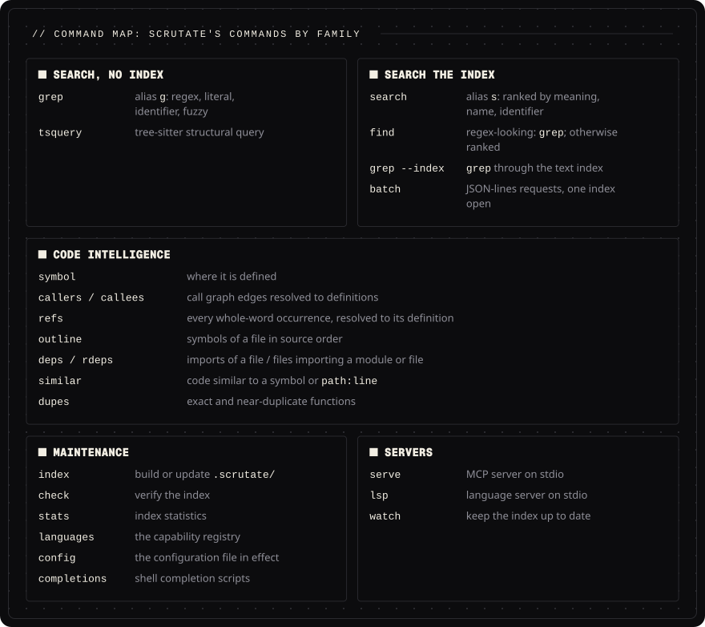

<!-- Head written by tools/gen_doc_assets.py: edit its table, then run it. -->
<p align="center">

</p>

# Command-line reference

[Documentation](README.md) &nbsp;·&nbsp; Previous: [Install](INSTALL.md) &nbsp;·&nbsp; Next: [MCP server](../integrations/mcp/README.md)

**Contents**: [Conventions](#conventions) &nbsp;·&nbsp; [Engine A: grep](#engine-a-grep-alias-g) &nbsp;·&nbsp; [Engine B](#engine-b) &nbsp;·&nbsp; [Setup and the Grep hook](#setup-and-the-grep-hook)

<!-- End of head. -->

`scrutate --help` and `scrutate <command> --help` are authoritative; this page explains the model.

<p align="center">

<br><sub>The commands by family. The sections below are the reference.</sub>
</p>

## Conventions

<p align="center">

<br><sub>Exit codes, as the first convention below states them.</sub>
</p>

- **Exit codes**: `0` results found, `1` no results, `2` error (bad arguments, unreadable index,
  invalid pattern, a `--root` that is not an existing directory, a search path that does not
  exist...), `130` interrupted (Ctrl-C, or stopped early for a reason other than
  `--max-results`). `grep --type-list` and `grep --version` need no pattern.
- **Diagnostics**: errors are one line on stderr (`scrutate: error: ...`). With `--json`, or with
  `SCRUTATE_DIAGNOSTICS=json` for any command, an error is one JSON record instead:
  `{"type": "error", "schema": 1, "message": "..."}` (`"internal_error"` for a bug).
- **Streams**: results on stdout, diagnostics and progress on stderr. Output is plain `path:line:text`
  when stdout is not a terminal; colour only on a terminal (`--no-color`, or `NO_COLOR` set to
  any non-empty value, disables it).
- **Determinism**: `--sort` orders Engine A output as `rg --sort path` does: the paths in
  command-line order, and under each one its files by their paths compared part by part, then by
  line. So `sub/deep/a.txt` comes before `sub/deep-x/b.txt`, and `foo/mod.rs` before `foo.rs`; a
  file two paths reach comes once under each. Default output is in completion order for speed;
  `-c`, `-l` and `--symbols` are always sorted (without `--sort`, `-c` and `-l` compare whole
  paths as strings, all paths together). Engine B output is fully deterministic (ties broken by
  id).
- **Machine-readable output**: `--json` on every command that prints results (`stats` always
  prints JSON). Engine A emits JSON Lines with
  `"schema": 1` and `"type"` ∈ {`match`, `context`, `count`, `file`, `binary`, `summary`, `symbol_group`};
  Engine B commands emit one JSON document, an answer's envelope: `{"schema": 2, "result": ...}`,
  with `"stopped_at": N` when the answer stopped at its limit `N` with more left. `result` is the
  answer itself; a `batch` record and the MCP server's structured result carry the same envelope.
  The schema number changes only on incompatible changes: the envelope is schema 2 (in schema 1
  the index commands printed the answer alone, and `refs` and the `grep_code` answer carried a
  `schema` key of their own, which the envelope now holds). `tsquery --json`, `check`, `stats`,
  `languages` and `config` print a report of their own, not an answer.
  In `match` and `context` records `spans` and `column` count bytes of `text` (an invalid byte
  is printed as U+FFFD, three bytes), and a span never runs past `text` into the line end; the
  Python bindings' `Match.spans` and `Match.column` count the same way.
- **Paths**: `scrutate grep` prints a path as the walk reached it from the path given, as grep and
  ripgrep do: `dir/a.txt` for `dir/`, `./dir/a.txt` for `.`, an absolute path for an absolute one,
  and relative to `.` when no path is given (text, `--json`, `-c` and `-l` alike; with `--symbols`
  a path is the file's path under `--root`, as the index names it). As in ripgrep, each line
  and count carries its file's path unless the only path given is one file; `-H`
  (`--with-filename`) and `-I` (`--no-filename`) choose, and of the two the later wins. `-l` and
  `--json` always carry the path. `find`, the index commands, the MCP tools and the LSP server
  print paths relative to the repository root. On Windows `\` is printed as `/`, and a verbatim
  drive path (`\\?\C:\x`) as `C:/x`; on Unix a backslash is part of a file name and stays.
  On Unix a file name that is not UTF-8 is printed as its own bytes in piped output, `-l` and
  `-c`, so `scrutate grep -l x | xargs cat` opens it; in `--json` its `path` shows U+FFFD in
  place of the bad bytes and the record gains `path_bytes`, the name's bytes as an array of
  numbers. Windows names that are not valid UTF-16 print with U+FFFD. The index commands and
  the MCP tools show a control
  character in a name as an escape (`\n`, `\x1b`) and a backslash doubled (`\\`); a path or a
  location written that way is read back by every command that takes one. `scrutate grep` does
  the same in colour on a terminal and in the text of `--symbols`; its piped output prints the
  name as it is, as grep and ripgrep do.
- **Configuration**: the nearest `.scrutate.toml` from the current directory up to the top of
  the repository (the directory that holds `.git` or `.scrutate`), else
  `$XDG_CONFIG_HOME/scrutate/config.toml`; `$SCRUTATE_CONFIG` names a file, and with `--root` the
  file in that directory is used. `[index] exclude_dirs` is read only from the `.scrutate.toml`
  at the root of the index, so every command, the MCP server, the language server and the Python
  bindings leave out the same directories wherever they start; in any other file (a
  `.scrutate.toml` in a subdirectory, `$SCRUTATE_CONFIG`, your `config.toml`) it is ignored with
  a warning. `SCRUTATE_INDEX_EXCLUDE_DIRS`, when set, replaces it (set it empty to index those
  directories). The globs of a `.scrutate.toml` match each path from the file's
  directory, whatever path is searched and wherever the command runs. A path outside that
  directory and a path named on the command line are not filtered by them, and `-g` or
  `SCRUTATE_GREP_GLOBS` replaces them. `follow = true` in a repository's own `.scrutate.toml`
  is ignored with a warning: a search follows links only on your word (`-L`,
  `SCRUTATE_GREP_FOLLOW`, the file `$SCRUTATE_CONFIG` names, or your own
  `config.toml`). `scrutate config` names the file and shows what is in
  effect, with the directory the globs match from. A file with an unknown field, or that does not
  parse as TOML, stops every command that reads it (exit 2, one line naming the file, the line and
  what is wrong); `--help`, `--version`, `config` and `completions` still run. `[[language]]` tables
  add languages ([below](#custom-languages)). Precedence: command line >
  environment variable > configuration file > built-in default. Every configurable option names its
  variable in `--help` (e.g. `--hidden` ↔ `SCRUTATE_GREP_HIDDEN`). An on/off variable is off when
  it is `0`, `false`, `no`, `off` or empty, and on for any other value (`1`, `true`, `yes`, `on`).
  `--root` (`SCRUTATE_ROOT`) must be an existing directory; otherwise the command exits 2 and
  creates nothing.
- **Running in a subdirectory**: without `--root` (or `SCRUTATE_ROOT`), a command that uses the
  index runs on the top of the repository the current directory is in (the first directory
  upward that holds `.git`, a file or a directory), and says so on stderr
  (`[scrutate] using the index in <path>`). A first index is built there, whichever
  subdirectory the first command runs in, and the top's index wins over one an earlier run left
  in a subdirectory; with no index at the top, an index in a directory between is used. A
  clone, a submodule or a git worktree inside an indexed checkout is its own repository, with
  its own index (a linked worktree's starts as a copy of its main checkout's, see The index
  directory). Outside a repository the nearest directory above that holds `.scrutate` is
  used, else the current directory. A home directory kept in git is not taken for a top. In
  the home directory or at a filesystem root with no index there, a command that would build a
  first index stops with exit code 2 and says to pass `--root` or run `scrutate index`;
  `scrutate index`, `--root` and `SCRUTATE_ROOT` build there as asked, and an index already
  there is used. A path argument is read from the current
  directory when it exists there, else as given (a path from the repository root, as answers
  print it). A file or a location of another indexed repository, as `search --also` prints it
  (`../two/src/db.py:5-6`), is answered from that repository's index by `symbol`, `callers`,
  `callees`, `refs --def`, `outline`, `deps`, `rdeps` and `similar`; a file under no index is
  answered as one that `is outside the repository`.
  `grep --index` from a subdirectory answers for that subdirectory, and from a directory the
  index never enters (hidden or ignored) it says so and exits 2; `tsquery` walks from the
  current directory and keeps its cache in the root's index; `serve` and `watch` use the index
  above. The language server applies the same rule to the editor's first workspace folder
  (else `rootUri`), so it uses the index at the top.
- **Shell completion**: `scrutate completions bash|zsh|fish|powershell|elvish`.
- **Cancellation**: Ctrl-C stops a search between files and exits 130; a closed pipe
  (`| head`) stops it silently, with `-c`, `-l`, `--sort`, `--type-list` and `languages` too.

## Engine A: `grep` (alias `g`)

```
scrutate grep [OPTIONS] PATTERN [PATHS...]
```
With no path, `grep` searches standard input when it is a pipe or a file, and the current
directory otherwise; `-` names standard input among other paths. A path named on the command
line that is not a directory, such as a named pipe, `<(...)` or `/dev/stdin`, is searched as
ripgrep does; a named pipe found while walking a directory is skipped. Its lines carry the label
`<stdin>` where a path would stand (`-H`, `--json`); `--index` ignores standard input.
`PATTERN` is a regex unless `-F` (literal), `--ident` (identifier in any casing) or `--fuzzy[=N]`
(within N edits, default 1, literal, at most 4096 characters; an edit is one character inserted,
deleted or substituted, a byte of invalid UTF-8 counts as one, and `-i` and `-S` fold case as
they do for a regex). The default regex engine runs in linear
time and has no look-around or backreferences; `-P` (`--pcre2`) switches to PCRE2 for those. PCRE2
backtracks, so a pattern can take exponential time; its match limit stops the search of a file
then, and `scrutate` prints a warning naming that file. With `-P`, `--index` cannot narrow the
files and searches all of them. `--fuzzy-regex[=N]` matches a regex within N edits
(default 1): an edit is one character, as with `--fuzzy`, and a byte of invalid UTF-8 is one unit
that no position matches; classes (`\w`, `\d`, `\s` too) are Unicode, and `-i` and `-S` fold case
as they do for a regex (`-i 'été'` finds `ÉTÉ`). It has no anchors or word boundaries, at most 64
character positions (a bounded repeat counts each copy), and a pattern within N edits of the
empty string is refused. `-z` also searches inside zip and tar archives (members are shown as
`archive.zip{dir/file}`) and compressed files: gzip in process; bzip2, xz, zstd, lz4, brotli and
`.Z` through the system's tools, as ripgrep does. An archive or compressed file stops at 8 GiB
expanded or a million members, and a member or compressed file stops with a warning at a line
longer than 64 MiB (not with `-U`, which holds the whole member). A tar member whose GNU long
name or PAX path is longer than 64 KiB is skipped with a warning; other PAX records are read
past without being kept. An old-GNU sparse member (`tar --sparse`) is skipped and the members
after it are searched. An archive named alone is
searched as a directory of its members, so each line names its member, also when it is the only
one; a compressed file named alone prints no name. Control characters in a member name are shown
as escapes (`\n`, `\x1b`, a backslash as two), so a name cannot forge an output line; `--json`
keeps the name as it is. Archives inside archives are not opened, and `--index` does not
cover archive members. `-e PATTERN` (repeatable) gives several
patterns; a line matching any of them matches, and the first positional argument is then a path.
The argument after `-e` is the pattern whatever it starts with (`-e '->'`, `-F -e -1`), as in
grep and ripgrep.
Options mirror grep/ripgrep where the meaning is identical: `-i`, `-S` (smart case), `-w`, `-U`
(multiline: each line of a multi-line match is printed with its own number), `-v`, `-l`, `-c`,
`-A/-B/-C`, `-m`, `--max-results`, `-g GLOB` (`!` excludes), `-t TYPE` / `--type-list` (`-t !TYPE`
excludes, ripgrep's `-T`; a type matches the file name after the ignore rules, as ripgrep's
does, so a gitignored file of the type stays out, a hidden file of the type comes in, a glob
that matches a file decides before the type, and a file named on the command line is searched
whatever its type), `--hidden`,
`--no-ignore`, `-L` (follow links), `--max-filesize`, `--max-depth`, `-n` / `-N` (line numbers
or none; the later wins, and `--json` keeps them), `-j THREADS` (at most 256, as are
`SCRUTATE_THREADS` and the configuration file's `threads`; default: the cores, at most 12; on
macOS the performance cores; more when the files come from the disk, a cold cache: up to 64 on
Linux, elsewhere twice the cores, at most 24), `--sort`, `--max-bytes BYTES` and `--offset N`
(a bounded answer in path order, see "Answers from the index" below),
`--json`, `--stats` (with `-l` each file is searched only to its first match, so it prints
`N of M files match` and the JSON summary gives `"matches": null`), `--symbols` (group lines by
the enclosing function using the index, when one exists; a file whose search a NUL byte stopped
after a match ends its last group with a `note:` line, `"note"` in the JSON `symbol_group`). On macOS, searches of one user that run at the same time split the default threads
between them and take them back as the others end: each gets the default divided by the number
running, at least 1 (py-big, four at once: 244 ms each before, 185 ms now; one alone is
unchanged). A search that walks directories, or searches a list of more than 256 files
(`--sort`, `--index`), joins that count when it starts, so four searches
of a small repository started together run on one thread each (13.3 ms each, GNU grep 14.5 ms;
before, 20 threads on 5 cores and 14.7 ms); one given a thread count
(`-j`, `SCRUTATE_THREADS`, `threads`) keeps it and is not counted, and neither is one waiting on a
reader that does not read or one stopped with Ctrl-Z, until it goes on. A search stopped with
SIGSTOP, which no program can see coming, stays counted until it continues or ends. The count
is a System V semaphore of the user, listed by `ipcs -s` until the machine restarts; a killed
search leaves nothing in it, and where the system gives none a search runs as it would alone.
`SCRUTATE_GREP_DEBUG=1` prints the count and the threads taken on stderr each time they change.
Files that cannot be read, or not to the end, are named in warnings on stderr (the first
ten); they do not change the exit code. A search path that does not exist is named in a warning
and the exit code is 2; matches in the other paths are still printed. On Linux, files on `/proc`,
`/sys` or another kernel pseudo filesystem (debugfs, tracefs, securityfs, configfs, cgroup) are
read until the kernel has no more: such a file gives its size as 0 and can answer the first read
short. The walk finds them by one `statfs` per root and per directory named `proc` or `sys`
below one (with `-L`, a link of another name to such a directory is not checked).

The ignore files are `.gitignore`, `.ignore`, `.rgignore`, the global git excludes and
`.git/info/exclude`, read as ripgrep reads them (`.rgignore` before `.ignore` before
`.gitignore`); `--no-ignore` turns them off. As in ripgrep, `scrutate grep` searches
`node_modules` and the other directories the code index skips by name, unless an ignore file
excludes them.

Where the details differ between tools, scrutate does what ripgrep does. `-m N` stops the search
of a file at its Nth matching line: the trailing context after it is printed, and a match inside
that context is shown as a match. `--max-results N` stops after N matching lines in total, with
`-c` and `-l` too; with `--sort` they are the first N in path order, the same on every run. A
file named on the command line that holds a NUL byte is searched as ripgrep does it: the NUL
ends a line, counts and lists include the file, and line output prints one line in place of its
lines, `binary file matches (found "\0" byte around offset N)` (with `--json`, a record
`{"type": "binary", "path", "text"}`). A file the walk finds with a NUL byte is left out of `-c`
and `-l`, so `-v -l`, `-v` and `-v -c` agree. When the search of such a file stops at a NUL byte
after a match, a last line says so, as ripgrep does: `path: WARNING: stopped searching binary
file after match (found "\0" byte around offset N)` (a `binary` record with `--json`). `-c` and `-l` give one record per path given: a
file that two paths reach is counted or listed twice. Smart case folds only a pattern that has a literal and no uppercase letter in
it, so `-S '\p{Ll}'` stays case-sensitive and matches lowercase letters only. Of `-i` and `-S`
the later one wins, and `SCRUTATE_GREP_SMART_CASE` applies only when neither is given. With
`-A`, `-B` or `-C`, groups that are not adjacent, and different files, are separated by a line
`--` (not in `--json`). With context on several threads a file's lines leave a group at a time,
so another file's lines never stand between them; a file searched alone still streams. A `-g` value is one glob, commas included (`-g '*.{txt,log}'`); the
variable `SCRUTATE_GREP_GLOBS` is split at commas outside braces. One difference: a `-g` glob
with a slash (`-g 'sub/*.rs'`) applies under every searched path, where ripgrep matches it from
the current directory. The globs of a `.scrutate.toml` match from that file's directory (see
Configuration above).

`--index` answers from Engine B's text index (`scrutate index`): the index names the files that
can contain a match (trigram postings), and Engine A's matcher searches only those, so the output
is what the walk prints for the indexed snapshot of `--root`. Run `scrutate index` (or `index
--text`) after changing files; the update is incremental. Options that change which files a walk
visits (`--hidden`, `--no-ignore`, `-L`, `--max-depth`, `--max-filesize`, explicit paths) are
refused with `--index`; `-g` and `-t` filter the indexed files, so a hidden file that a type
or a glob brings into the walk is not searched (the index holds no hidden file). `--index --update` first brings
the text index up to date (building it if there is none; only new and changed files are read),
so the answer is the walk's for the tree as it is now: the call for an editor that searches
often while files change.

## Engine B

| Command | Purpose |
|---|---|
| `index [--force] [--text \| --no-text]` | Build or incrementally update `.scrutate/`: the code-intelligence index and the text index for `grep --index` (`--text`: only the text index; `--no-text`: skip it). Progress on a terminal. |
| `search QUERY [-k N] [-a ALT]... [--also ROOT]... [--why] [--json]` (alias `s`) | Ranked search by meaning, name or identifier; `--alt` fuses alternative phrasings; `--also` searches other repositories too: their results print by the path given (`../two/src/db.py:5-6`), the repository's own as without it, and a root given twice is searched once; with `--json` each result keeps its path in its repository and gains `root`. A definition is matched by its name, signature, body and documentation; the documentation is the comment block right above it plus any docstring, also when attributes, decorators, annotations or type specs stand between (Rust `#[derive(...)]`, `@Get(...)`, `@override`, Elixir `@spec`, Erlang `-spec`), and the language's own form where it has one (Elixir `@doc`, a Julia docstring, Haskell haddock, PowerShell's help block); a comment a blank line away, a shebang, or a comment on the enclosing definition's header line is not it. A query of one word, or of stop words alone, is looked up as a name too (`search find`). A name typed with its case ranks the definition spelled that way first (`search BurstFiles`: the struct before `burst_files`; typed in a style neither is written in, `burstFiles`, both come first), and a struct and its `impl` block are separate results. Every line of an indexed file can be found: a line past what a definition's chunk keeps, or code outside any definition, is found as a window named after the definition (or file) it is part of (`long.py:885-934  [window] very_long`), and a definition and its windows give one result, the part that matched best, with that part's lines. |
| `find QUERY` | Unified: regex-looking → `grep`; otherwise ranked search (indexing a small repository on the spot); otherwise identifier grep. A regex-looking query that finds nothing, or is not a valid regex, goes to ranked search when an index exists. A question with a space and a trailing `?` (`how is the token refreshed?`) is taken as words. |
| `symbol NAME [--limit N]` | Where is it defined (`Class.method` works). The name is looked up as typed first: a whole stored name (`list->vec`, `Foo::Bar`, `#main`), a qualified name, or the end of one. Only when that finds nothing, `Type::method`, `Type#method` and `p->method` are read as `Type.method`; then a stored owner is compared without its generic arguments and path (`Stack<T>.push`, `crate::config::Config::new`, `App\Models\User::find`); last, for a name written as a path, a top-level definition of its last part. A name with a leading dot is looked up without it (`.helper` as `helper`). Names match with case and `_` ignored, and the definitions come in this order: the name spelled as typed before its namesakes in another case, then definitions outside test files, then types (`class`, `struct`, `enum`, `trait`, `interface`, `type`, `impl`) before functions and methods before the rest, and a definition with a body before one without. `callers`, `callees`, `similar`, `refs` and `read_code symbol` take names the same way. A method is named by its owner's bare type: `Stack.push` for `impl<T> Stack<T>` in Rust and for `void Stack<T>::push()` in C++. A dotted Lua or Elixir name is split off its owner: `function M.helper` is `helper` with the qualified name `M.helper`, `defmodule MyApp.Accounts.User` is `User`. A method of a JavaScript or TypeScript object literal, and a property whose value is a function, is named under what holds the literal: `api.get`, `store.sub.m`, `tool.build` for `module.exports.tool`, also through `as`, `satisfies` and parentheses; a literal nothing names keeps the bare name. A C or C++ function declared without a body (at file scope, in a namespace, in `extern "C"`, inside an include guard) is a `function` symbol, so a prototype and its definition are two symbols, the definition listed first; a method declared in its class and defined outside it is likewise two, the declaration (`method`) and the definition (`function`). An Objective-C method declared in an `@interface` is a `method` symbol beside its definition, and a function pointer typedef (`typedef int (*cb)(int)`) is the type `cb`. At most 20 definitions, or `--limit`. |
| `callers NAME` / `callees NAME` (`--limit N`) | Call graph edges resolved to definitions (callee names outside the repository listed after `external:`). `callers` lists callers outside tests first, then by path and line (with another definition of the name in the repository, those that name its owner or sit in its package come first), and the ones that stay undecided last, so an index brought up to date answers as a fresh index of the same tree does. A call written outside every definition (a script's main block, a shell script's last `main "$@"`, top-level JavaScript) belongs to the chunk that holds its line: the module chunk for the lines before the first definition, else the first window that holds it. `callers` lists that chunk (`job.py:5-6  [window] job`), the resolver decides such a call as it does any other, and `callees FILE:LINE` for a line outside every definition answers for that chunk. A call matches a definition by the name as the call writes it (`Ok(1)` is not a call of `ok`) and in its own language family only: JavaScript and TypeScript; C, C++, CUDA and Objective-C; Java, Kotlin, Scala and Groovy; Erlang, Elixir and Gleam; C# and F#; every other language alone (a file of no known language matches any); an unknown qualifier (`Nope.refresh`) gives no results, and a name with a leading dot answers as the name without it (`callers .helper` as `callers helper`). A call the resolver ties to something else (a function of an imported module such as `subprocess.run`, a local variable, a field) is not a call of a namesake in the repository; `callees` lists such a name after `external:`. In a language the resolver does not read (every one outside Python, JavaScript, TypeScript, Rust, Go, Java and PHP), a call without a receiver runs the definition in its own file when there is one, a free function of that file or a method of the caller's own type: `callees` lists that one alone, and `callers` of a namesake in another file leaves the call out (`helper()` in `e.c` calls the `static` `helper` of `e.c`). For any other call the resolver cannot place, `callees` lists up to three definitions of the name, those in the caller's file first, then those in its directory. A file whose extension two languages share (`.m`, `.h`, `.pp`, `.cls`) is put in its family by its text, and a Nix function, which is a key, is listed as a callee, as is a macro of the repository (`#define SQUARE(x)`, `macro_rules! square`, a Lisp `defmacro`). A method call `x.m()` is never a call of a free function `m` in Rust, JavaScript, TypeScript, Go and Java, a receiver whose type comes from outside the repository makes the call external, and a definition's own name is not a call of it. Calls inside the arguments of a Rust macro (`println!("{}", f(x))`, `vec![k(1)]`) count. A method call records the method, not the receiver: Lua `obj:meth()`, Objective-C `[obj meth]`, R `obj$meth()`, PowerShell `$obj.Meth()`, PHP `$o?->m()`; `new Point()` in C++, Scala, Groovy, Dart, D and Solidity records `Point`. A Lisp name is recorded whole (`list->vec`, `set-car!`), and a JavaScript private method with its `#`. A call is recorded under the name its definition has: a Ruby or Elixir name keeps its trailing `?` or `!` (`valid?`, `save!`) and a Julia name its `!` (`update!`); an R name keeps its dots (`is.ready`), a Bash name its `::` (`ns::helper`), and a Haskell, OCaml, F# or Nix name its primes (`step'`); a PHP call through a namespace is recorded by its last part (`\App\Util\helper()` calls `helper`); a Rust raw identifier is recorded without its `r#` (`r#type()` calls `type`), and `symbol` and `callers` take either spelling. Dart, Groovy, Elixir, LLVM IR (`call @g`), TLA+ and Verilog (`g(x)` in an expression) record calls; an Elixir `def`, `use`, `alias` or `if` and the head of a definition are not calls. Verilog task calls and module instances, VHDL calls in a subprogram (a subprogram with a body is a function of its package body or architecture), Jsonnet calls, Make `$(call g,...)` and assembly `call`, `bl` and `jal` targets record calls; an assembly label holds its instructions up to the next label or section. Not recorded: a Verilog task call without parentheses (`h;`) or on a member (`obj.m(1);`). A VHDL indexed signal `a(i)` reads as a call, and an assembly call under a local label counts for that label and for the global one above it. `callers` lists first the callers the resolver ties to that definition, then those it could not decide (the ones that name the owner type or sit in the same package first), and says how many are undecided; it asks the resolver about every call site, and keeps what it learned (`.scrutate/answers/`), so the same `callers` or `callees` again on an unchanged index and unchanged files resolves nothing (`callers size` on Guava, 1,970 call sites: 1.4 s of CPU the first time, 0.43 s from what was kept, where asking about the 400 likeliest cost 0.6 s). A call of a class is a call of its constructor: `callers Point.__init__` lists `Point(1)`, and the same holds for a JavaScript or TypeScript `constructor` (`new Widget()`), a Java, C# or C++ constructor, PHP `__construct`, Swift `init`, and Ruby `initialize` through `Invoice.new`. A Java call that its arguments do not tie to one overload is a caller of each overload. A call through a base class, an interface, a trait or an abstract method that the target overrides or implements, at any depth, is listed among the undecided callers of the target (`b.size()` with `b: Base` for `Big.size`); a call that resolves to a sibling's override is not. A variable declared as the base type and built by a constructor in the same function (`Base b = new Big()`, `const b: Base = new Big()`, `b: Base = Big()`, Go `var s Sizer = Big{}`, Rust `Box::new(Big)`) is typed by the constructor until it is assigned again, so its call is a decided caller of the override. `callees` of a function that calls through the base type lists the base method only. A `super` call (Java, TypeScript and JavaScript `super.m()`, Python `super().m()` and `super(C, self).m()`) is a decided call of the nearest base method that defines it, by the method resolution order in Python (`super(C, self).m()` takes the first class after `C` in the order of the class the call sits in, and stays undecided when `C` is not in that order), and never a call of the override it sits in; with a base from outside the repository it is external. Go `x.Embedded.M()` resolves through the embedded field. |
| `path FROM TO [--depth N]` | The shortest chain of calls from FROM to TO, each a name, `Class.method` or a location (`path:line`) as `callers` takes them. The search goes breadth first over the calls `callees` gives for each definition, at most `--depth` calls deep (default 10): first over the calls the resolver ties to a definition, and only when those reach no chain, over every call `callees` lists, where a step the resolver did not tie ends `(by name: the resolver did not tie this call)` (`"tied": false` in JSON). The first line is FROM's definition, then one line per call: the call site and the definition it reaches (`  a.py:6  calls b.py:4-5  [function] middle`). Of several shortest chains, the one through the definitions first by path and line wins, and of one definition's calls the first by line. The call site is the first line where the resolver ties the call to that definition, else the first line of the call. No chain: `(no call path from A to B)` and exit 1; when the depth stopped the search with definitions left to follow, the line ends `within N calls: raise depth to search further`. A name with several definitions is an error (exit 2) that lists them (up to 20) with their locations: pass one as `path:line`. `--json` gives `from`, `to`, `found`, `depth`, `stopped` and `steps`, each step with `path`, `line`, `definition` and `tied`. |
| `map [PATH]` | The repo map: the files that define code, ranked by PageRank (damping 0.85, 50 iterations) over the edges between files that the index's names give. A call of a name goes to every other file of the caller's language family that defines it, its weight split among them, unless the caller's own file defines the name; an import goes to the file its module path maps onto, as `deps` maps a module for a language the resolver does not read. No call site is resolved and no file parsed: resolving every call site, as `callees` does, took 188 s of one process on Guava (3,364 files) where the map takes 1.1 s of CPU, and 2.0 s on this repository's `crates/scrutate/src` where it takes 0.02 s. Of two files with the same score, the one with more edges in and out comes first, then by path, so one index gives the same bytes on every run. Each file is listed as `path  (rank N, score S)` with up to 5 definitions, one line each (`  1-2  [function] helper  (6 calls)`): most called first (the calls of the name split among the files that define it, rounded), then outer before inner, longer before shorter, and by line; overloads of one name are listed once. `PATH` keeps the files under one directory; the ranking is the whole repository's. `--json` gives a list of files, each with `path`, `rank`, `score` and `definitions` (`id`, `path`, `start`, `end`, `kind`, `qualname`, `calls`). |
| `refs NAME [--def PATH[:LINE]] [--textual] [--max-results N]` | Every whole-word occurrence, each resolved to the definition it refers to, or listed as unresolved with a reason (see below). It takes the names `symbol` takes (`Stack::push`). `--max-results N` stops after N uses, every use on a line counted, and an answer that stopped says so. A use on a line longer than 400 bytes shows the 300 bytes around it, with `...` where the line is cut (`"cut": true` in JSON; `column` stays the byte column in the whole line). |
| `read [PATH] [--symbol NAME] [--start N] [--end N]` | Lines of a file, or with `--symbol` whole definitions (a name, `Class.method` or a location; `PATH` then keeps the ones in that file): the MCP `read_code` tool, with its arguments, limits and answers (see `serve` below). A path is read from the current directory, as the other commands read one. Reading a file by its path does not update the index. |
| `outline FILE` | Symbols of a file in source order. |
| `deps FILE` / `rdeps TARGET` | Imports of a file (resolved to repository files when possible) / files importing a module or file. Imports resolve as in `refs`: Rust `crate::`, `self::` and `super::` paths and `mod` declarations (`deps` lists a `mod` line too), Go imports through `go.mod`, also from a module in a subdirectory, Python `from . import b`, TypeScript `./lib/c.js` to `c.ts` and `./types` to `types.d.ts`. `deps` gives one line per file a statement names. An `#include "util.h"` resolves to the file next to the including one; `rdeps` matches an import by its base name only when it resolves to no file. When nothing resolves to the target but some imports could not be resolved, `rdeps` says so: `no import resolves to X, but N imports could not be resolved and may name it`. It counts a relative import whose path is the target without its extension, the target or its directory, and, in a file that is not JavaScript or TypeScript, a bare import with a part spelled as the target's module name (`b` for `a/b.py` or `a/b/__init__.py`). A Java import resolves through the package declarations of the files, in any source root (`src/main/java` included): a class import to the class's file, `a.b.*` to the files of the package, a static import to the file of its class. A PHP `use` resolves to the file that defines the class or function it names, in the namespace it names. An import is recorded as its statement writes it. JavaScript and TypeScript: the module of `import`, of `export ... from` and of `import x = require()`, and the argument of a `require` or `import()` call when it is a string or a template string without `${}`; an exported declaration is no import. PHP: `require` and `include` with either kind of quote, and `use`, plain, `function` or grouped (`use Foo\{A, B}` gives `Foo\A` and `Foo\B`). R: `library`, `require`, `requireNamespace` and `source`. Julia: each module of a `using` or `import` list, the module before a colon, and `include`. Ruby and Lua: `require` and its kin without a receiver, with a literal argument. Kotlin and C#: the imported name, not its alias. Objective-C `@import` and QML imports are recorded too. |
| `similar TARGET [-k N]` | Code similar to a symbol or `path:line` (vector cosine + token Jaccard). A constant has no vector: `similar` on one is an error that says so. |
| `dupes [--min-tokens N] [--threshold J] [--limit N]` | Exact and near-duplicate functions. `exact` means the same body text once runs of whitespace are squeezed; a pair with the same words written differently is `near` with similarity 1.00. `--threshold 1` prints the exact groups only. At most 50 groups, or `--limit`. |
| `impact [--base REV] [--staged] [--depth N]` | What a change touches: the definitions the git diff changes, the callers that reach them up to `N` steps away (default 3) with their distances, and the test files to run (see below). |
| `files QUERY [--limit N]` | Paths of the repository ranked for a short query that may be misspelt (`srch.rs` finds `search.rs`), files read lately first among equals; no index needed (see below). |
| `dead [PATH]` | Definitions nothing in the repository uses: functions, methods, classes, structs, traits, interfaces, types and enums (fields, constants, variables, modules, `impl` blocks and windows are not looked at). One is dead when no line outside its own lines names it as a whole word, in any file the code index's walk reaches (every regular file the ignore rules let through, also one the index leaves out by its extension or size; a binary file is not read). One whose name another line holds is asked of the resolver (`Names`) about up to 16 of those lines in files the resolver reads, its own file first: a line the resolver ties to it is a use, and the definition is in neither group. Otherwise it is undecided, and the reason counts the lines that name it: those the resolver ties to something else (another definition, a local, a comment or a string, so `getattr(obj, "name")` keeps `name` undecided), those it cannot place, those in files it does not read, and those not asked. While a file over 64 MB is there, nothing is called dead: a definition no other line names is undecided. Entry points are in neither group: definitions in a test file, `main`, a definition with an attribute, decorator or annotation other than ones that change nothing about who calls it (`#[inline]`, `#[allow]`, `#[derive]`, `#[cfg]` other than `cfg(test)`, `@property`, `@staticmethod`, `@Deprecated`, `@Nullable` and their kin), every method of a type or `impl` that has such an attribute (`#[pymethods]`), a method written `override`, and a constructor (`constructor`, `initialize`, a method named as its class). Per language: Python names that start with `__` (called by name by Python or a host such as `__lldb_init_module`) or with `test`, and a name quoted in a file with `__all__`; Rust `extern` functions, the methods of a trait `impl`, `write_fmt` (which `write!` calls), and `pub` items and the methods of a `pub` trait in a library crate (a file under the `src/` of the nearest `Cargo.toml` that has `src/lib.rs` or a `[lib]` table, `src/main.rs` and `src/bin/` aside); Go `init`, exported names of a package other than `main` and exported methods (an interface may call them); JavaScript and TypeScript an `export`ed definition, the methods of an exported class, a name on a line of its file that exports (`module.exports = { f }`) and every definition of a `.d.ts` file, and an interface, type or class of a TypeScript file that has `declare module` or `declare global` (it may merge with one from outside); Java and C# `public`, `protected` and `internal` members, interface members and Java's serialization hooks (`readObject`, `writeObject`, `readObjectNoData`, `readResolve`, `writeReplace`); Kotlin, Scala and Groovy definitions and PHP methods unless `private` or `internal`, PHP magic methods; Swift `public` and `open`; Dart names without a leading `_`; GDScript names with one (the engine's virtual functions); Make targets. A JavaScript or TypeScript method of an object literal, and a definition in a `.vue`, `.svelte` or `.astro` file, is undecided when no other line names it: code may call it by its key, or the component's template may use it. A method of a type that extends or implements another, and a class or struct that does, is undecided when no other line names it: the base type's code may call it. A name built at run time (`getattr(obj, "handle_" + kind)`) or by a macro that pastes identifiers is not seen. `PATH` (a directory or file) keeps the definitions under it, the uses are still looked for in the whole repository, and a path that is not there is an error. The dead come first, then the undecided, each by path and line, and a last line counts both: `app.py:8-9  [function] unused_private`, `app.py:21-22  [function] by_name  (undecided: named on 1 other line: 1 tied to something else (another definition, a local, a comment or a string))`, `(1 dead, 1 undecided)`; nothing found prints `(no dead code found)` and exits 1. `--json` gives `dead` and `undecided`, lists of `id`, `path`, `start`, `end`, `kind`, `name`, `qualname`, and `reason` for an undecided one. What the resolver said of each line is kept (`.scrutate/answers/`) as for `callers`. `tools/check_dead.py BINARY [ROOT]` checks with ripgrep that no other line of the tree names a definition it calls dead. |
| `tsquery LANG QUERY [PATHS] [--limit N] [--no-cache]` | Tree-sitter structural query over every file of a language up to 1 MB (no index; per-file results are cached, see below). An empty query, a query without a `@capture`, an unknown predicate, and a predicate written outside every pattern's parentheses (tree-sitter would apply it to nothing, so the pattern would match every node: write `((identifier) @i (#eq? @i "x"))`) are errors. A path that does not exist from the current directory is read under `--root`; one that exists in neither place is named in a warning, the other paths are still searched, and the exit code is 2. Paths print as `grep PATH...` prints them, in plain output and in `--json`: the path as given, then the path below it (`src/a.py` for `src`, `./src/a.py` for `./src`, nothing in front for `.` or no path), so a printed path can be passed to the other commands. `--rewrite TEMPLATE` replaces each match with a template of its captures and prints a diff; `--write` changes the files (see below). |
| `check [--files] [--json]` | Verify database integrity, segment consistency and (with `--files`) that indexed files are unchanged. Exit 1 on problems. The line `chunks: N ranked in the database, M alive in segments, K constants (no postings)` counts the chunks that have segment rows, which leaves out constants, and then the constants; `--json` gives them as `constants`. `--json` counts the indexed files also without `--files` (`files_changed` and `files_missing` are then 0: not checked). |
| `stats` | Index statistics as one JSON object (files, chunks, symbols, call edges, imports, segments, and the text index's files, segments and bytes). |
| `languages [--json]` | The verified capability registry. The JSON form gives each language's extensions, the extensions it shares with another language and takes by the file's text (`extensions_by_content`), its file names, and every kind of definition the index gives it (`definition_kinds`: `method` for a function in a class and `constant` included). A custom language follows the built-in ones: its line ends `custom: .scrutate.toml` (or `custom:` and the path of your configuration file), and its JSON has `"tier": "custom"` and `"source"`. |
| `watch [PATH]` | Keep the index (and the text index, if there is one) up to date from filesystem events (see below). |
| `serve [--refresh-interval S] [--max-bytes N] [--watch] [--structured]` | MCP server on stdio (see below); `--watch` also runs the watcher in a background thread; `--structured` also sends each answer as JSON. |
| `lsp` | Language Server Protocol server on stdio (see below). |
| `config [--json]` | Show the configuration file in effect. `--json` prints `{"root": ..., "configuration_file": ...}`: the root an index command run here uses, and the configuration file (`null` when none). It builds no index; the editor plugins read it to find the root. |
| `batch FILE [--features] [--timing]` | Run requests from a JSON-lines file with one index open. A line `{"query": ..., "k": ...}` is a ranked search; a line `{"op": TOOL, ...}` runs any operation, named and given arguments as the MCP tool is (`{"op": "callers", "name": "parse"}`), and prints the answer's envelope with the operation's name (`{"op", "schema", "result"}`, and `stopped_at` when it stopped at its limit) or `{"op", "error"}`. A line that is not JSON prints `{"error": "line 3, column 2: not JSON (...)"}` and the other lines still run. `--features` adds to a search every candidate (`id`, `path`, `name`, `qualname`, `kind`, `score` and its features `x`), the feature names once per line (`feature_names`, the order of `x`) and the ids each source found (`exact_ids`, `lex_ids`, `sem_ids`): the rows the ranker is trained on. |

The code index holds every file the ignore rules let through, hidden files included, except
binary files, files over 1 MB, `.git/`, `.scrutate/`, the directories named in
`SCRUTATE_INDEX_EXCLUDE_DIRS`, or when it is not set in `exclude_dirs` of the root's
`.scrutate.toml` (names only: at most 1000; a name with `/` or `\`, `.` and `..` exclude nothing; in the variable `\,` is a comma inside a name; the file may be a link to a file inside the root), and cache and tool directories by name (`node_modules`,
`__pycache__`, `.venv`, `.mypy_cache`, `.pytest_cache`, `.next`, `.tox`, `.idea`, `.vscode`).
`build`, `dist`, `target` and `venv` are skipped by name outside a git repository; inside one,
the ignore files decide, so a `target/` that `.gitignore` does not list is indexed. Data,
generated and binary files are left out by extension (`.lock`, `.sum`, `.csv`, `.log`,
`.min.js`, `.map`, archives, media) and lock files by name (`package-lock.json`,
`npm-shrinkwrap.json`, `pnpm-lock.yaml`, `packages.lock.json`, `Package.resolved`,
`.terraform.lock.hcl`, `*.lockfile`, `bun.lockb`); `scrutate grep` still searches them. A comma
inside a name in `SCRUTATE_INDEX_EXCLUDE_DIRS` is written `\,`. The ignore files are the ones
`grep` reads, `.rgignore` included. A `.h` file is read as Objective-C when it holds
`@interface`, `@protocol`, `@implementation` or `@class`, as C++ when a line starts with
`namespace`, `class`, `template <`, `using namespace`, an access label (`public:`), `extern
"C++"` or a standard C++ include (`#include <vector>`), and as C otherwise.

Constants are symbols of kind `constant`:

- Rust: `const` and `static` at file level, in a `mod` block or in an `impl` or trait body.
- Go: package-level `const` and `var`.
- JavaScript and TypeScript: a top-level `const` that is not a function (exported or not). In a
  class body, a TypeScript `static readonly` field and a JavaScript `static` field whose name is
  written in capitals (`static MAX = 1`).
- TypeScript: enum members.
- Java: `static final` fields.
- Python: an assignment to a name written in capitals at module level or in a class body, and
  each such name of a tuple or list target (`A, B = 1, 2`, `[A, B] = 1, 2`).
- C, C++, Objective-C and GLSL: `#define NAME value`, enumerators, and a `const` or `constexpr`
  declaration with a value at file level, in a namespace or in `extern "C"`, also inside an
  include guard (`const int SIZE = 4;`, `NSString *const kName = @"x";`, not
  `extern const int SIZE;`).
- C++: a `static const` or `static constexpr` member with a value in a class body
  (`Config.kSize`), and a member defined with its value outside the class
  (`const int Config::kLater = 5;` is `Config.kLater`).
- GDScript: `const` at file level or in an inner class body (`Backpack.LIMIT`), owned by the
  file's `class_name` when it declares one (`Player.LIMIT`, `Player.Backpack.LIMIT`).

Every name of a Go or Java declaration with several (`var X, Y int`, `const A, B = 1, 2`) is a
constant with the whole declaration as its text.
`symbol`, `outline`, `read_code symbol` and `refs` find them; ranked search (`search`, `find`,
the MCP `search_code`) never returns one.

Ranked search reads words of every script. Scripts written without spaces (Han, kana, Thai, Lao,
Tibetan, Myanmar, Khmer, the Tai scripts, Balinese and Javanese) become overlapping pairs of
characters, so `天気` finds `東京の天気`; any other script gives one
lowercased token per word. Han characters are folded to their simplified form for matching, in
the index and in the query, so `资料库` finds `資料庫` and the reverse; this applies to Japanese
text too. Names, `symbol`, `grep` and the text shown in results keep the characters as written. Only ASCII words are split at case changes and stemmed. Names
compare in Unicode NFC, so a name typed with a combining accent finds the precomposed spelling.
A definition name longer than 200 bytes is still a symbol when it holds no whitespace.

### `refs`
```
scrutate refs NAME [--def PATH[:LINE]] [--textual] [--max-results N] [--json]
```
Finds every whole-word occurrence of `NAME` (as `grep -w`) and decides which definition each one
refers to. For Python, JavaScript, TypeScript, Rust and Go the rules are, in order:

1. An occurrence that is the name of a definition, or the name in an import statement, is that
   definition (or what the import resolves to).
2. A qualified occurrence (`obj.N`, `a::b::N`, `pkg.N`) is looked up in what the qualifier names:
   a module bound by an import (`import x`, `import * as x`, `use crate::a`, a Go import), a
   module path (`crate::`, `self::`, `super::`, a workspace crate, a Rust child module), or a
   class or type (`Class.N`, `Type::N`, then its Python and JavaScript base classes in method
   resolution order, up to 8 levels; a Python base from outside the repository keeps its place
   in the order, and a method it may define stays undecided). `self.N`,
   `this.N`, `cls.N` and `Self::N` look in the enclosing class or impl. A receiver that is a
   local variable or a parameter (`x.N`) is looked up in the type its declaration states: an
   annotation (`x: T`, `x T`, `x: &T`) or what it is built from (`T(...)`, `new T(...)`,
   `T::new(...)`, `T { .. }`, `&T{}`), the nearest declaration before the use that is in scope
   there, in the function around the use or the functions around that (a closure sees the
   variables of the function it is written in, unless it binds the name itself; a Rust `fn` item does not, and a Python method does not see its class body): not one in a block that has ended, a closure or lambda, an `if let` or `match` arm, or
   the declaration's own value (a Python function is one scope, and a JavaScript `var` belongs
   to its whole function). A variable that
   gets its value from a function call takes the function's declared return type (through `?`
   and holders such as `Box`, `Rc` and `Arc` in Rust, `await` in TypeScript); `self.x.N` takes
   the declared type of the field `x`, and a module-level or static variable its declared or
   built type. A Go method is found by its receiver type in any file of the package. A method
   call on the result of a call (`mk().norm()`) goes through the type the callee declares it
   returns. `this` inside a method of a JavaScript or TypeScript object literal is the literal
   (`this.put()` in `api.get` is `api.put`); an arrow function takes `this` from the code around
   it. A call on a value of an outside type is external, except when a trait or interface of the
   repository declares a method of that name: then it stays undecided, since a blanket `impl` or
   a merged interface can give the outside type that method. A variable whose type none of these gives is
   unresolved.
3. A plain occurrence is, first, a definition nested in an enclosing function (or directly in an
   enclosing class body); a parameter or local variable of that name hides everything else
   within its own scope (a lambda's parameter inside the lambda, a block-scoped name inside its
   block). A name bound by a pattern hides only in its own branch (Rust `if let`, `while let`
   and a `match` arm, a Python `case`), a `catch` binding and a Go `:=` in an `if`, `for`,
   `switch` or type switch only in that statement, a Python parameter only in the function body
   (defaults and annotations are outside it), a `let` or `for` not in its own value, and an
   import inside a function only in that function. A closure sees the locals of the function it
   is written in; a Rust `fn` item inside a function does not. Then a top-level definition of the
   file; then a name an import binds (`from x import N`,
   `import {N} from './x'`, `use a::N`, `require`); then, in Go, a top-level definition of another
   file of the same package directory; then wildcard imports (`from x import *`, `export * from`,
   `use a::*`, Go dot imports).

The arguments of a Rust macro are tokens to the grammar, so there a name after `.` is a field,
or a method when `(` follows; `name:` inside `{}` is a field name; and a closure parameter or a
`let` is a local. An occurrence matches the name in either Unicode spelling, composed or
decomposed.

Java has rules of its own. A file's package comes from its `package` declaration, so every
source root works. Imports are single-type, on-demand (`.*`) and `static`. Locals are
parameters, lambda parameters and the variables of `for`, `catch`, an `instanceof` pattern and a
try-with-resources. A plain name is also looked up in the enclosing class and the classes and
interfaces it extends, through nested, inner and anonymous classes, enums with methods, records
and default methods. A receiver goes through its declared type, a chain through declared return
types, a class in front of a call (`Util.foo()`, also `p.Util.foo()` with `p` a package of the
repository) is a use of that class, a local, a parameter or a field there is that variable,
and a receiver typed by an interface resolves to the interface's method. The number of
arguments picks one overload; when it does not, the call, like a method reference (`Sq::grow`),
stands for every overload of the name. Undecided: an untyped lambda parameter, an element of a
generic type (`list.get(0).area()`), a value of a type parameter, and a class whose base type is
not in the repository. Fields, enum constants and record accessors are not definitions here:
their occurrences are listed as `field or key`.

PHP has rules of its own too. A class or function name is made full through the `use` that
binds its first part (plain, aliased, grouped, `use function`), else through the `namespace` it
is written in (a `namespace X;` line or a braced block); a name with a leading `\` is full as it
is. A full name `A\B\C` is the class, interface, trait or enum named `C` whose file declares
the namespace `A\B` where it defines it; an unqualified function call that finds none there takes
the global function, as PHP does. `$x->m()` goes through the class of `$x`: `$this` is the class
around, a variable the value of its latest assignment before the use (`new C()`, what a call
returns), else the type its parameter declares; `$this->p` the type property `p` declares, also
through a constructor parameter that declares it. A call takes the return type its method or
function declares (`self` and `static` are the class it is in). `self::m()` and `static::m()`
look in the class around, `parent::m()` in the class it extends, `C::m()` in `C`. A method is
looked for in the class, then the traits it uses, then the class it extends and the interfaces
it implements; when a base from outside the repository may declare it, the call is external.
Undecided: a variable bound by `foreach` or `catch`, a value of an untyped parameter, a union
type, a dynamic name (`$o->$m()`). Properties and class constants are `field or key`, a bare
constant is `constant`, a part of a namespace is `namespace`. Names compare as they are written,
though PHP ignores the case of class and function names.

Import paths resolve to repository files: Python relative imports, packages (`__init__.py`), and
an absolute import whose first part is the name of the checkout directory (`networkx.classes` in
a checkout named `networkx`), and, when no module from the root has the name and the importing
file's directory is not a package (it holds no `__init__.py`), the module beside the importing
file (`from helpers import make_items` in `tests/` finds `tests/helpers.py`, as Python finds it
when it runs the script; such a sibling wins over a standard library module of the same name,
while `import logging` in a package that has its own `logging.py` stays the standard library);
JavaScript relative paths with the usual extensions and
`index` files (a `.js` import finds the `.ts` source), and the names a project gives its own
folders in `tsconfig.json` or `jsconfig.json` (`paths`, `baseUrl`, also through a relative
`extends`, a string or a list whose later entries win; `${configDir}` at the start of a `paths`
place or of `baseUrl` stands for the folder of the config nearest the importing file; `paths` are relative to the `baseUrl` the
configs end with, else to the folder of the config that sets them), then a workspace package by
its `package.json` name: through `exports` (the conditions `types`, `import`, `default`, `require`
and `node` in that order, then any other by name), `module`, `main` or an `index` file; a target
in a build directory the repository does not hold stands for the same path under `src/`
(`./dist/index.js` for `src/index.ts`); a subpath through its `exports` key or pattern, else a
path in the package; of two packages with one name, the one nearest the importing file. A
declaration file (`.d.ts`) stands in only when no implementation has the name (`./m` with `m.js`
and `m.d.ts` side by side is `m.js`). Rust module files (`a.rs`, `a/mod.rs`) from
the crate root, workspace crates by their `Cargo.toml` name; a file directly in a package's
`src/bin/`, `tests/`, `examples/` or `benches/`, and `build.rs`, is a crate root of its own
(`mod common;` in `tests/it.rs` is `tests/common/mod.rs`), a file beside it is its module only
when it declares it, and `path` entries of `Cargo.toml` are not read; Go import paths through the module
path in `go.mod` (by the directory they end with when there is no `go.mod`); a PHP `use` to the
file that defines the class or function it names, while a `require` or `include` path is mapped
onto the files as in a language the resolver does not read. `tsconfig.json`,
`jsconfig.json`, `package.json`, `Cargo.toml` and `go.mod` are read only when they are regular
files inside the repository, of at most 1 MB. Re-exports (`from .x import N` in `__init__.py`, `export {N} from`,
`pub use`) are followed. Occurrences in comments and strings are unresolved; so are those in a
language the resolver does not read (`not resolved in this language`), in a file without a
grammar (`no grammar`) and in a file whose syntax tree is more than 2,000 levels deep (`nested
too deeply to read`), and so is anything the rules do not reach (method calls on a value
whose type they cannot infer, enum variants, local variables). In JavaScript a `var` belongs to
its function, `let` and `const` to their block. Imports of modules outside the repository give
`external`; a package name that no `package.json` of the repository declares is outside.

The output lists each definition with its references, then the unresolved occurrences with the
reason. `--def PATH[:LINE]` keeps one definition of `NAME`: the one in `PATH`, or the one
containing `LINE` when the file has several; no such definition is an error. `--textual` gives the
behaviour without resolution: definitions, callers and every occurrence grouped by enclosing
symbol (it never misses anything, and works without an index). Both search the files the MCP
`grep_code` tool searches: hidden files included, the directories the index skips left out. With `--json`, each definition has
a `references` list (`path`, `line`, `column` in bytes, `text`, `via`) and the document has an
`unresolved` list with a `reason` (left out with `--def`). A file whose search a NUL byte
stopped after a match is named in a `note:` line at the end (`notes` in JSON, each with `path`
and `note`): a use after that byte is not listed. Resolution reads the index's
definitions and parses the files that hold occurrences again, so it needs no index change. The
MCP `references` tool gives the same answer (`textual` and `def` are arguments there).

### `impact`
```
scrutate impact [--base REV] [--staged] [--depth N] [--json]
```
What a change touches, from git's diff. By default the working tree against `HEAD`: the changes
to tracked files, staged or not, and every untracked file that is not ignored, as a new file.
`--base REV` compares the working tree with another commit; `--base main...` (three dots) with
the merge base of `main` and `HEAD`, as git reads it (`A...B` is the merge base of `A` and `B`).
`--staged` takes the staged changes alone, against `HEAD` or `--base`, and no untracked file.
The answer has three sections, each a line with its count and then one line per item:

- `changed`: each definition a changed line falls in, the innermost one around the line, as
  `path:start-end  [kind] name  (status)`. `added` is a definition the base does not have (by
  kind and qualified name in the file; a whole new file is all `added`), `edited` one it has, and
  `deleted` one only the base has, named with its lines in the base. A file renamed with edits
  (git's `-M`) names its definitions at the new path, and a note says what it was renamed from.
  A changed line outside every definition names the window that holds it, as `callers` lists a
  call written there, or the file (`path  [file]`) when no window does (a blank line, a deleted
  line, a staged line). A staged change is read from the staged copy and named where the index
  holds that definition now.
- `callers`: the definitions that call a changed one, then their callers, breadth first, each
  with its distance in front (`1` calls a changed definition) and each once, at its smallest
  distance. Each step is the answer `scrutate callers LOCATION --limit 500` gives for one
  definition, undecided callers included (marked `(undecided)`). A deleted definition has no
  location in the tree to ask about, so its callers at distance `1` are the definitions whose
  code still calls its name where the resolver ties that call to no definition that exists (a
  call it resolves to a namesake elsewhere, a local or an import from outside is not one; a
  deleted method is matched by its name, with the receiver's type where the resolver decides it).
  Each is marked `(calls a deleted definition)`, the first thing the diff breaks, and the walk
  goes on from it as from any caller. A window and a module are not followed.
  `--depth N` (at most 10, `0` for none) stops the walk; 3 by default, because past three steps
  the callers of a much used function grow toward most of the repository and say little about
  what to test. The walk stops at 2,000 callers and says so.
- `tests`: each test file (the index's test flag: a `test` or `tests` directory, `test_*.py`,
  `*_test.go` and the like) that defines a changed symbol or holds a caller, with its distance and
  the symbol in it that was reached, and each test file the diff changed, once, at its smallest
  distance.

The items are sorted by distance, path and line, the same on every run. A file with no
definitions to name gets a line under `notes` instead: a binary file, a submodule (its commits
are not read), a file the index leaves out. `--json` gives the answer's envelope, its `result`
with `against`, `base` (the commit compared with), `staged`, `depth`, `changed` (each with
`status`), `callers` (each with `distance`, `via`, the location of what it calls, `undecided`
and `calls_deleted`), `tests` (`path`, `distance`, `via`), `notes` and `stopped`. `--max-bytes` pages
the text by whole lines, as the other answers. No change is exit code 1; a directory outside a
git repository, git missing, a revision git does not know, two revisions with no merge base and a
file with unmerged changes are errors (exit 2). A revision that starts with `-` is refused before
git runs, so it can never be read as an option. The command line does not send `impact` to a
running `serve`: git runs in the command's own environment. The MCP tool `impact` takes `base`,
`staged` and `depth` and gives the same answer.

### `files`
```
scrutate files QUERY [--limit N] [--json]
```
The paths of the files a search of the repository covers (the files `grep_code` sees), ranked
for `QUERY`, one per line, at most 20 or `--limit N` (1 to 1000) with a closing line when more
matched. No file is opened (the walk reads only the ignore files) and no index is needed. Case
is ignored, and `\` in the query is `/`. A path matches when the query is a part of it, when the query's letters appear in it in order
(`srch.rs` finds `search.rs`), or when the query is within a few edits of a part of it (a letter
wrong, added or left out, or two neighbours swapped: `saerch.rs`), one edit for each four
characters of the query and at most three. The order:

1. a basename equal to the query, with or without its extension (`search` and `search.rs` both
   name `src/search.rs` exactly);
2. then a match in the basename, then a match in the rest of the path (a query with `/` in it
   matches the whole path only);
3. then a part before letters in order before fewer edits;
4. then frecency, higher first;
5. then the shorter path, then the path.

The answer is the same on every run for the same files and the same frecency. Frecency is the
number of reads of a file, each counting half as much after 7 days. `read` and the MCP
`read_code` count one read of each file they read; `files` counts one for a query that is
exactly a path it lists, so a caller that shows the list and opens the chosen path says which
it chose by asking for that path. The counts live in `frecency.json` under
`$XDG_STATE_HOME/scrutate/` (else `~/.local/state/scrutate/`; on Windows
`%LOCALAPPDATA%\scrutate\`), keyed by the repository's root: at most 1,000 files over every
repository, the lowest counts dropped first, written whole to a new file that is renamed over
the old. A file that does not parse is ignored and replaced at the next write; one that cannot
be written leaves the read as it was. Calls of one process wait for each other; two processes
writing at the same moment can lose one count. `--json` gives the envelope with each `path`, its
`match` (`exact`, `basename` or `path`), `edits` and `frecency`, and `stopped_at` when the limit
cut it. No match is exit code 1 with nothing on standard output; an empty query is an error
(exit 2). The command line does not send `files` to a running `serve`. The MCP tool
`find_files` takes `query` and `limit` and gives the same answer.

### Answers from the index: one definition for every front end

`symbol`, `callers`, `callees`, `path`, `map`, `refs`, `read`, `outline`, `deps`, `rdeps`, `similar`, `dupes`,
`impact`, `dead` and the ranked search of `search` and `find` are operations (`ops.rs`): the CLI, the MCP server,
`batch`, the Python bindings and the language server run the same code, through the same check
of the files an answer cites and the same recovery from a damaged index, with the same defaults (search `k` 8, callers 30, callees 40, call path depth 10, references 200, duplicates 50,
structural search 1000) and print the same text or JSON. An empty answer has exit code 1;
`outline`, `deps`, `rdeps`, `similar` and `dupes` then print nothing on standard output and one
sentence on standard error. When `symbol`, `callers`, `callees`, `dupes`, `tsquery`,
`read_code symbol`, `duplicates` or `structural_search` stops at its limit with more left, the
answer ends with a line that says so and names the argument that raises it (`(stopped at 30
results: raise limit to see more)`): the MCP argument `limit`, and `--limit` for `symbol`,
`callers`, `callees`, `dupes` and `tsquery`; with `serve --structured` the JSON carries
`stopped_at`. With `--json` the envelope carries `stopped_at` and that line goes to standard
error; a `batch` record that stopped carries `stopped_at` too.

`--max-bytes BYTES` (or `SCRUTATE_MAX_BYTES`) limits the size of such an answer, and of the
answers of `search` and `tsquery` (`--json` ignores both). A cut answer
keeps whole items and ends with a line like `(12 more results not shown: call again with
offset=8, or narrow the request)`; `--offset 8` continues it. The whole answer, that line
included, fits the budget; only a budget smaller than one item and that line together is
passed. An agent that runs the CLI through a shell can set the variable once, so no answer is cut
by its harness in the middle.

`grep` keeps its own budget, so a pipeline (`| wc -l`, `| xargs`) sees every line unless asked:
`grep --max-bytes BYTES` (or `SCRUTATE_GREP_MAX_BYTES`, or `max_bytes` under `[grep]` in the
configuration file; `SCRUTATE_MAX_BYTES` does not apply to it) prints whole lines in path order,
as `--sort` does, and closes with `(N more lines not shown: call again with offset=K, or narrow
the request)` when it cut the answer; `grep --offset K` continues it. The whole answer, that line
included, fits the budget, and the exit code is the one of the whole answer. `-c`, `-l`,
`--symbols` and context lines are cut the same way, by lines; `--json` is never cut. Without a
budget the answer is whole, and a plain piped `grep` takes the same path it took before.

### `serve` (MCP)

Nineteen tools over stdio, each one an operation above (`search_code`, `grep_code`,
`find_symbol`, `callers`, `callees`, `call_path`, `repo_map`, `read_code`, `outline`,
`dependencies`, `dependents`, `references`, `similar_code`, `duplicates`, `structural_search`,
`impact`, `find_files`, `dead_code`, `reindex`). `repo_map` is `map` (argument `path`) and `call_path` is `path` (arguments `from`,
`to` and `depth`, at most 100), with the same text. `dead_code` is `dead`, with its directory or file in `path`.

Before a call the server checks the repository for changed files and updates the index. Without
`--refresh-interval` the wait between scans is at most a second, and shorter when a scan is
cheap; with `--refresh-interval S` (or `SCRUTATE_REFRESH_INTERVAL`) no scan comes sooner than S
seconds after the last one. With `--watch`, each update the watcher makes counts as a scan.
A scan that could not run, because another process held the index, does not start the
interval. Inside that window an answer still checks the files it cites and the files its
arguments name, one `stat` each: when one changed or is gone, or a named file is new and a scan
would index it, those files alone are indexed again and the answer is computed again, once. A
change in a file the answer does not cite or name waits for the next scan.
At the end of its input (EOF) the server
answers the calls in flight, lets a running index build finish, and exits.

While it runs, the server offers its open index to command line calls of the same user on the
same root: `symbol`, `callers`, `callees`, `path`, `map`, `refs`, `outline`, `deps`, `rdeps`, `read`, `similar`,
`dupes`, `dead`, `search` (of this repository alone: with `--also` another root it does its own work) and
the ranked part of `find` run there (`impact` does not: git runs in the command's own environment; nor does `files`, which needs no index), with every file looked at first as always, and print the same bytes and
exit code a fresh process gives (about 12 ms in place of 28 ms on a copy of this repository). The meeting
point is a socket file, `.scrutate/session.sock` (owner only; Unix; no network port), removed
when the server exits. A command never starts a server. When anything about the server is not
as the command would do the work (another build of scrutate, another `SCRUTATE_*` setting,
another root, a stale socket, a write running), the command does the work itself and says
nothing; `SCRUTATE_SESSION_DEBUG=1` says why on stderr, and `SCRUTATE_NO_SESSION=1` turns the
use off. A command waits 20 ms for the server's greeting (a server stopped in a terminal costs no
more than that); `SCRUTATE_SESSION_WAIT_MS` sets another wait for a machine too busy to greet in
time. Of two servers on one root, the first offers the socket.

- Every tool but `reindex` is marked read-only (`readOnlyHint`), and all are marked as staying on
  this machine (`openWorldHint: false`), so clients that ask before a write do not ask for these.
- The server returns `instructions`: which tool to start with and that answers are capped.
- Every read-only tool takes `max_bytes` and `offset`, as `--max-bytes` and `--offset` above;
  the whole answer, closing line included, fits `max_bytes`. The default is 24,000 bytes (about
  6,000 tokens); `serve --max-bytes N` (or `SCRUTATE_MAX_BYTES`) sets another default, and
  `tools/list` shows it. Both a call's `max_bytes` and the server's default are held between
  1,000 and 1,000,000, and a call's own value wins. `serve` refuses `--offset`: every tool call takes its own.
- Arguments: a wrong type or a negative number is a tool error that names the argument (`k must be a
  non-negative integer`), and JSON `null` is the same as leaving an argument out. An error quotes
  at most 200 characters of an argument. Every path argument may be written `./x` or `pkg/../x`.
  In text answers, control characters in a path are shown as escapes (`\n`, `\x1b`); the JSON
  form keeps them as they are. A path or a location written that way is read back, so what an
  answer prints can be passed to the next call.
- `grep_code` is an Engine A search of the files the index holds: hidden files such as `.github/`
  are searched (with a text index, its trigrams say which of the files it holds as they are now
  can match, and the other files are read; the answer is the same); ignored files, `.git/` and
  the directories the index skips by name
  (`node_modules` and the like) are not (`scrutate grep` skips hidden files unless `--hidden`,
  and reads those directories unless an ignore file excludes them). The pattern is a regex unless
  `mode` names another matching mode (`literal`, `identifier`, `fuzzy` and `fuzzy_regex` within
  `max_edits` edits, default 1, or `pcre2`), as `grep -F`, `--ident`, `--fuzzy`, `--fuzzy-regex`
  and `-P` do; `case` is `sensitive` (the default), `insensitive` or `smart`, and `word` keeps
  whole words. `path` keeps one file or directory of the repository (its answers still name
  files from the root; one that leaves the repository is refused) and `globs` keeps the files
  they match, as `grep -g` (`!` excludes); neither brings back a directory the index skips.
  Matching lines are grouped by enclosing symbol; `max_results` (default 100) stops it,
  and the answer says so. A capped answer holds the first matches in path order, so the same call
gives the same lines every time and a second page neither repeats nor skips one; `references`
does the same, over the same files. A file whose search a NUL byte stopped after a match ends
its last group with a `note:` line (`"note"` in JSON). An invalid pattern is an error.
- `search_code` takes at most 10 `alt_queries`; a cancelled search stops between them. A
  cancelled `grep_code` or `references` stops its search between files.
- Every answer begins each result with its location (`path:start-end`). A location can be passed
  wherever a tool takes a symbol, to mean exactly that definition among several of the same name:
  `read_code symbol`, `find_symbol`, `callers`, `callees`, `call_path from` and `to`, `similar_code target`, `references def`.
  For `callers` of a location, the resolver decides when another definition of the same name in
  that language could be meant; a call site it cannot decide is kept, and a closing line counts
  those. `callees` of a location lists the calls inside that definition.
- `read_code` reads a line range of a file (`path`, `start`, `end`), or with `symbol` a whole
  definition: a name, `Class.method` or a location. A name with several definitions returns each
  (up to 20), and `path` keeps the ones in that file. With `end`, every line up to `end` is
  read; without it, 400 lines. The answer closes with `(lines A-B of N in P: read_code path=P
  start=B+1 for more)` while lines are left. An empty file answers `P is empty`, a `start` past
  the end `P has N lines: start=S is past the end`; an `end` before `start` and a path that is
  not a regular file are errors. A file is read through a 64 KB buffer and only as far as the last
  line asked for, with at most 1 MB of line text (a longer line is cut and says so). A file with
  a NUL byte in its first 8 KB is refused, and a definition read with `symbol` goes through the
  same reader, so it fails as the read of its file would. A path that leaves the repository by
  its own parts answers `path outside repo` with no file looked at, and a link that leaves it
  answers as a missing file does. An absolute path is one under the root as `config --json`
  prints it: another spelling of the same directory (through a link) counts as outside. A file over 1 MB that was not read to its end closes
  with `of P, more lines follow` in place of the line count, and the JSON `file_lines` is `null`.
- `references` ends with a closing line when `max_results` cut the search, answers `(no
  results)` when nothing is found, and refuses an empty name.
- `structural_search` refuses an empty query, a query without a `@capture` and an unknown
  predicate, as `tsquery` does.
- `impact` takes `base` (a revision, `main...` for a merge base), `staged` (boolean) and `depth`
  (default 3, at most 10), and answers as `scrutate impact` does (see `impact` above).
- `find_files` takes `query` and `limit` (default 20, at most 1000) and answers as `scrutate
  files` does (see `files` above). A `read_code` call counts one read of each file it reads.
- `reindex` takes `force` (boolean): every file is read again, also one whose size and
  modification time did not change, and a damaged index is rebuilt. It brings the text index
  up to date too when there is one, so `grep --index` sees what it indexed; it never makes one.
- `serve --structured` (`SCRUTATE_MCP_STRUCTURED=1`) adds an `outputSchema` to every tool and
  `structuredContent` to every result, beside its text: the answer's envelope with `complete`
  (`{"schema": 2, "complete": true, "result": ...}`), as the matching CLI command prints it with
  `--json`. When the
  text and the JSON together pass one and a half times `max_bytes`, `result` is `null`,
  `complete` is `false` and `text` holds the page that fits; a larger `max_bytes` gets the whole
  answer as JSON. It is off by default because clients differ in what they show their model:
  Claude Code 2.1.322 shows the JSON in place of the text, and the text is the form with the
  snippets (measured with that client on 2026-11-11). Turn it on for a client whose scripts read
  tool results, such as Codex in Code Mode.
- A call runs on a thread of its own, so `notifications/cancelled` reaches it, and calls run
  side by side, each on a reader of its own (up to the number of cores, at least 2 and at most 8; one more waits
  for a reader): a call waiting for the index or for a reader stops, an index update it runs (`reindex`, or the scan before a read)
  stops and rolls back at its next batch, and the answer of one already computing is dropped.
  Nothing more is sent for a cancelled request.
- While the first index of a repository is being built, by this server or by another process,
  a call waits up to 20 seconds and then answers that the index is still being built. A call that carries a `progressToken` waits for
  the index instead, with a `notifications/progress` every two seconds, and gets its answer.
- Protocol: a client that opens with `initialize` is served revisions 2024-11-05, 2025-03-26,
  2025-06-18 and 2025-11-25. A request that names its version in `_meta`
  (`io.modelcontextprotocol/protocolVersion`) is served by revision 2026-07-28, which has no
  handshake: `server/discover` describes the server, every result carries `resultType`, lists
  carry `ttlMs` and `cacheScope`, and another version in `_meta` is answered with error -32022 and
  the supported one. Both eras work on the same pipe. An `initialize` with a missing or unknown
  `protocolVersion` is answered with 2025-11-25.
- JSON-RPC: a batch (an array of messages) is answered with one array. A line that is not valid
  JSON, or not UTF-8, gets error -32700, and the server goes on reading. A message that is not an
  object, an empty array and a request without `method` get -32600; an unknown method gets
  -32601; an unknown tool or a `tools/call` without `name` gets -32602. A message without `id`
  (a notification) is never answered; only `notifications/cancelled` does anything. A client's
  response (a `result` or `error` without `method`) is ignored.

### `lsp`

```
scrutate lsp
```
A language server for editors (JSON-RPC 2.0 over stdin and stdout, `Content-Length` framing).
The repository is the top of the repository the editor's first workspace folder is in
(`workspaceFolders`, else `rootUri`), found as for a command run in that folder, so the editor
and a shell there share one index; `--root` when the editor sends no folder. A folder of another
repository is not answered. With no folder and no `--root`, started in the home directory or at
a filesystem root that has no index, the server builds none and says so in the log. It answers
from the Engine B index:

| Request | Answer |
|---|---|
| `textDocument/definition` | the definition the resolver ties the name under the cursor to, the same one `textDocument/references` names (`item.total()` after `item = Order()` is `Order.total`); when the resolver cannot place it, definitions of the name, as `symbol` finds them: first the run of characters around it (`get-user`, `list->vec`, `Foo::Bar`), then the plain word; with a qualifier (`Point.norm`, `a::b`), only the definitions whose qualified name matches, when there are any; definitions in the same file first. The name is taken as the file's language writes it, with or without a receiver before it: `valid?` and `save!` in Ruby and Elixir, `update!` in Julia, `step'` in Haskell, `is.ready` in R, `~Shape` and `operator==` in C++ (a wider name only when the index has it, so `x-y` in Python is still `x` minus `y` and `~mask` is still the bitwise operator). In Rust the name of `r#type` is `type`, with the cursor on either part. A Haskell or Elm function that starts with its type signature is answered at the equation below it |
| `textDocument/references` | for the same name, the occurrences `refs` resolves to the definition under the cursor, and that definition (left out when `includeDeclaration` is false); when the cursor's occurrence is unresolved, every whole-word occurrence, as `refs --textual` |
| `workspace/symbol` | symbols whose name contains the query (case and underscores ignored), exact and prefix matches first, at most 200 |
| `textDocument/documentSymbol` | the `outline` of the file, nested (methods under their class) |

It advertises only these four, plus full text sync. Open documents are read from the editor's
text, so an unsaved line still finds the word under the cursor; locations in other files come from
disk. `didSave` updates the index incrementally in a background thread, so requests keep being
answered meanwhile, and before a request the index is scanned for changes at most once a second. When the repository has no index, `initialize` builds
one (as `scrutate index` does, without the text index) and reports it with `window/logMessage`;
requests that arrive meanwhile wait for it. Columns are UTF-16 code units, as the protocol
requires. The exit code is 0 after `shutdown` then `exit`, 1 otherwise. Logs go to stderr.

### `watch`
```
scrutate watch [PATH]
```
Sets up the watch on `PATH` (default `--root`), then updates the index once, so a change made
during that first update is seen, prints `watching PATH` on stderr, and waits for filesystem
events. On Linux each directory the indexes can hold gets one inotify watch of its own, and an
ignored tree gets none (2 watches instead of 7,012 on a tree with an ignored `node_modules` and
`target`); the set is walked again after a burst that creates, removes or moves a directory, so
new, moved and replaced directories are watched. The root is watched first, then shallow
directories before deep ones, by path; when some get no watch (past
`fs.inotify.max_user_watches`, or a directory that cannot be read) stderr says how many.
`.git/info` gets a watch too, for its `exclude` file, also the main repository's when the root
is a linked worktree. Windows uses
one recursive ReadDirectoryChangesW watch on `PATH`. On macOS it runs the index's own incremental check
instead, every second or, on a large tree, after a pause ten times as long as the last check took
(at most 30 s): the FSEvents backend would link CoreServices into every `scrutate` command
(about 1 ms of start-up), and the check compares sizes and nanosecond times, so it misses no
edit. Events under `.scrutate/` and `.git/` are dropped. A file of a burst is kept when the
walk of an index lists it in its directory, so every rule the walks follow decides: ignore files
above the repository top, a nested repository's own rules, a linked worktree's `info/exclude`,
the skipped build and vendor directories and `SCRUTATE_INDEX_EXCLUDE_DIRS` for the code index,
hidden paths for the text index. A burst of
events is collected until 200 ms pass without one (at most 2 s). On Linux and Windows a burst
that names only files (written, created, removed or renamed in directories already watched)
updates those files alone, with no walk of the tree and no new watches, so a saved file costs
the same in a tree of 20,000 directories as in a small one. A burst that creates, removes or
moves a directory, changes an ignore file (`.gitignore`, `.ignore`, `.rgignore`,
`.git/info/exclude`) or `.scrutate.toml`, or reports lost events runs the usual incremental
update of the whole tree and reads the ignore files again. The rule files outside the tree
count too: an `.ignore` or `.rgignore` in any directory above the root, a `.gitignore` above it
up to the repository top, `.git/info/exclude` of each repository nested in the tree, git's
global excludes file and the git configuration files that name it. On Linux each directory
above the root gets one watch of its own for this, and another file written there costs a
filter and nothing more; when such a directory cannot be watched the watcher says so once, and
a change to its rules, like one in a rule directory made after the last walk, applies with the
next walk of the tree. So does a burst that changes an
indexed file while a directory has no watch, or once the last walk is 30 s old, which is how a
change the watcher did not see is found. Either way the code index is
updated, and the text index when `.scrutate/text/` exists (`watch` never creates one;
`scrutate index` does). `SCRUTATE_WATCH_DEBUG=1` prints one line per burst on stderr (the
number of paths, and whether the tree was walked). Each
update that changed something prints one line on stderr. A failed first update stops the
watch; a later one that fails is reported and the watch goes on. Ctrl-C stops it after the
update in progress (exit 130). When `PATH` is removed or moved away, `watch` stops with an error
(exit 2). Other processes can read and update
the same index meanwhile; the indexes' own locks order the writers, and stopping the process
mid-update leaves the previous state in place.

`serve --watch` runs the same watcher in a background thread while the server answers requests;
when the watcher stops, stderr says why and the server goes on answering.
The watcher and the tool calls share one session: the watcher's updates and the scans before
calls take one writer lock, so they run one at a time, and a call that reads meanwhile sees the
index as of its last commit.

### `tsquery` cache
Each file's captures are kept in `--root`/.scrutate/tsquery/, one file per (scrutate version,
language, query text, searched paths from `--root`), keyed by a hash of the file's content and
its name. No absolute path is part of a name, so a copy of the tree with its `.scrutate/` uses the
same cache. The
hash is the one the code index records, so with an index in `--root` a file whose size,
modification time and change time the index holds as current is not read when its captures are
cached. A file whose content
was seen before is not parsed again; the output is byte-identical to `--no-cache`, which parses everything and
leaves the cache alone. A run that visits every file keeps only the entries it used, so edited and
deleted files do not accumulate. The directory is bounded at 128 MB: beyond it the least recently
used query files are deleted, and a query whose results alone exceed it is not cached. The cache
is safe to delete at any time.

### `tsquery --rewrite`
`scrutate tsquery LANG QUERY [PATHS] --rewrite TEMPLATE [--write]` replaces each match of the
query with TEMPLATE. The replaced text is the capture named `@match`; a match without one
replaces its widest capture (the first written on a tie). In the template `$NAME` is the text of
capture `@NAME`, `${NAME}` the same before a letter or for a name with other characters than
letters, digits and `_`, and `$$` a dollar. A capture with several nodes gives the text from its
first node to its last; one the match does not hold gives nothing. A template that names a
capture the query does not have, or has a `$` without a name, is an error.

```
scrutate tsquery python '(call function: (identifier) @f (#eq? @f "print") arguments: (argument_list) @args) @match' --rewrite 'log$args'
```

Without `--write` it prints a unified diff of every file it would change (three lines of context,
`--- PATH` and `+++ PATH` as `tsquery` prints the path, so `patch -p0` applies it) and changes
nothing. With `--write` it changes them and prints `PATH: N replaced` per file written. The exit
code is 0 when there was something to change, 1 when nothing, and 2 when a path cannot be read or
a file was left alone. `--json`, `--limit` and `--offset` are refused with it, `--max-bytes` does
not cut the diff, and it never reads or fills the `tsquery` cache: each file is read and parsed
afresh.

Two matches that overlap are not both rewritten: the outer one is (of two over the same text,
the first pattern's), and the inner one is named in a warning
(`a.py:1:7: inside the match at 1:1, not rewritten`). The text the outer one keeps of its
captures is the file's text as it was read, so a second run may rewrite what the first skipped.
A match whose template gives back the same text is no change. Once the template's text no longer
matches the query, a second run finds nothing to change and exits 1.

Each file is written whole: its bytes are read once, the new bytes are written to a temporary
file next to it (`.NAME.scrutate-PID.tmp`), which gets the file's permissions, and that file is
renamed over the original only if the original's bytes on disk are still exactly those read; a
file changed meanwhile is left alone and named in a warning. A file is left alone, and named,
when its text where a match would change does not parse (a tree-sitter error or missing node
there), when the rewritten text does not parse there, when it is not UTF-8, when it is a link,
and when it lies outside `--root`. Only files under the given paths are read, as `tsquery`
reads them (ignore files obeyed, hidden files and links below a given path left out).

The index learns of a written file as of any edit: the next `symbol`, `search` or other lookup
sees its new size and time and reads it again, and Engine A's `grep` reads the file as it is.
`grep --index` answers from the text index as it was built, so `grep --index --update` sees the
new text. No MCP tool rewrites: the server only reads, except `reindex`.

### Custom languages

A `[[language]]` table adds a language without a new build. It is read from the `.scrutate.toml`
at the root of the index and from your own configuration file (`$SCRUTATE_CONFIG`, else
`$XDG_CONFIG_HOME/scrutate/config.toml` or `~/.config/scrutate/config.toml`), both at once,
wherever the command starts:

```toml
[[language]]
name = "mylang"
extensions = ["myl"]
line_comment = "--"
block_comment = ["{-", "-}"]
definitions = [
  { kind = "function", pattern = '^\s*fn\s+([A-Za-z_][A-Za-z0-9_]*)' },
  { kind = "class", pattern = '^\s*type\s+([A-Za-z_][A-Za-z0-9_]*)' },
]
```

- `name`: the language's id (letters, digits, `_` and `-`). It may not be a built-in language or
  a `--type` alias (`py`, `js`, `sh` ...), nor a name another table already took.
- `extensions`: one or more, without the dot, matched without regard to case. An extension a
  built-in language owns is refused, so every part of scrutate (the parser, the resolver, the
  language server) agrees on what a file is; so is one the index never reads (`csv`, `log`,
  `lock` ...) and one another custom language owns.
- `line_comment` (optional): the mark that starts a comment line.
- `block_comment` (optional): the opener and the closer of a block comment.
- `definitions`: one table per pattern, `kind` one of `class`, `constant`, `enum`, `function`,
  `impl`, `interface`, `macro`, `method`, `module`, `struct`, `trait`, `type`, and `pattern` a
  regular expression (Rust `regex` syntax, the size limits of `grep`) matched against one line at
  a time. The first group is the name, so a pattern needs one. The first pattern that matches a
  line wins; comment lines never define.

Files with those extensions are parsed as the heuristic tier parses a file
([LANGUAGES](LANGUAGES.md)): a definition runs to the line before the next definition at the
same or a shallower indentation, without the blank and comment lines at its end, at most 200
lines (40 for a `class`, `struct`, `enum`, `impl`, `interface`, `trait`, `type` or `module`),
and the comment right above it is its documentation, for the ranked search. Lines outside the
definitions are windows. `symbol`, `outline`, `search` and `find` answer from them, `grep --type
mylang` (and `--type-list`, and the `type` of `grep_code`) knows the extensions, and `languages`
lists the language. There are no call edges or imports, so `callers` and `deps` find nothing in
these files.

The index keeps a signature of each custom language. When a table changes (a pattern, an
extension, a comment mark, the table removed), the next update reads again the files of the
extensions whose language changed, and no others. A table that does not hold stops every command
that reads it, and every index update, with one line that names the file and the line, and exit
2: TOML that does not parse, a key the table does not have (there is no key that names a file,
so a table cannot make scrutate read one), a bad name or extension, a kind not in the list, a
pattern that does not compile or has no group. The repository's file is read as other
repository files are: a regular file inside the root, at most 1 MB, through a link only when
the resolved file is inside the root.

### Environment variables
`SCRUTATE_ROOT`, `SCRUTATE_THREADS`, `SCRUTATE_GREP_{HIDDEN,NO_IGNORE,FOLLOW,SMART_CASE,MAX_FILESIZE,MAX_DEPTH,MAX_BYTES,GLOBS,TYPES}`,
`SCRUTATE_INDEX_EXCLUDE_DIRS`, `SCRUTATE_REFRESH_INTERVAL`, `SCRUTATE_MAX_BYTES`,
`SCRUTATE_MCP_STRUCTURED`, `SCRUTATE_CONFIG`, `SCRUTATE_WATCH_DEBUG`, `SCRUTATE_GREP_DEBUG`,
`SCRUTATE_NO_SESSION`, `SCRUTATE_SESSION_DEBUG`, `SCRUTATE_SESSION_WAIT_MS` (see `serve` above), `SCRUTATE_SEMANTIC`
(path or `none`; another model makes the stored vectors anew on the next update, from the word
counts the index keeps and without reading a source file: a third of a fresh build's CPU or less
for a model, next to nothing for `none`),
`SCRUTATE_RANKER` (path or `none`; a ranker whose features differ from this version's makes
`search` fail), `SCRUTATE_PROFILE` (print indexing phase
timings), `SCRUTATE_DIAGNOSTICS` (`json`: errors as JSON records), `NO_COLOR` (any non-empty
value), `XDG_STATE_HOME` (where `files` keeps its frecency, see `files` above). On/off variables follow the rule under Conventions.

### The index directory
`.scrutate/index.db` (SQLite, WAL), `.scrutate/seg/*/` (memory-mapped arrays) and
`.scrutate/text/` (the text index: a manifest and immutable trigram segments),
`.scrutate/tsquery/` (the `tsquery` cache), `.scrutate/answers/` (what `callers` and `callees`
resolved, one file per request), while `serve` runs `.scrutate/session.sock`, plus a
`.gitignore` so it is never committed. It is a cache: deleting it is always safe; `scrutate index
--force` rebuilds it, parsing every file; a damaged index rebuilds itself. The index keeps what
parsing made of each file's content (the artifact store), so a file renamed or moved under the
same name, or brought back by a branch switch, is not parsed again. In a linked git work tree
(`git worktree add`), a new index starts as a copy of the main checkout's index, and content new
to the work tree is looked up in the main checkout's store; nothing of the main checkout is
written (docs/SECURITY.md). If a newer scrutate built `.scrutate/`,
this version reads the index without updating it (one line on stderr says so), or refuses it
with exit 2 when it cannot read it; `scrutate index --force` (`--text --force` for the text
index) rebuilds it with this version. A `serve` or `lsp` process that is already running
answers each request with that refusal as an error and stays up. A command that reads the index never waits
for another process that is writing it: it answers from the last committed index and says so in
one line on stderr. The one exception is a first build by another process, when there is nothing
committed to answer from: the command fails with "the index is being built by another process"
(exit 2), and a `serve` tool call waits up to 20 seconds for it before it answers that the
index is still being built. `scrutate index` (and `--force`) waits for the writer. A read-only index
directory, or a read-only repository with a complete index, is answered from the index as it is.
A `.scrutate` that is a symbolic link, or that holds one, is refused: nothing is written or
deleted outside the repository.

## Setup and the Grep hook

```
scrutate setup <claude|codex|opencode|cursor|gemini> [--project] [--uninstall] [--dry-run] [--hook] [--instructions]
scrutate hook grep
scrutate hook stats [--json]
```

`setup` adds one MCP server entry named `scrutate` to an agent's configuration. The entry runs
this binary by its absolute path, since an agent started from the dock has no shell `PATH`, with
the argument `serve`, so the server serves the repository the agent starts it in. With
`--project` the entry goes into the agent's file in the repository the current directory is in
(its top, the directory that holds `.git`) and runs `--root <that directory> serve`.

| Agent | User file | `--project` | Entry |
|---|---|---|---|
| `claude` | `~/.claude.json` (`$CLAUDE_CONFIG_DIR/.claude.json` when set), top-level `mcpServers`; through `claude mcp add-json scrutate JSON --scope user` when `claude` is on `PATH` | `.mcp.json` | `{"type": "stdio", "command": ..., "args": [...]}` |
| `codex` | `$CODEX_HOME/config.toml` (default `~/.codex`) | none: an error | `[mcp_servers.scrutate]` with `command` and `args` |
| `opencode` | `opencode.jsonc` or `opencode.json` in `$XDG_CONFIG_HOME/opencode` (default `~/.config/opencode`): the first that exists, else a new `opencode.json` | the same names at the top | `mcp.scrutate` = `{"type": "local", "command": [...], "enabled": true}`; in a file whose `mcp` already holds `servers`, `mcp.servers.scrutate` without `enabled` |
| `cursor` | `~/.cursor/mcp.json` | `.cursor/mcp.json` | `mcpServers.scrutate` = `{"command": ..., "args": [...]}` |
| `gemini` | `~/.gemini/settings.json` | `.gemini/settings.json` | `mcpServers.scrutate` = `{"command": ..., "args": [...]}` |

Every other key, server, comment and blank line of the file stays as it was, byte for byte: a
JSON or JSONC file is edited as text, one member put in or taken out, and never written again
from a parse; `config.toml` gets one table appended. A file that does not parse, or where a key on
the way to the entry is not an object, is named in an error (exit 2) and left as it is, and nothing
of that run is written. The new text goes to a temporary file in the same directory, which then
replaces the file by rename and keeps its permissions; a symbolic link is followed and stays. A
file that changed between the read and the write is not written, and the error says to run setup
again. A missing file is created (with its directory) holding only the entry. Run twice, setup
leaves the file as it is; a `scrutate` entry that runs something else is replaced.

`--uninstall` takes out everything `setup` adds for that agent and scope: the `scrutate` entry,
the Grep hook (any `PreToolUse` group with matcher `Grep` whose one command is a `scrutate`
binary's `hook grep`, wherever that binary is now) and the marked block, so each file is again
what it was before `setup`, byte for byte; `--hook` and `--instructions` are accepted with it and
change nothing; a file `setup` created
is deleted when nothing else is left in it. Claude Code's user file goes through
`claude mcp remove scrutate --scope user` when `claude` is on `PATH`; Claude Code writes that whole
file itself (as its running sessions do all the time), and keeps an empty `mcpServers` it made.
`--dry-run` prints each file it would change with the lines it would add (`+`) or take out (`-`),
and the commands it would run, and writes and runs nothing.

Claude Code asks once before it starts a server of a project's `.mcp.json`. Gemini CLI starts a
stdio server only in a folder it trusts (`gemini trust`, or `~/.gemini/trustedFolders.json`);
`setup gemini` says so and leaves trust to you.

`--hook` (Claude Code) adds a `PreToolUse` group to Claude Code's settings, `~/.claude/settings.json`
(`$CLAUDE_CONFIG_DIR/settings.json`), or `.claude/settings.json` with `--project`:
`{"matcher": "Grep", "hooks": [{"type": "command", "command": "<binary> hook grep", "timeout": 10}]}`.
The other agents get a note and no hook: Codex has `PreToolUse` hooks but searches by running `rg`
in its shell, with no search tool of its own; cursor-agent has a `preToolUse` hook and Gemini CLI
a `BeforeTool` hook, but their search tools take other arguments and answer in another form;
opencode's hooks are JavaScript plugins (`tool.execute.before`), not commands. The hook runs only
where Claude Code's Grep tool is enabled: a setup that turns Grep off, or a `--tools` list without
it, never runs it (`claude -p --tools Grep` does).

`--instructions` adds a short block that tells the agent to use scrutate's tools, between
`<!-- scrutate:begin -->` and `<!-- scrutate:end -->`, after a blank line at the end of the agent's
instruction file: Claude Code `~/.claude/CLAUDE.md` (`CLAUDE.md`), Codex `$CODEX_HOME/AGENTS.md`,
opencode `~/.config/opencode/AGENTS.md` (`AGENTS.md`), Cursor `AGENTS.md` with `--project` only
(it keeps a user's rules in its settings), Gemini CLI `~/.gemini/GEMINI.md` (`GEMINI.md`); the
names in parentheses are the `--project` files at the top. Without the option no instruction file
is read or written.

`hook grep` is the hook program. It reads the JSON Claude Code sends before a Grep call on
standard input (`hook_event_name`, `tool_name`, `tool_input`, `cwd`, `session_id`) and answers
with Engine A's matches: the lines ripgrep gives for the arguments Grep passes it (`--hidden`,
`--glob '!.git'` and the other version control directories, `--max-columns 500`, `-U
--multiline-dotall` for `multiline`, `-i`, `-A`, `-B`, `-C` or `context`, the `glob` argument
split at whitespace and at commas outside braces, `type`). They are worded as Grep words them:
`path:N:text` for a match and `path-N-text` for a context line, the path from the session's
directory, `--` between groups when context was asked, no number for `-n: false`, no path when the
path searched is a file, `[Omitted long matching line]` for a line longer than 500 characters;
`Found N files` and the paths for `files_with_matches`, newest first as Grep sorts them; the
counts and `Found N total occurrences across M files.` for `count`. Matches come in path order.
Grep's paging applies (`head_limit`, 250 lines when not given and none for 0, and `offset`, with
Grep's `[Showing results with pagination = ...]`), and then the bound of the MCP tools: at most
24,000 bytes (`SCRUTATE_MAX_BYTES`, held between 1,000 and 1,000,000), whole lines, ending with
`(N more lines not shown: call Grep again with offset=K, or narrow the request)` when it cut. It
prints
`{"hookSpecificOutput": {"hookEventName": "PreToolUse", "permissionDecision": "deny", "permissionDecisionReason": "Grep result:\n..."}}`,
and Claude Code gives the reason to the model in place of Grep's result. The header line
`Grep result:` is the whole cost of an answer the bound does not cut: 13 bytes more than Grep's
own result. In Claude Code 2.1.323's
own code the reason of a hook from the user's settings files reaches the model whole, and the
reason of another hook is cut at 2,000 characters.

It fails open: it prints nothing and exits 0, so Grep runs as if there were no hook, for any other
tool or event, an argument it does not know, `-o`, a `glob` with a `/` other than a leading
`**/` (ripgrep matches it from its own working directory), a `type` whose files differ between
ripgrep and scrutate's registry (it takes `asm`, `cmake`, `cs`, `csharp`, `dart`, `elisp`, `elm`,
`erlang`, `fish`, `gleam`, `go`, `julia`, `kotlin`, `lua`, `nix`, `py`, `python`, `racket`,
`rst`, `rust`, `solidity`, `swift` and `yaml`), a path that starts with `~`, goes through a
symbolic link or lies outside the project (`$CLAUDE_PROJECT_DIR`, else `cwd`), a `deny` or `ask`
rule for `Read` or `Grep` in a Claude Code settings file (the user's, the project's, the local one
and the managed one), an invalid pattern, no match, a file name that is not UTF-8, a binary file
that matched, a file it could not read, a search longer than 3 seconds, and on Windows. It never
exits with another code (exit code 2 would block the call), and it reads no `.scrutate.toml` or
other scrutate configuration file.

`hook stats` prints the counter. Each answered call appends one line to
`$XDG_STATE_HOME/scrutate/hook-grep.jsonl` (default `~/.local/state/scrutate/`; on Windows
`%LOCALAPPDATA%\scrutate\`): `{"session", "grep_bytes", "sent_bytes", "time"}`, where
`grep_bytes` is the size of the result Grep would have returned for that call, made from every
match Engine A found and worded and paged as Grep words and pages it, and `sent_bytes` the size
of the reason sent. The text form gives one line per session, in the order the sessions began,
`session ID: N calls, Grep would have returned A bytes, scrutate sent B (C saved)`, then the same
for `all sessions`; `--json` prints
`{"counter": PATH, "sessions": [{"session", "calls", "grep_bytes", "sent_bytes", "saved_bytes"}], "total": {...}}`.
The exit code is 1 when no call was counted. A small answer costs the header line more than Grep
would have sent (a negative saving); the saving comes from long answers the byte bound cuts.
