<!-- Head written by tools/gen_doc_assets.py: edit its table, then run it. -->

# Questions and answers

[Documentation](README.md) &nbsp;·&nbsp; Next: [Install](INSTALL.md)

<!-- End of head. -->

Short answers to the questions a new reader asks first. Each answer links to the document that
holds the evidence.

## What is scrutate?

Scrutate is an open-source code search tool for the terminal, editors and AI coding agents, in one
Rust binary. Engine A searches any folder at once with no index, like grep or ripgrep. Engine B
indexes a repository and answers ranked searches by meaning or name, finds definitions, callers
and references, and names the tests a git diff touches. [Architecture](ARCHITECTURE.md) explains
both engines.

## How is it different from ripgrep?

Engine A is built on the same `grep-*` and `ignore` crates as ripgrep, and it agrees with ripgrep
on 2,000 random corpora and patterns. It adds one spelling for every casing of an identifier
(`--ident`), matches within N edits (`--fuzzy`, `--fuzzy-regex`) and a trigram text index
(`grep --index`). Engine B has no ripgrep counterpart: it knows where each function is defined,
what calls it and what each file imports. [Competitive position](COMPETITIVE.md) compares it
with each tool.

## Is it faster than ripgrep?

In the recorded runs, yes. On the development Mac, Engine A was significantly faster than every
grep-class tool measured, ripgrep included, in every warm-cache and cold-cache benchmark; in a
Linux virtual machine on the same Mac it was fastest on every Linux-tree benchmark. That Mac is a
laptop shared with other work, so these are measured results, not a publishable #1 claim.
[Leaderboard](LEADERBOARD.md) has every number with its 95% interval.

## Do I need to build an index?

No. `scrutate grep` needs no index, no parser and no background process. Run `scrutate index`
when you want Engine B: the index lives in `.scrutate/` at the repository root and updates
incrementally, and `scrutate watch` or `scrutate serve --watch` follows edits as they happen.
[Command line](CLI.md) lists every command.

## Does my code leave my machine?

No. The binary makes no network connections and has no HTTP or DNS dependency, and the models it
ranks with are compiled into it. [Security](SECURITY.md) has the threat model and the evidence.

## Which languages does it understand?

Engine A searches text in any language. Engine B parses code with tree-sitter grammars for the
common languages, more with the `extra-langs` build feature, and uses keyword rules for the rest.
[Languages](LANGUAGES.md) lists what the index finds in each language, checked by tests.

## How do I give an AI coding agent scrutate's tools?

Run `scrutate setup claude` (or `codex`, `opencode`, `cursor`, `gemini`). It writes an MCP server
entry into that agent's config file, and `--uninstall` takes it out again. The server is
`scrutate serve`, MCP on stdio, and `--watch` keeps its index current.
[MCP server](../integrations/mcp/README.md) lists the tools and the config for each client.

## Does it work in my editor?

Yes. `scrutate lsp` is a language server on stdio with definitions, references and symbols from
the index; VS Code and Neovim use it, and JetBrains IDEs run scrutate as external tools. The
set-up for each is in [integrations/](../integrations/).

## Which platforms does it run on?

macOS on Apple silicon and Intel, Linux on x86_64 and aarch64 (static musl builds too), and
Windows on x86_64 and ARM64. CI runs the Rust tests on all six. [Install](INSTALL.md) has the
details for each platform.

## How do I install it?

From source for now: no release archive is published yet. [Install](INSTALL.md) has the build
command, what each platform needs, and the package definitions (Homebrew, Scoop, winget, `.deb`,
`.rpm`) that wait for the first release.

## Can I use it from Python?

Yes. The Python bindings stream Engine A's matches with the GIL released and open the index
through `scrutate.Repo`. [Python bindings](../crates/scrutate-py/README.md) shows both.

## Is it production-ready?

Not yet declared. 0.1.0 is the first release, and [Release readiness](RELEASE_READINESS.md) lists
what is verified and what is not.

## Is it free to use?

Yes. Scrutate is licensed under MIT OR Apache-2.0, at your option, and that covers the code, the
models and the documents. The maintainer also offers commercial terms and paid support
([Sponsor and hire](../README.md#sponsor-and-hire)).

## What does the name mean?

*Scrutate* is an English verb from Latin *scrutari*, "to search carefully, examine thoroughly".
It is said SKROO-tayt. [Naming](NAMING.md) has the sources and the registry checks.
