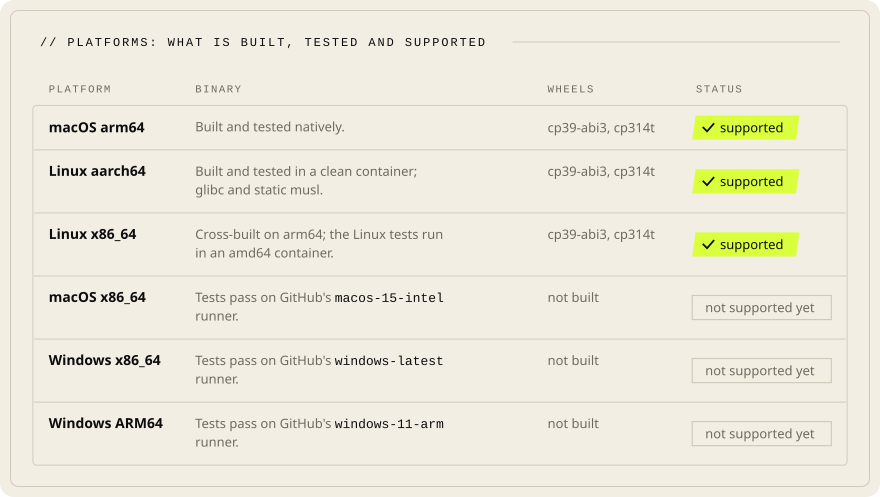

<!-- Head written by tools/gen_doc_assets.py: edit its table, then run it. -->
<p align="center">

</p>

# Installation, update, uninstallation

[Documentation](README.md) &nbsp;·&nbsp; Previous: [Questions](FAQ.md) &nbsp;·&nbsp; Next: [Command line](CLI.md)

<!-- End of head. -->

One static-friendly binary and an optional Python package. Nothing runs in the background or
phones home.

## Supported platforms (0.1.0)

A platform is supported only once its binary and wheel were built, installed and tested on it.
The logs each row names are in `bench/results/platforms/`.

<p align="center">

<br><sub>A summary of the table below: three platforms supported, three tested on GitHub runners with no wheel yet.</sub>
</p>

| Platform | Binary | Wheels | Status | Evidence |
|---|---|---|---|---|
| macOS arm64 (Apple Silicon; macOS 13 or newer, tested on macOS 27) | built and tested natively | `cp39-abi3` on CPython 3.10, 3.11, 3.12, 3.13; `cp314t` on free-threaded 3.14 | **supported** | docs/TEST_RESULTS.md; `wheels-macos-arm64.json` |
| Linux aarch64 (glibc and static musl) | built and tested in a clean `rust:1-slim-bookworm` container (no Python on the image); the static musl binary prints byte-identical output | `cp39-abi3` on CPython 3.10, 3.12, 3.13; `cp314t` on free-threaded 3.14 | **supported** | `linux-aarch64/verify.log`, `musl-identical.txt`, `wheels.json` |
| Linux x86_64 (glibc and static musl) | the same script in a `linux/amd64` container under emulation on the Apple Silicon host (behaviour, not x86 speed). For the release commit gcc crashed under emulation, so the binary and every test binary were cross-built on arm64 and all 118 Linux tests run in an amd64 container (the other four of the 122 are for macOS on Apple silicon) | same as aarch64 (full run on an earlier commit) | **supported** | `linux-x86_64/cross-verify.log` (release commit); `verify.log`, `musl-identical.txt`, `wheels.json` (earlier full run) |
| macOS x86_64 | GitHub's `macos-15-intel` runner: the Rust tests and a smoke test of the release binary pass (CI run 43013926055); cross-built here, where the test binaries compile and link (no Rosetta 2 on the build machine) | not built | **not supported yet**: no wheel built or installed | `macos-x86_64/verify.log`; CI run 43013926055 |
| Windows x86_64 | GitHub's `windows-latest` runner: the Rust tests and a smoke test of the release binary pass (CI run 43013926055; five tests of files removed while open or of file names Windows forbids run on Unix only); cross-built here with MinGW-w64 | not built | **not supported yet**: no wheel built or installed | `windows-x86_64-cross/build.log`; CI run 43013926055 |
| Windows ARM64 | GitHub's `windows-11-arm` runner: the Rust tests and a smoke test of the release binary pass (CI run 43013926055); not built here | not built | **not supported yet**: no wheel built or installed | CI run 43013926055 |

## From a release archive

No archive is published for 0.1.0: the release workflow has not run. Once releases exist:

```sh
v=0.1.0; t=x86_64-unknown-linux-gnu
curl -sSfLO "https://github.com/scrutate/scrutate/releases/download/v$v/scrutate-$v-$t.tar.gz"
curl -sSfLO "https://github.com/scrutate/scrutate/releases/download/v$v/scrutate-$v-$t.sha256"
sha256sum -c "scrutate-$v-$t.sha256"        # checksum
gh attestation verify "scrutate-$v-$t.tar.gz" --owner scrutate   # Sigstore provenance (optional)
tar xzf "scrutate-$v-$t.tar.gz"
install -m 0755 "scrutate-$v-$t/scrutate" ~/.local/bin/scrutate
scrutate completions bash > ~/.local/share/bash-completion/completions/scrutate   # or zsh/fish/powershell
```

The `-linux-gnu` archives need glibc 2.34 or newer (Debian 12, Ubuntu 22.04, RHEL 9 and later);
the `-linux-musl` archives are static and run on any Linux.

Windows: unzip, put `scrutate.exe` on `PATH`, `scrutate completions powershell | Out-String | Invoke-Expression`.

## From source (any platform with stable Rust 1.91 or newer)

```sh
git clone https://github.com/scrutate/scrutate && cd scrutate
cargo build --release -p scrutate --locked          # a few minutes; binary at target/release/scrutate
cargo test --release -p scrutate                     # the Rust test suite
```
`rust-toolchain.toml` pins the compiler (1.99.1) for reproducible builds; rustup installs it on
first use. `--features extra-langs` adds the optional heavy grammars (Fortran, OCaml, F#, Verilog,
VHDL, CUDA, TLA+, D, AutoHotkey, Odin, QML, LLVM IR; about 80 MB more). `.gitattributes` checks
text files out with LF line ends everywhere, so a Windows build's compiled-in data
(`crates/scrutate/data`) matches every other build.

## Python package

```sh
pip install maturin
maturin build --release --strip -m crates/scrutate-py/Cargo.toml -o dist
pip install dist/scrutate-*.whl
python -c "import scrutate; print(scrutate.__version__)"
```
Three wheels per OS and architecture cover every supported interpreter, and `pip` picks one:
`cp39-abi3` for standard CPython 3.9 to 3.14, `cp314t` for free-threaded 3.14 (which has no
stable ABI), and `cp315-abi3.abi3t` for 3.15 and newer, standard and free-threaded. The build
above makes the one for the interpreter that runs it; `-i python3.14t` names another. API, errors
and Ctrl-C: [Python bindings](../crates/scrutate-py/README.md).

## Connect your coding agent

`scrutate setup <claude|codex|opencode|cursor|gemini>` writes that agent's MCP server entry,
running this binary by its absolute path; `--project` writes the repository's file instead,
`--hook` adds Claude Code's Grep hook, and `--uninstall` takes back all setup added. Every option
and each agent's file: [Command line](CLI.md#setup-and-the-grep-hook).

## Updating

Replace the binary (same steps). Indexes are caches. A version with another index schema rebuilds
the index on first use (`index schema changed; rebuilding the index` is normal); one with another
bundled model keeps the index and makes its vectors anew on the next update; one that parses or
tokenizes differently reads every file once on its next update
(`index built with other parsing rules; every file is read again on the next update`).

## Uninstalling

```sh
scrutate setup claude --uninstall                                          # each agent you set up
rm ~/.local/bin/scrutate ~/.local/share/bash-completion/completions/scrutate
find ~/code -maxdepth 3 -name .scrutate -type d -prune -exec rm -rf {} +   # the caches, wherever you indexed
rm -rf ~/.config/scrutate                                                  # optional configuration
rm -rf ~/.local/state/scrutate                                             # read counts and the Grep hook's counter
pip uninstall scrutate                                                     # the Python package, if installed
```
Scrutate writes nothing else: no services, no registry keys. Outside the repositories you indexed
it writes only your configuration, the agent files `scrutate setup` edits, and its state
directory (`$XDG_STATE_HOME/scrutate/`, else `~/.local/state/scrutate/`, on Windows
`%LOCALAPPDATA%\scrutate\`) with `frecency.json` and `hook-grep.jsonl`.

## Package managers

None is published for 0.1.0. The package definitions are in `packaging/`: a Homebrew formula, a
Scoop manifest, winget manifests, and `.deb`/`.rpm` builds from `crates/scrutate/Cargo.toml`;
`packaging/README.md` says how each was tested and what is left for release time. `cargo install
scrutate` from crates.io is not possible yet: the bundled models are too large for crates.io, and
the build needs the patched `ignore` crate in `vendor/`. From a checkout,
`cargo install --path crates/scrutate --locked` works.
