<!-- Head written by tools/gen_doc_assets.py: edit its table, then run it. -->

# Project name: **Scrutate**

[Documentation](README.md) &nbsp;·&nbsp; Previous: [Research](RESEARCH.md)

<!-- End of head. -->

*scrutate*: an English verb descended from Latin *scrūtor / scrūtārī*, "to search carefully,
search into or out, examine thoroughly, investigate" (Lewis & Short, *A Latin Dictionary*, 1879,
as cited by Wiktionary's entry for *scrutor*, which lists English *scrutate* among the word's
descendants next to *scrutinize*). The CLI is `scrutate`, the crate is `scrutate`, the Python
package is `scrutate`, the index directory is `.scrutate/`.

## Why this name

- It says what the tool does (searching through a codebase and examining it closely) without
  being a generic "code search" phrase.
- It is a real, pronounceable word (SKROO-tayt) that developers can say, type and remember, with
  the connotation of *scrutiny* already attached; it is rare enough in current English that no
  software project in the checked registries uses it.
- It is a verb, so it works in sentences ("scrutate the repo for callers of `refresh_token`").
- Nothing in the registries a developer tool collides with uses it (evidence below).

## Method

Thirty candidates were generated in two rounds (real words with search/insight semantics, coined
blends, Rust- and grep-themed names). Each was checked on **2026-11-08** with
`tools/name_research.py` against:

| Source | How | Result recorded |
|---|---|---|
| crates.io | `GET /api/v1/crates/<name>` | taken / free |
| PyPI | `GET /pypi/<name>/json` | taken / free |
| npm | `GET registry.npmjs.org/<name>` | taken / free |
| GitHub repositories | search API, `<name> in:name`, 30 most-starred inspected | number of name matches; most-starred repository whose name is exactly the candidate |
| GitHub user/organisation | `GET /users/<name>` | **not verifiable** from this environment (the token is repository-scoped; the endpoint returned 403 for every candidate) |
| Homebrew | `formulae.brew.sh/api/formula/<name>.json` (finalist only) | no formula |
| Web search | finalist only | software products / companies with the same or a confusable name |

Raw evidence: `docs/name_research.json` (one record per candidate with the HTTP status codes and
the top GitHub match).

## Evidence table

| Candidate | crates.io | PyPI | npm | GitHub name matches | Most-starred exact-name repo | Verdict |
|---|---|---|---|---|---|---|
| **scrutate** | free | free | free | 3 (all *Scrutateur...*, none exact) | none | **selected** |
| greplex | free | free | free | 0 | none | runner-up: confusable with the existing tools *greple* (Perl grep) and *Greptile* |
| grepnova | free | free | free | 3 | none, but a `grepNova` GitHub account owns `grepNova/ruby`, `grepNova/proyectos` | rejected: account collision |
| sondel | free | free | free | 28 | none | rejected: a surname, no meaning for users |
| codesonde | free | free | free | 1 | none | rejected: weak, hard to say |
| sondex | free | free | free | 7 | `josuekot23/sondex` ★0 | rejected |
| grepwise | free | free | free | 3 | `ozkanpakdil/grepwise` ★1 ("Splunk alternative") | rejected: exact-name project |
| codeken | free | free | free | 52 | `all3xfx/codeken` ★0 | rejected: exact-name project |
| lexicode | free | free | free | 46 | `wobh/lexicode` ★14 | rejected |
| querent | free | taken | taken | 45 | `teogor/querent` ★5 | rejected |
| pellucid | free | free | taken | 69 | `meppent/pellucid` ★48 (Rust EVM decompiler) | rejected: Rust-ecosystem collision |
| kenning | free | taken | free | 115 | `antmicro/kenning` ★149 | rejected |
| codequill | free | free | taken | 20 | `The-Best-Codes/codequill` ★25 | rejected |
| sourcelight | free | free | taken | 39 | `philosophysystems/sourcelight` ★0 | rejected |
| spelunk | free | taken | taken | 616 | `Rich-Harris/spelunk` ★30 | rejected |
| spelunker | free | taken | taken | 163 | `wowserhq/spelunker` ★23 | rejected |
| percept | free | taken | taken | 32 750 | none exact in top 30 | rejected: generic |
| greptile | free | taken | taken | 1 317 | `ncornette/greptile` ★24; also an existing company | rejected |
| ferrograph | taken | free | free | 10 | `GarthDB/ferrograph` ★4 ("Rust code intelligence") | rejected: direct collision |
| dowser | taken | taken | free | 101 | `catfact/dowser` ★16 | rejected |
| syntaxis | taken | taken | free | 160 | `shobrook/syntaxis` ★18 | rejected |
| celerity | taken | taken | taken | 257 | `jarib/celerity` ★204 | rejected |
| lodestar | taken | taken | taken | 665 | `ChainSafe/lodestar` ★1 433 | rejected |
| quarry | taken | taken | taken | 1 947 | `barneygale/quarry` ★548 | rejected |
| sift | taken | taken | taken | 7 358 | `svent/sift` ★1 656 (a grep alternative) | rejected |
| scour | taken | taken | taken | 859 | `scour-project/scour` ★878 | rejected |
| hark | taken | taken | taken | 4 177 | `otalk/hark` ★571 | rejected |
| tessera | taken | taken | taken | 10 694 | `tessera-metrics/tessera` ★1 172 | rejected |
| augur | taken | taken | taken | 1 437 | `augurlabs/augur` ★695 | rejected |
| rummage | taken | taken | taken | 227 | `facelessuser/Rummage` ★87 (grep GUI) | rejected |

## Finalist checks for *scrutate*

- crates.io, PyPI, npm: no package of that name (HTTP 404 on 2026-11-08).
- GitHub: no repository named `scrutate`; the three name matches are French `Scrutateur` projects
  (unrelated word).
- Homebrew: no formula (`formulae.brew.sh` returns not-found; the same request for `ripgrep`
  returns the formula, so the check itself works).
- Web search for "scrutate" software: no product or project. The nearest name is **Scrut**
  (Scrut Automation, a compliance-automation SaaS), a different word in an unrelated market.

## Re-check on 2026-11-09

- crates.io, PyPI, npm: still no package named `scrutate` (HTTP 404).
- GitHub account or organisation `scrutate`: does not exist (the authenticated `GET /users/scrutate`
  returns 404), so the name can be claimed there.
- Domains (WHOIS): `scrutate.com` **is registered** (created 2026-06-22, registrar Cloudflare; WHOIS
  does not show the owner, and whether it belongs to this project's authors was not checked). `scrutate.io`, `scrutate.org` and `scrutate.net`
  returned "not found" (unregistered at the time of the query). `scrutate.dev` and `scrutate.app`:
  the registry's WHOIS server gave no answer to this client, so their status is unknown.
- Trademarks: a web search for "Scrutate" as a software product, company or mark found none. The
  closest marks found are **SCRUT**, **SCRUT.IO** and **THE SCRUT PLATFORM**, held by Scrut
  Automation Inc. (security and compliance software; listed on Justia's trademark pages). They are
  a different word, but they are in software, so a confusion analysis belongs in the legal review.

## What is *not* verified: read before relying on the name

- **Trademark registers**: USPTO, EUIPO, WIPO and national registers were not searched directly,
  and the name has **not** been legally cleared. A search by counsel is required before
  commercial use, and it should cover the SCRUT marks above.
- **The `.com` domain** is registered; unless it is already the authors', a product site needs
  another domain or a purchase.
- **Global uniqueness** is not claimed: the checks cover the listed registries on the listed dates
  and nothing else.
