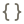
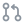

<!-- Head written by tools/gen_doc_assets.py: edit its table, then run it. -->

# Documentation

The documents are grouped by what you came to do: use scrutate, understand how it works, check the evidence behind its claims, or work on it. Each document starts with a link back here and to the documents before and after it in its group. A document written by a script says so at the top; change the script, not the page.

<!-- End of head. -->

<table>
<tr>
<th colspan="2" align="left"> Install it, run it, connect it to an editor, an agent or CI.</th>
</tr>
<tr>
<td width="50%" valign="top">
 <a href="INSTALL.md"><b>Install</b></a> 
How do I install, update and remove scrutate?
</td>
<td width="50%" valign="top">
 <a href="CLI.md"><b>Command line</b></a> 
What does each command do, and what does it print?
</td>
</tr>
<tr>
<td width="50%" valign="top">
 <a href="../integrations/mcp/README.md"><b>MCP server</b></a> 
How do I give an agent scrutate's tools?
</td>
<td width="50%" valign="top">
 <a href="../integrations/vscode/README.md"><b>VS Code</b></a> 
How do I use the language server in VS Code?
</td>
</tr>
<tr>
<td width="50%" valign="top">
 <a href="../integrations/neovim/README.md"><b>Neovim</b></a> 
How do I use scrutate from Neovim?
</td>
<td width="50%" valign="top">
 <a href="../integrations/jetbrains/README.md"><b>JetBrains IDEs</b></a> 
How do I run scrutate from a JetBrains IDE?
</td>
</tr>
<tr>
<td width="50%" valign="top">
 <a href="../integrations/github/README.md"><b>GitHub Actions</b></a> 
How do I run scrutate in a GitHub workflow?
</td>
<td width="50%" valign="top">
 <a href="../integrations/pre-commit/README.md"><b>pre-commit hook</b></a> 
How do I stop a commit that adds duplicate functions?
</td>
</tr>
<tr>
<td width="50%" valign="top">
 <a href="../crates/scrutate-py/README.md"><b>Python bindings</b></a> 
How do I call both engines from Python?
</td>
<td width="50%"></td>
</tr>
<tr>
<th colspan="2" align="left"> How the engines work and what the words mean.</th>
</tr>
<tr>
<td width="50%" valign="top">
 <a href="ARCHITECTURE.md"><b>Architecture</b></a> 
How do the two engines work inside?
</td>
<td width="50%" valign="top">
 <a href="LANGUAGES.md"><b>Languages</b></a> 
What does the index find in each language?
</td>
</tr>
<tr>
<td width="50%" valign="top">
 <a href="../GLOSSARY.md"><b>Glossary</b></a> 
What does each word of this codebase mean?
</td>
<td width="50%"></td>
</tr>
<tr>
<th colspan="2" align="left"> Measurements, tests, security and the evidence behind every claim.</th>
</tr>
<tr>
<td width="50%" valign="top">
 <a href="LEADERBOARD.md"><b>Leaderboard</b></a> 
Where is scrutate faster or slower, and how sure is that?
</td>
<td width="50%" valign="top">
 <a href="BENCHMARKS.md"><b>Benchmarks</b></a> 
What do time, memory and start-up cost, tool by tool?
</td>
</tr>
<tr>
<td width="50%" valign="top">
 <a href="QUALITY.md"><b>Ranking quality</b></a> 
How good are ranked answers on code it was not fitted on?
</td>
<td width="50%" valign="top">
 <a href="TEST_RESULTS.md"><b>Test results</b></a> 
Did every quality gate pass, and what did it print?
</td>
</tr>
<tr>
<td width="50%" valign="top">
 <a href="SECURITY.md"><b>Security</b></a> 
What can a hostile repository, query or client do?
</td>
<td width="50%" valign="top">
 <a href="TRACEABILITY.md"><b>Traceability</b></a> 
Which requirement is met, and what is the evidence?
</td>
</tr>
<tr>
<td width="50%" valign="top">
 <a href="RELEASE_READINESS.md"><b>Release readiness</b></a> 
Is 0.1.0 ready, and what is still missing?
</td>
<td width="50%" valign="top">
 <a href="COMPETITIVE.md"><b>Competitive position</b></a> 
What does the evidence say against other tools?
</td>
</tr>
<tr>
<td width="50%" valign="top">
 <a href="dashboard.html"><b>Benchmark dashboard</b></a> 
The benchmark results as charts (open it in a browser)
</td>
<td width="50%"></td>
</tr>
<tr>
<th colspan="2" align="left"> How changes are made, released and planned.</th>
</tr>
<tr>
<td width="50%" valign="top">
 <a href="../CONTRIBUTING.md"><b>Contributing</b></a> 
What must pass before a change is merged?
</td>
<td width="50%" valign="top">
 <a href="RELEASING.md"><b>Releasing</b></a> 
Which steps does a release take, in order?
</td>
</tr>
<tr>
<td width="50%" valign="top">
 <a href="DELIVERY.md"><b>Delivery index</b></a> 
Where is each delivered item in this repository?
</td>
<td width="50%" valign="top">
 <a href="DEPENDENCIES.md"><b>Dependencies</b></a> 
Which crates and data are compiled in, and why?
</td>
</tr>
<tr>
<td width="50%" valign="top">
 <a href="ROADMAP.md"><b>Roadmap</b></a> 
What is done, what is blocked and what is next?
</td>
<td width="50%" valign="top">
 <a href="RESEARCH.md"><b>Research</b></a> 
Would a small transformer model rank code better?
</td>
</tr>
<tr>
<td width="50%" valign="top">
 <a href="NAMING.md"><b>Naming</b></a> 
Why is it called scrutate, and how was that checked?
</td>
<td width="50%" valign="top">
 <a href="../CHANGELOG.md"><b>Changelog</b></a> 
What changed in each version?
</td>
</tr>
<tr>
<td width="50%" valign="top">
 <a href="../packaging/README.md"><b>Packaging</b></a> 
Which package definitions exist, and how was each tested?
</td>
<td width="50%" valign="top">
 <a href="../fuzz/README.md"><b>Fuzz targets</b></a> 
What does each fuzz target check?
</td>
</tr>
<tr>
<td width="50%" valign="top">
 <a href="../CLA.md"><b>Contributor licence agreement</b></a> 
What rights do I give with a contribution, and what do I keep?
</td>
<td width="50%" valign="top">
 <a href="../TRADEMARKS.md"><b>Trademark policy</b></a> 
What may a fork, a package or a product do with the name and the logo?
</td>
</tr>
</table>
