<!-- Head written by tools/gen_doc_assets.py: edit its table, then run it. -->

# Release-readiness assessment: Scrutate 0.1.0

[Documentation](README.md) &nbsp;·&nbsp; Previous: [Traceability](TRACEABILITY.md) &nbsp;·&nbsp; Next: [Competitive position](COMPETITIVE.md)

<!-- End of head. -->

**Verdict: 0.1.0 is a verified first release for developer use on the platforms INSTALL.md
declares (macOS arm64, Linux aarch64, Linux x86_64). It is not declared production-ready for
mission-critical environments**, whose criteria are not all met (below).
Every PASS refers to a test, benchmark or audit output here.

## What the release gates say (mission section 10)

| Gate | Result |
|---|---|
| Functional universal instant search | **met**: Engine A, differential agreement with ripgrep; every leaderboard answer matches an independent reference |
| Unknown-language generic search | **met**: every readable file, no configuration |
| Reliable filesystem traversal | **met**: ignore rules, symlink loops, dangling links, permissions, long and unicode names, case-colliding checkouts, SMB shares |
| Ignore rules and advanced filtering | **met** |
| Literal and regex search | **met**: linear-time regex with size limits |
| Machine-readable output | **met**: JSON Lines (schema 1) from `grep`, one JSON envelope (schema 2) from the index commands, JSON error records |
| Functioning, tested code-intelligence foundation | **met**: 61 + 13 verified grammars, call graph, imports, ranked search with measured quality, text index equal to Engine A |
| Automated tests | **met**: 122 Rust tests, Python tests of the training code and benchmark builders, bindings tests on four or five interpreters per platform, pinned ranking features, a ranking quality floor, 2,000 differential cases against ripgrep, fuzz regressions and a reproducible build, all passing (docs/TEST_RESULTS.md) |
| Reproducible competitive benchmarks | **met**: `bench/leaderboard.py`, `bench/indexed.py`, pinned corpora, raw results in `bench/results/` |
| Verified builds for declared supported platforms | **met for the declared platforms**; others are not declared |
| Security assessment | **met as a self-assessment** with fuzzing; no independent audit |
| Professional documentation | **met** |
| Installation instructions | **met** |

## Why not "production-ready" yet

1. **Platform coverage.** CI run 43382848665 (commit `08cd9fa`) passed every push job on all six
   platforms ([README](../README.md#status-010)). Windows and Intel macOS still lack a benchmark
   run and a release archive built by the release workflow and installed on a machine
   (docs/ROADMAP.md, known limits).
2. **No independent security review** ([SECURITY](SECURITY.md#known-gaps-and-residual-risks)).
3. **Release pipeline unexercised**: signed releases, attestations and package-manager packages
   exist only as workflow definitions.
4. **Benchmark leadership is not proven on dedicated hardware**, which section 14 requires for #1
   claims; the laptop and its Linux VM win every benchmark (docs/LEADERBOARD.md, R-4.6 below).

## Remaining defects and incomplete requirements

Status words as in docs/TRACEABILITY.md.

| ID | What is missing | Status | What closes it |
|---|---|---|---|
| R-4.6, R-14.16 | #1 on every benchmark, metric and declared platform: every row measured is won with significance (macOS arm64: 37 warm, 5 cold, 8 indexed; Linux aarch64 VM: 14 warm, 4 cold, 8 indexed), but Linux x86_64 has no benchmark run and nothing was measured on dedicated hardware | PARTIAL | a run of `bench/run_macos.sh` and `bench/competitors/linux_bench.sh` on a dedicated Mac and on dedicated aarch64 and x86_64 Linux machines |
| R-14.11 | Results from dedicated, otherwise idle hardware | BLOCKED | a dedicated Mac and Linux machine; the harness and corpora are ready |
| R-13.9 | Windows and Intel macOS executed, not only cross-built | PARTIAL | CI run 43013926055 passed on Intel macOS, Windows x64 and Windows arm64 (Rust tests and a smoke test of the release binary); wheels and release archives built and installed there by `release.yml` |
| R-6.12, R-14.15, R-12.18 | CI runs, benchmark regression tracking in CI | PARTIAL | `ci.yml` has a green run (43013926055, all 12 jobs of a push); `benchmarks.yml` and `release.yml` run on a runner |
| R-12.17 | Signed releases and published packages | PARTIAL | the release workflow's Sigstore steps and the package pull requests, which need the published repository |
| R-6.15, R-12.16 | GitHub App / GitLab integration exercised against a real platform | PARTIAL | the published repository |
| R-12.15 | The cross-platform part of verification | PARTIAL | as R-9.10 |
| R-7.2 | Trademark search by counsel | PARTIAL | counsel's search of the trademark registers |

## Defects found and fixed while preparing this release

- Four fuzzing finds, and a blocking file lock that fails at once on SMB (EAGAIN):
  [SECURITY](SECURITY.md#controls-and-evidence) describes each.
- Broken symbol rules for D, LLVM IR, AutoHotkey, VHDL architectures and OCaml modules, found by
  writing their samples.
- Tests that silently needed a `git` or `kill` binary, which minimal Linux images lack.
- About 1.5 ms of start-up loading Foundation and libobjc through the `ctrlc` crate.
- A file given as the search root printed with an empty path (`:1:text`, or `one.txt/` next to a
  second root).
- A GIL-release test that could not show its claim: every line matched, so the time went into
  building Python objects (it failed on x86_64, skipped elsewhere). It now searches one large file
  for one match ([TRACEABILITY](TRACEABILITY.md) R-13.4).
- `--max-results N` gave one or two matches too many when several threads matched at once
  (caught by the bindings test; a CLI test repeats the search sixty times).
- A bundled SQLite with a published CVE, found by `cargo audit` on the release candidate
  (RUSTSEC-2026-0459, [SECURITY](SECURITY.md#controls-and-evidence)).
- In the benchmark harness: ast-grep parsed a pattern as a C type macro, so the Linux structural
  benchmark compared Scrutate with a tool that matched nothing; git's case-insensitive ignore
  matching hid 1,343 files from a reference (every tool disagreed with it); a reference using
  Python's backtracking regex on the backtracking-trap benchmark never finished; a
  musl/glibc comparison compared the JSON summary's run time, and unordered output.

Closing the rows the first full benchmark run lost found: smart case took `\S` for an uppercase
letter; `-c` with `--max-count` printed the full count; the fuzzy modes silently ignored `-w` and
`-U` (now an error); the file watcher panicked on patterns in `.git/info/exclude`; the MCP server
reported a refused `read_code` path as a success and was silent on an invalid `grep_code` regex;
the disk read test never fired on Linux, so cold trees were read on one thread per core; the fuzz
workspace stopped building once `ignore` was vendored, as its own workspace missed the patch
(the release code's fuzz-regression gate caught it). In the harness: a read-files
ceiling whose threads shared a directory read cold trees at a third of disk speed, and warm runs
went cold once other applications took the page cache's memory.

Found on 2026-11-11 by running every install and usage path before going to GitHub; none in the
search engines, each one the first user or CI run would hit:

- The workflows had never run: the musl jobs added their target to the runner's default
  toolchain, not the pinned one; the audit job lacked a permission its action needs; a job ran
  `pip install` on a system Python that refuses it; the musl comparison had no `--sort` and
  compared a run time; a check written with `!` could not fail; the benchmark gate used another
  machine's baseline and skipped itself when the file was missing; `compare_tools.py --out`
  crashed on a bare file name.
- The declared `rust-version` (1.89) did not build: a locked dependency needs 1.91.
- The GitLab and Bitbucket templates failed when there were no duplicates (exit status 1 means
  "nothing found") and unpacked the tool inside the checkout, which then indexed it.
- The pre-commit entry was invalid YAML and passed when the tool failed; the MCP page gave one
  configuration to clients that read three; the wheel put its third-party notices at the top of
  `site-packages`.
- The Python reference lacked four definition kinds the engine has, so parity failed on Rust
  sources.

## Recommendation

Use 0.1.0 for development on macOS arm64 and Linux, where both engines are verified and the
results reproduce from this repository. It is production-ready once the four gaps above are
closed (for Windows and Intel macOS, wheels too: R-13.9).
