<!-- Head written by tools/gen_doc_assets.py: edit its table, then run it. -->

# Security assessment (0.1.0)

[Documentation](README.md) &nbsp;·&nbsp; Previous: [Test results](TEST_RESULTS.md) &nbsp;·&nbsp; Next: [Traceability](TRACEABILITY.md)

**Contents**: [Threat model](#threat-model) &nbsp;·&nbsp; [Controls and evidence](#controls-and-evidence) &nbsp;·&nbsp; [Running git](#running-git) &nbsp;·&nbsp; [The session socket](#the-session-socket) &nbsp;·&nbsp; [The main checkout's index in a linked work tree](#the-main-checkouts-index-in-a-linked-work-tree) &nbsp;·&nbsp; [A repository's language tables](#a-repositorys-language-tables) &nbsp;·&nbsp; [Setup and the Grep hook](#setup-and-the-grep-hook) &nbsp;·&nbsp; [The structural rewrite](#the-structural-rewrite) &nbsp;·&nbsp; [Known gaps and residual risks](#known-gaps-and-residual-risks) &nbsp;·&nbsp; [Reporting](#reporting)

<!-- End of head. -->

Scope: the `scrutate` binary (Engine A, Engine B, CLI, MCP server) and the Python bindings, as
built from this repository on 2026-11-11. This is a self-assessment by the authors with the tests
named below; it is **not** an independent audit or penetration test.

## Threat model

Scrutate reads source trees chosen by the user and writes one cache directory (`.scrutate/`) inside
each indexed repository, and one small state file outside it: `frecency.json` under
`$XDG_STATE_HOME/scrutate/` (else `~/.local/state/scrutate/`; on Windows `%LOCALAPPDATA%\scrutate\`),
where `read`, `read_code` and `files` count the reads of each file for `files` to rank by. It holds
the canonical root of each repository and the paths of files read in it, with a count and a time,
at most 1,000 files; it is written whole to a new file in that directory and renamed into place,
and a file there that does not parse is ignored and replaced. Nothing in it is ever run or used as
a path to open: a path in it only ranks a file the walk of the repository already found. Delete it
at any time to forget the counts. In a linked git work tree it also reads the index of the repository's
main checkout (below). The assets are (1) the confidentiality of the source code, (2) the
integrity of the machine running the tool, (3) availability (no hangs or resource exhaustion on
hostile inputs). Attackers considered: a **hostile repository** (crafted files, names, symlinks,
`.gitignore`, a corrupted or planted `.scrutate/` directory), a **hostile query** (patterns),
a **hostile MCP client** (malformed JSON-RPC, path escapes), and **another local process** that
reaches the socket a running `serve` offers to command line calls (below). Two commands write
outside a repository, on the user's word only: `scrutate setup` writes an agent's configuration
files, and the Grep hook it installs appends to a counter file (below). One command writes source
files: `scrutate tsquery --rewrite` with `--write` ([below](#the-structural-rewrite)).

 What crosses into scrutate, and the controls from the table below on each boundary. The network is not used.

## Controls and evidence

| Area | Control | Evidence |
|---|---|---|
| No code execution from repositories | Files are parsed as data (tree-sitter, regex); nothing is evaluated, imported, or run. No build systems, repository hooks, `.scrutate.toml` scripts or plugins exist. The binary starts another program in two cases: `grep -z` decompresses bzip2, xz, lzma, lz4, zstd, brotli and `.Z` files by running the system's `bzip2`, `xz`, `lz4`, `zstd`, `brotli` or `uncompress` from `PATH` on the file (through `grep-cli`, as ripgrep does), while gzip, zip and tar are read in process; and `impact` (the command and the MCP tool) runs `git` from `PATH` in the root to read the diff (see [Running git](#running-git)). Without `-z` or `impact`, no search starts a program. `scrutate setup claude` runs `claude mcp add-json` or `claude mcp remove` from `PATH` when it is there ([below](#setup-and-the-grep-hook)). | Code review: the engine's process spawns are `grep_cli::DecompressionReaderBuilder` in `archive.rs` and `Git::command` in `impact.rs`, and `setup.rs` runs `claude` as above; `tests/impact.rs` (a revision written as an option is refused, and no file is written). |
| No network | The binary makes no network connections and has no HTTP/DNS dependency. | `cargo tree` (docs/DEPENDENCIES.md) contains no networking crate; offline build and run verified in a proxy-restricted environment. |
| Filesystem confinement | `read_code` / `read()` reject paths that resolve outside the repository root, and `read_code` refuses a path that is not a regular file; the index is written only under `<root>/.scrutate/`, and another checkout's index is only read, in a linked git work tree, from its main checkout ([below](#the-main-checkouts-index-in-a-linked-work-tree)); segment files are written to a temp directory *inside* `.scrutate/seg/` and renamed into place (no `/tmp`, no predictable world-writable paths). A repository's `exclude_dirs` (`.scrutate.toml` at the root) can only leave directories out by name: the file is read as other repository files are (a regular file inside the root, at most 1 MB; through a link only when the resolved file is one), and its names are never read as patterns. A `.scrutate` that is a symbolic link, or that holds one (checked three levels deep, no link followed), is refused, and files of fixed names are written with remove and `create_new`, so nothing outside the repository is written or deleted through a link. A `--root` that does not exist or is not a directory is an error, and nothing is created. `tsconfig.json`, `jsconfig.json`, `Cargo.toml` and `go.mod` are read only when they are regular files inside the repository, of at most 1 MB. A path a tool call names, a file an answer cites and a file a watch event names are indexed only when the path resolves inside the repository root: a linked folder on the way that leads outside makes the file count as missing. A path in a tool call that leaves the root by its own parts (`..`, an absolute path elsewhere, a share on another machine) is refused with nothing looked at, so on Windows no connection is made to a machine a call names. The language server reads a document from disk only under the root, links on the way included, and resolves no path on another machine's share than the root's: for a document outside it (another folder, a URI that leaves through `..`) it uses the text the editor sent, or nothing. | `tests/robustness.rs::symlinks_ignores_and_nested_repos` (symlink escape not followed by default), bindings test `r.read("../etc/passwd")` → error, lsp `a_document_that_is_not_under_the_root_is_never_read_from_disk`, mcp_tools `a_path_through_a_linked_folder_reads_nothing_outside_the_repository`. |
| Symlinks | Not followed by default (Engine A and B); `-L` follows with loop detection (the `ignore` walker). | robustness: loop + dangling + escaping symlinks. |
| Permission-aware | Unreadable files are counted as errors (`--stats`) and skipped, never fatal. | robustness `unreadable_files_are_reported_not_fatal` (skipped when running as root, as in CI containers; the code path is exercised by the error counter). |
| Resource exhaustion: regex | Rust `regex` (linear time, no backtracking) with compiled-size limits (20 MB regex, 10 MB DFA); oversized patterns are rejected with an error. | robustness `regex_limits_and_errors_are_clean`: `(a*)*b` on a 10 000-char line finishes; `(a{1000}){1000}` is an error. |
| Resource exhaustion: files | Engine B skips files > 1 MB and binary files (NUL in the first 4 KB); chunk text and body are capped at 200 lines (40 for a container) and 32 KiB; tree-sitter parse per file; Engine A streams with bounded batches; `--max-filesize`, `--max-depth`, `--max-results`, `--max-count`. With `-z`, an archive or compressed file stops at 8 GiB expanded or a million members, a member at a line longer than 64 MiB, and a tar member's name from a long-name or PAX header is read up to 64 KiB, so a small archive cannot make `grep -z` hold gigabytes. Index time stays linear in nesting depth: a file of 60,000 nested Lisp calls, nested lists or 50,000 nested HTML elements indexes in under a second. The resolver does not read a file nested more than 2,000 levels deep, so such a file cannot overflow the stack of `refs`, the language server or the MCP server, or hold them for minutes. | robustness `hostile_text_shapes_never_panic` (5 MB line, 200k lines, 20 000-deep nesting); parse_index `deeply_nested_lisp_and_html_parse_in_linear_time` (Lisp and Scheme to 60,000 levels, bare lists to 80,000, HTML to 50,000). |
| Hostile text | Invalid UTF-8 (lossy decode), BOM, CRLF/CR, UTF-16 with a byte-order mark (transcoded by both engines), multibyte boundaries, emoji identifiers, 255-byte names, spaces/unicode in paths. A real UTF-8 boundary panic was found by this suite and fixed (`text::prefix_bytes`). | same test; `parser_fuzz_smoke` (400 random inputs); proptest `parser_yields_well_formed_chunks`. |
| Index corruption | `PRAGMA quick_check` on open; every segment array validated for dtype/shape/length on open; `scrutate check` runs `integrity_check` + deep validation (sorted ids, posting ranges, IVF permutation) and optional file re-hashing; damaged indexes are rebuilt automatically, also when a search first meets the damage in a segment array (a posting row, a pointer or a cluster table that points outside the segment); a planted non-database file is replaced; locked ≠ corrupt (never deletes a live database). The artifact store is part of the index: an artifact that does not decode, kept texts that do not decode, a file that names an artifact the store does not hold, and rows that disagree with their artifact are found where an update reads them (and by `scrutate check`) and rebuilt by the same rule. | `tests/artifacts.rs::damage_to_the_store_is_found_and_the_index_built_again`; robustness `corrupted_index_is_detected_and_rebuilt` (5 corruption scenarios); cli `a_posting_row_outside_its_segment_triggers_a_rebuild`; `concurrent_indexers_and_readers_do_not_corrupt` (3 writers + 2 readers, 30× repeated, `integrity_check` ok). |
| Cache files | `.scrutate/tsquery/` (captures by content) and `.scrutate/answers/` (what `callers` and `callees` learned) are read only as regular files within their size limit (128 MB and 64 MB), never through a symbolic link, and decoded with every length checked; a file that does not decode, or whose header names another scrutate, executable, index database or root, counts as no file. They are written whole to a temporary name and renamed into place, and only after the index directory check refuses a symbolic link anywhere in `.scrutate/`. A planted cache file that does decode is trusted as the checkout's own index is: it can make the answers it names wrong until it is deleted (deleting `.scrutate/` is always safe). | `files::tests::a_cache_file_is_read_only_as_a_regular_file_within_its_limit`; `answers::tests`; the tsquery tests in `tests/cli.rs`. |
| Panic containment | A panic in the CLI prints one diagnostic line and exits 2; a panic inside an MCP tool call is reported as a tool error and the server keeps running: the session closes the reader the call ran on and opens another. The Python bindings and the language server keep a panic inside its call the same way. An index update that panics rolls back at once, and the next update clears a write transaction left open. A panic in the MCP server's first index build is reported on stderr and in each tool call's answer; calls stop waiting for it, and `serve` still exits when its input closes. | `cli::main_exit`, `session.rs`; `session::tests::a_panic_inside_one_call_is_that_calls_error_and_the_session_goes_on`; mcp_protocol `a_first_build_that_panics_is_reported_and_the_server_still_answers_and_exits`. |
| Supply chain | 211 crates in the dependency graph of the binary (every platform's), each with a permissive licence (MIT, Apache-2.0, BSD, ISC, Zlib, Unlicense, 0BSD, Unicode-3.0, CC0-1.0), plus one data file compiled in, a Han fold table derived from Unihan 18.0.0 (Unicode-3.0, `crates/scrutate/data/han_fold.txt`); `Cargo.lock` committed; `cargo audit` over the 256 locked crates: **0 vulnerabilities, 0 warnings** (RustSec advisory DB of 1,446 advisories, 2026-11-13). The bundled SQLite was upgraded for RUSTSEC-2026-0459 (`rusqlite` 0.41, `libsqlite3-sys` 0.39). `ignore` is vendored with four documented changes (`vendor/ignore`; the SBOM marks it as a modified copy). `zip` 9, used only by `grep -z`, has no open advisory; `pyo3` was upgraded to 0.30 (2 advisories in 0.27). SBOM generated per release (`tools/sbom.py`, CycloneDX 1.5). | `cargo audit` output in docs/TEST_RESULTS.md; SBOM in release artifacts. |
| Reproducible builds | Release profile pins codegen; `Cargo.lock` and a pinned toolchain (`rust-toolchain.toml`: 1.99.1). Two clean builds in two different build images (`rust:1-slim-bookworm` and `golang:1.26-bookworm` with rustup, both using the pinned 1.99.1 compiler, fresh containers) produced the same SHA-256 for the release commit (`261ed1a2...`, linux/arm64); the binary the Linux leaderboard measured, built in another directory, has that hash too. Reproducibility on other operating systems, or across source paths in general, is not claimed. | `tools/repro_docker.sh`, `bench/results/platforms/repro/`; `tools/reproducible_check.sh` (same machine). |
| Signed releases | Release workflow attaches SHA-256 checksums and Sigstore build-provenance attestations (`actions/attest`) to every binary and wheel. | `.github/workflows/release.yml`, **not yet executed**; no release has been signed at the time of writing. |
| Coverage-guided fuzzing | Four libFuzzer targets (`fuzz/`, nightly toolchain, AddressSanitizer): the `.npy` reader on arbitrary bytes; the text-index soundness property (a text a pattern matches must satisfy the pattern's trigram condition); the edit-distance matcher; every parser tier on arbitrary text under 60 file extensions. It found four real defects, each fixed with a regression test and its crash input kept in `fuzz/regressions/`: chunk line numbers shifted after form feeds (Python-style line splitting); a truncated string array panicked the `.npy` reader; a shape whose element count overflowed wrapped in release builds and could have produced an over-long slice view (undefined behaviour, now a saturating count and checked sizes); a zero-width string array with a huge shape requested a multi-terabyte allocation. | `bench/results/fuzz/` (run logs), `fuzz/regressions/`, unit tests `npy::header_tests::damaged_headers_are_errors_not_panics`, `parse::tests::form_feeds_and_lone_cr_do_not_shift_line_numbers`. |
| Network file systems | A repository on an SMB share (Samba 4.23 server, macOS `smbfs` client): Engine A output identical to the local copy; Engine B indexes, answers, survives three concurrent `index` processes with readers, and passes `check --files`. Found and fixed: a blocking file lock fails at once on SMB (EAGAIN), so the text index polls `try_lock`. One host only: several machines sharing one index over a network file system is not supported (SQLite's documentation warns that its locking is unreliable there). | `tools/netfs_check.sh`, `bench/results/platforms/netfs-smb-macos.txt`. |
| Untrusted `.scrutate.toml` | The configuration file sets option defaults only (booleans, numbers, globs); it cannot name programs or paths to execute. Unknown keys are rejected. `follow = true` in a repository's own file is ignored with a warning, so a cloned repository cannot make a search leave it through a symbolic link; the flag, the environment and the user's own file still can. | `config.rs` tests; `tests/cli.rs` (a link out of the repository). |
| MCP server | Only reads the repository and writes `.scrutate/` and the frecency file above; path arguments are confined; the server takes requests on stdio, and on Unix offers its open index to command line calls of the same user through `.scrutate/session.sock` (no network port; see [The session socket](#the-session-socket)). Malformed input gets the JSON-RPC error the specification names, and the server keeps reading: a line that is not JSON or not UTF-8 gets -32700; a message that is not an object, an empty batch and a request without `method` get -32600; an unknown method gets -32601; an unknown tool and a missing tool name get -32602; an argument of the wrong type, or a negative number, is a tool error that names the argument. Notifications are never answered, and a client's own responses are ignored. An error quotes at most 200 characters of an argument. Each tool call has a thread of its own, at most 32 at once (further calls run on the reading thread), and at most 8 read the index at once. | `mcp.rs`; manual protocol smoke test in docs/TEST_RESULTS.md. |
| Python bindings | Engine behind a session (calls side by side, writes one at a time, a panic kept inside its call); `GrepIter` borrow-checked by PyO3; free-threaded declaration (`gil_used = false`) made after this review; stable ABI build. | `python/tests/test_bindings.py`. |

## Running git

`impact` reads what changed by running the `git` program found on `PATH` (on Windows the
current directory is not searched first), with the root as its working directory: `rev-parse`, `merge-base`, `diff` (raw and `-U0`), `ls-files --others` and one
`cat-file --batch`. Nothing in the repository names this program or its arguments, and the
calls only read: each passes `--no-optional-locks` (git then does not refresh and write its index
file), `-c core.fsmonitor=false` (no file system monitor program), `--no-ext-diff` and
`--no-textconv` (no external diff or text conversion program from git's configuration).

The one argument a caller gives is a revision (`--base`, the tool's `base`). It is refused
before git runs when it is empty or starts with `-`, so `--base=--output=x` cannot become git's
`--output` option and write a file, and it is passed as one argument, `REV^{commit}` to `git
rev-parse --verify`. The commit id that call prints is what every later call gets. `A...B` is
split first and each side checked the same way.

What remains is git's own trust in its configuration: a clean filter that the user's git
configuration defines (Git LFS, for example) runs when git compares a working tree file the
repository's `.gitattributes` assigns to it, as it does for `git diff`. A repository can select
such a filter but cannot define one: a clone carries no `.git/config`.

## The session socket

While `scrutate serve` runs on a repository, on Unix, it listens on a socket file at
`<root>/.scrutate/session.sock`, so that an index command (`symbol`, `refs`, `search`, the ranked part of `find` and the
others the CLI documents) can use the index the server holds open. This is a new local boundary; this section is
its review.

What it is. A Unix-domain stream socket, mode 0600, made when `serve` starts and removed when it
exits. No TCP or UDP port is opened. The command line never starts a server: without a running
`serve` there is no socket and nothing listens. The listening thread lives inside the `serve`
process and ends with it, so no process outlives the command that started it. On Windows there is
no socket and no session use: a named pipe with the same protection would be a boundary nobody
here can run or test, so the command line always does its own work there.

Checks, at both ends:

- The server asks the system who the peer is (`getpeereid` on macOS and the BSDs, `SO_PEERCRED`
  on Linux) and closes a connection from another user before it reads or writes a byte.
- The command line connects only to a path that is a socket owned by its own user, in a
  `.scrutate` directory owned by its own user, neither of them a symbolic link (`lstat`, no link
  followed), then asks the system who the peer is and drops a server of another user.
- The server greets with its identity: the executable file (device, inode, size, modification
  time), the version, the index schema and content revisions, the model signatures, every
  `SCRUTATE_*` setting that can change an answer, and its root. The command line compares it with
  its own and uses the server only when all are the same.
- A request is one line of at most 1 MB, read within 2 seconds; at most 16 connections are served
  at once and a further one is closed. A greeting slower than 20 ms (`SCRUTATE_SESSION_WAIT_MS` sets another wait), an answer slower than 60 s,
  a closed connection or any error makes the command line do the work itself.

What a process of the same user can do through it that it could not do before: nothing. A
request is an operation the command line could run itself (`ops::Op`, a ranked search
included, with how to print it: `--json`, the byte limit and offset, `--why`; deserialised and run
through the same `Repo` path, with the same path confinement: a path that leaves the root is
refused as in a tool call); the answer is text that process could have computed by running
`scrutate` in the same directory. The socket reads only the repository the server was started on
and writes only its `.scrutate/` and that user's frecency file, all of which that user can already read and write. It can
keep the server busy, as it could keep any process of its own busy; the limits above bound what
one connection holds.

What another user on the machine can do: nothing. The file mode keeps another user from
connecting on systems that check a socket file's mode (Linux); everywhere, the server checks the
peer's user before it reads a byte, so a connection from another user gets no greeting and no
answer. Another user who plants a socket of their own at the path (only possible if they can
write the repository's `.scrutate/`) is refused by the command line's owner and peer checks.

What a hostile repository can do: it cannot point the socket elsewhere. The path is fixed
(`.scrutate/session.sock` under the root); the existing rule that a `.scrutate` that is a symbolic
link, or that holds one, is refused applies to the socket's name too (`files::index_dir` refuses
the index, the server will not bind there, and the command line will not connect through a link).
A checkout cannot hold a socket (git stores no sockets); a regular file planted at the path is not
removed, the server offers no socket, and the command line passes it over.

Edge cases:

- A path too long for a socket address (103 bytes on macOS, 107 on Linux): the socket is named
  from its directory, which the process enters for the call and leaves; the server does this at
  its start before any thread runs, the command line before it starts any. The process opens
  the directory it was in before it enters and goes back through that descriptor (`fchdir`), so
  a working directory renamed or unreachable by its path meanwhile is still the one it returns
  to. If even that fails, the command line stops with an error instead of going on in the wrong
  directory, and a server offers no socket.
- Two servers on one root: the first keeps the socket; a second finds a live server there and
  offers none. When the first exits it removes the socket only if it is still the one it made
  (device and inode), so it never removes another's.
- A server that died without removing its socket (killed): a connect fails at once (refused), the
  command line does its own work, and the next `serve` replaces the stale socket file.
- A root that was moved: the socket moves with it, but the server's root in its greeting no
  longer matches, so the command line does its own work. A root that was deleted takes the socket
  with it.
- A session that would have to wait (its first build or another write running, every reader
  busy, another process holding the index's write lock): the command line does its own work.
- `SCRUTATE_NO_SESSION=1` turns the use off; `SCRUTATE_SESSION_DEBUG=1` says on stderr why a
  call did not use a session.

Evidence: `tests/session.rs` (the same bytes and exit codes as a fresh process for every command, a ranked search and
find with each of their options,
an edit seen at once, another build, another setting, the switch, a stale socket, a file that is
no socket, two servers, a moved root, a deep root, a deep root reached from another directory with relative
arguments, the socket's mode) and the unit test of the return to a renamed working directory
in `session.rs`. A peer of another user
could not be faked without a second account and is checked by code review only.

## The main checkout's index in a linked work tree

In a linked git work tree (`git worktree add`), a new index starts as a copy of the index of the
repository's main checkout, and an update looks for content it has not seen in the main
checkout's artifact store before it parses the file. Both read files outside the root, so this is
a boundary too; this section is its review.

How the main checkout is found: from git's own files, with no program run. The root's `.git`
must be a regular file of at most 4 KiB whose first line is `gitdir: <dir>`, and `<dir>` must be
`<common dir>/worktrees/<name>`. git records the link back: `<dir>/gitdir` must name this `.git`
file, and `<dir>/commondir` must name the common directory (paths compared after links are
resolved). The common directory must be named `.git` and be the `.git` directory, no link, of its
parent, which is the main checkout. Anything else (a `.git` file that merely points somewhere, a
bare repository, a main checkout without an index) is not followed, and the index is built as it
always was. The main checkout's `.scrutate` is checked as this checkout's own is: one that is a
symbolic link, or holds one, is refused, and its `index.db` must be a regular file.

Read, not write. Nothing under the main checkout's `.scrutate/` is written. Its database is
opened read-only (SQLite marks its read lock in `index.db-shm`, as every reader of that database
does), the copy is made with `VACUUM INTO` into this checkout's own `.scrutate/`, and the segments
it lists are copied, not linked. Writing new artifacts into the main checkout's store would let a
branch switch in one work tree save a parse in the others, but it would break the rule that
scrutate writes only its own `.scrutate/`, and one work tree could damage another's index; it is
not done.

What a hostile repository can make it read: a work tree's `.git` file is no file git checks out,
so it is not repository content; an attacker who can write it must also write the `gitdir` file
it names, which must name it back, and then makes scrutate read one more `.scrutate/` that the
same attacker wrote. That is the power of planting a `.scrutate/` in the repository itself, which
the threat model covers: decoded as data, with bounds checks, never run. An artifact whose counts
do not fit its bytes, a segment whose arrays do not validate, or a panic while reading the other
index counts as a miss, and the file is parsed.

What is verified and what is trusted: an artifact's key is a 128-bit BLAKE2b hash of the
artifact format, the content revision, the SHA-1 of the file's bytes, its file name, and for an
`index` file its directory's name, computed by this process from its own read of the file. So an
artifact is only used for bytes that hash to its key, and only under a name that parses the same.
It is not verified that the artifact holds what a parse of those bytes gives: the store that wrote
it is trusted, as a checkout's own index is today. A planted store can make the answers about the
content it names wrong in the work tree that reads it, until `scrutate index --force` (which parses
every file and reads no store) or a rebuild after damage (the same). Whether an artifact exists for
some content tells the reader nothing new: it is the same user, who can read that index already.

Edge cases:

- The main checkout deleted or moved: the link is no longer confirmed, and the index is built as
  usual. A seeded index needs nothing of the main checkout afterwards: its database and segments
  are its own.
- On another file system: the copy is a copy (a clone on APFS).
- Being written at that moment: the reads see the last commit and never half of one. `VACUUM INTO`
  reads in one transaction, and the lookups of an update read in one snapshot that lasts the
  update. A segment the snapshot lists that the main checkout removes meanwhile (it removes a
  segment it replaced right after its commit, so a copy can find it gone or half gone) makes the
  seed fail with nothing left behind, because every copied segment must open before the copy is
  taken, and the index is built as usual; an artifact whose
  vectors were in such a segment gets vectors made from its word counts. The main checkout's
  writer is never blocked: a reader of a WAL database does not stop a writer, it holds back the
  checkpoint until the read ends.
- Two plain clones of one repository (no git link between them) do not find each other, and a
  second checkout that is no git work tree builds its index as before.

Evidence: `tests/artifacts.rs` (a seeded work tree equals a fresh build, with and without a vector
model; links not confirmed both ways, a main index directory that is or holds a link, and a plain
copy are not followed; an uncommitted write of the main checkout is not read; a build in the main
checkout beside lookups in the work tree; damage to the store found and rebuilt).

## A repository's language tables

A `[[language]]` table in a repository's `.scrutate.toml` adds a language to the index of that
repository ([CLI](CLI.md#custom-languages)). It can name extensions that no built-in language
owns, comment marks, and regular expressions that pick definition names out of single lines. It
cannot run anything: the table is data, and its patterns are compiled by the `regex` crate (no
backtracking, linear in the line) with the size limits of `grep`. It cannot read a file: no key
names a path, an unknown key is an error, and the file itself is read as other repository files
are (a regular file inside the root, at most 1 MB, through a link only when the resolved file is
inside the root). It cannot change how another language is parsed: a built-in language's name
or extension is refused. The worst a hostile table does is give that repository's own files of
its extensions wrong symbols, or make every command in the repository stop with its error.

Evidence: `tests/custom_lang.rs` (an `include` or `path` key refused with its line, a link to a
table outside the repository not read, a pattern that does not compile, a built-in name or
extension refused).

## Setup and the Grep hook

`scrutate setup <agent>` writes only the files [docs/CLI.md](CLI.md#setup-and-the-grep-hook)
names for that agent and scope (the user's file under the home directory, `$CODEX_HOME` or
`$XDG_CONFIG_HOME`, or with `--project` the agent's file at the top of the repository the current
directory is in), and only when it is run; no other command and no search touches them. In each
file it puts or takes out one entry named `scrutate`, which runs this binary by its absolute path
with `serve` (with `--project`, `--root <repository> serve`), and nothing else; with `--hook` one
`PreToolUse` group in Claude Code's settings, and with `--instructions` one marked block in the
agent's instruction file. A file that does not parse is left as it is. The new text is written to
a temporary file beside the old one, which it then replaces by rename with the old file's
permissions, so a crash leaves the old file or the new one, never half of one; a link is followed
and stays a link. For Claude Code's user file, `setup` runs the `claude` program found on `PATH`
(`claude mcp add-json` and `claude mcp remove`, with the arguments `--dry-run` prints), because
running Claude Code sessions rewrite that file themselves. An entry in a project file
(`.mcp.json`, `.cursor/mcp.json`) is a command line that the agent runs for anyone who opens the
repository and accepts it; Claude Code asks before it starts one.

`scrutate hook grep` runs for each Grep call of Claude Code. Its input is the call as Claude Code
sends it on standard input: the pattern, the path, the flags, the session's directory and id.
It reads files as Engine A always does (ignore rules followed, no link followed, nothing
executed), and only below the project directory (`CLAUDE_PROJECT_DIR`, else the session's
directory): a search elsewhere is one Claude Code would ask about first, so the hook lets Grep
run and Claude Code ask. Claude Code filters Grep's results by the `Read` and `Grep` rules of its
settings; the hook cannot apply those rules, so when any settings file it can read (the user's,
the project's, the local one, the managed one) has a `deny` or `ask` rule for `Read` or `Grep`, or
does not parse, the hook lets Grep run. It fails open in the same way on any argument it does not
map, on an error, on a binary or unreadable file and after 3 seconds: it prints nothing, exits 0,
and Grep runs. It never exits 2, which would block the call. It writes one file, the counter
`$XDG_STATE_HOME/scrutate/hook-grep.jsonl` (default `~/.local/state/scrutate/`, on Windows
`%LOCALAPPDATA%\scrutate\`): one line per answered call with the session id, two byte counts and
the time, and no file name or text of the repository.

## The structural rewrite

`scrutate tsquery LANG QUERY [PATHS] --rewrite TEMPLATE` prints a diff and writes nothing. Only
with `--write` does it change files, and only files under the given paths whose canonical path
lies inside `--root`: a file reached through a link that leads out of the root, and a file that is
itself a link, are left alone and named. Each file is written to a new temporary file in its own
directory (`create_new`, so nothing planted there is opened) with the original's permissions,
and renamed over the original only if the original's bytes are still exactly those read, so an
edit made meanwhile is never lost. A file whose text does not parse where it would change, or
whose rewritten text would not parse there, is not written. The template is text: nothing in it
is run. No MCP tool rewrites, so an agent on the MCP server cannot change a source file. Tests:
`tests/rewrite.rs` (a link out of the root, an edit between the read and the write, the diff
mode writing nothing).

## Known gaps and residual risks

- **Not independently audited.** No external review or penetration test has been done. The fuzzing
  campaign (above) ran each target for ten minutes on one machine; that finds shallow defects, not
  all of them.
- **`unsafe` inventory** (every site in the Rust crates): `npy.rs`: memory-mapped array views
  (`Mmap::map`; `from_raw_parts` after dtype, length and alignment checks; the `Pod` trait documents
  the invariants; a byte view of a `Pod` slice when saving); `lex.rs`: one `matrixmultiply::sgemm`
  call with lengths derived from the slices it is given; `text.rs`: `from_utf8_unchecked` on a run
  of ASCII word bytes (ASCII boundaries are UTF-8 boundaries); `config.rs`: `std::env::set_var`
  during startup before any thread exists; `cli.rs`: `signal(SIGINT, ...)` (Unix) and
  `SetConsoleCtrlHandler` (Windows) declarations, whose handler only stores to an atomic flag;
  `policy.rs`: one `sysctlbyname("hw.perflevel0.physicalcpu")` call on macOS, writing an `i32`
  whose size it passes; `instant.rs`: on Linux one `statfs` per search root, and per directory named `proc`
  or `sys` below one, into a buffer larger than
  `struct statfs` on every Linux ABI, of which only the first field (`f_type`) is read;
  `running.rs` (macOS only): `getuid`, the System V semaphore calls `semget`, `semctl` and `semop`
  on one semaphore, `IPC_STAT` into a buffer larger than `struct semid_ds` of which the first 16
  bytes are read, `sigaction`, `pthread_sigmask` and `raise` for `SIGTSTP`, and file descriptor 1
  borrowed for one `fstat` and never closed;
  `foldfind.rs` (x86_64 only): one call to a function compiled for AVX2, made after the CPU reports AVX2;
  `session.rs`: `geteuid`, and `getpeereid` (macOS, the BSDs) or `getsockopt(SO_PEERCRED)` (Linux) into a `struct ucred` whose size it passes and checks, on a connected socket it owns, and `fchdir` back to a directory descriptor it holds open;
  `lazy_bind.rs` (the executable on macOS arm64 only): assembly stubs for 159 libSystem
  functions, each jumping to the address `dlsym` returned for its own name, with every argument
  register and the stack left as the caller set them; `fork` binds all of them first, so a child
  process never calls `dlsym`; `tests/lazy_bind.rs` runs variadic, floating-point, callback, panic
  and `fork` calls through them;
  `textindex.rs`: `Mmap::map` of segment and large source files (bounds-checked slicing only). tree-sitter grammars and SQLite are C code built from
  crates.io sources.
- **Memory-mapped files can change underneath a reader** if another process rewrites a segment in
  place. Segments are never modified in place (temp dir + rename; deletion only after the manifest
  no longer references them), so this requires an external actor; on Windows, a mapped file cannot
  be deleted and GC retries later.
- **Index privacy**: `.scrutate/` contains a compressed copy of every indexed chunk's text. It is
  ignored by git (`.scrutate/.gitignore` is written automatically) but anyone with read access to
  the repository directory can read it, the same access they already have to the sources.
- **Denial of service by index size**: a repository with millions of files will build a
  multi-gigabyte index; there is no quota. Engine A has no such state.
- **Read rules the hook cannot see**: a `Read` or `Grep` rule given only on Claude Code's command
  line (`--disallowedTools`, `--settings`) or by an SDK host is not in a file the hook reads, so the
  hook answers a Grep that such a rule would have filtered. Put such rules in a settings file, or
  leave the hook out (`scrutate setup claude --uninstall`, then `scrutate setup claude` without
  `--hook`).
- **Timing side channels, multi-tenant hosting, encryption at rest**: out of scope for a local
  developer tool.

## Reporting

Please report vulnerabilities privately to the maintainers (see README) rather than in public
issues; include the version (`scrutate --version`), platform and a reproduction.
