<!-- Head written by tools/gen_doc_assets.py: edit its table, then run it. -->
<p align="center">

</p>

# GitHub Actions

[Documentation](../../docs/README.md) &nbsp;·&nbsp; Previous: [JetBrains IDEs](../jetbrains/README.md) &nbsp;·&nbsp; Next: [pre-commit hook](../pre-commit/README.md)

<!-- End of head. -->

The action in `.github/actions/scrutate` downloads a release binary for the runner (Linux, macOS
or Windows; x86_64 or arm64), checks it against the release's checksum, puts it on `PATH` and
runs one command:

```yaml
jobs:
  duplicates:
    runs-on: ubuntu-latest
    steps:
      - uses: actions/checkout@v7
      - uses: scrutate/scrutate/.github/actions/scrutate@v0.1.0
        with:
          version: v0.1.0
          args: index
      - id: dupes
        uses: scrutate/scrutate/.github/actions/scrutate@v0.1.0
        with:
          version: v0.1.0
          args: dupes --min-tokens 80 --threshold 1
      - name: no exact duplicate functions
        if: steps.dupes.outputs.exit-code == '0'
        run: |
          echo "exact duplicates are listed above"
          exit 1
```

Exit codes are 0 for results, 1 for none and 2 for an error. The action's step fails only on an
error; it passes on 0 and 1 and puts the code in the `exit-code` output, so the job decides what
a result means. Above, finding duplicates (`0`) fails the job and finding none (`1`) passes it.
For `search` you would gate the other way round, on `exit-code == '1'`.

`args` is split on spaces; quote an argument that has spaces or an apostrophe
(`search "don't parse twice" -k 5`). Later steps of the job can also call `scrutate` themselves:
the first step puts it on `PATH`. Without `args` the action runs no command, and `exit-code` is
empty.

## A review comment on each pull request

With `comment: true`, on a pull request the action posts
[`scrutate review`](../../docs/CLI.md#review) as one comment: the changed definitions, their
callers with distances, the test files to run and the duplicates the pull request adds. On the
next push it edits that comment in place, so a pull request has one comment however often it is
pushed. The job needs `pull-requests: write`, and the checkout the whole history so the base
commit is there:

```yaml
on: pull_request
permissions: {}
jobs:
  review:
    runs-on: ubuntu-latest
    permissions:
      pull-requests: write # post and edit the review comment
    steps:
      - uses: actions/checkout@v7
        with:
          fetch-depth: 0
          persist-credentials: false
      - uses: scrutate/scrutate/.github/actions/scrutate@v0.1.0
        with:
          version: v0.1.0
          comment: true
```

| Input | Default | What it does |
|---|---|---|
| `version` | (required) | the release tag to install, such as `v0.1.0` |
| `args` | none | the command to run, as above |
| `comment` | `false` | `true` posts or edits the review comment on a pull request |
| `github-token` | `github.token` | the token the comment is posted with |

The comment step runs `.github/actions/scrutate/comment.sh`. It compares the checked-out commit
with the pull request's base commit, then lists the pull request's comments with `gh api` and
edits the first one a bot wrote that starts with the marker `<!-- scrutate-review -->`, or posts a
new one. It never fails the job: outside a pull request, without the base commit, when `review`
fails or when GitHub refuses the call (a pull request from a fork gets a read-only token), it
prints a warning and the step passes. Each value it uses (the pull request number, the base
commit, the repository name) comes through the step's environment, is checked against its shape
(a number, a commit id, `owner/name`) and is used only in quotes, so no input reaches a shell.
`actionlint` and `zizmor --persona pedantic` report nothing on the action. On the workflow above,
pedantic `zizmor` asks for what any workflow needs: the actions pinned by commit, as this
repository pins its own, a `name` for the job and a `concurrency` group.

The action lives in a subdirectory, so it is not listed on the Marketplace.
