<!-- Head written by tools/gen_doc_assets.py: edit its table, then run it. -->
<p align="center">

</p>

# pre-commit hook

[Documentation](../../docs/README.md) &nbsp;·&nbsp; Previous: [GitHub Actions](../github/README.md)

<!-- End of head. -->

Fail a commit when the repository holds exact duplicate functions, and list them. `--min-tokens`
is the smallest function that counts, in word tokens of its body; a `--threshold` below 1 also
catches near duplicates. The hook runs the `scrutate` on `PATH`, which pre-commit does not
install.

From this repository (pre-commit 4.4 or newer):

```yaml
# .pre-commit-config.yaml
repos:
  - repo: https://github.com/scrutate/scrutate
    rev: v0.1.0
    hooks:
      - id: scrutate-dupes
```

Or written out, to change the arguments:

```yaml
repos:
  - repo: local
    hooks:
      - id: scrutate-dupes
        name: scrutate duplicate functions
        entry: bash -c 'scrutate index > /dev/null || exit 2; scrutate dupes --min-tokens 80 --threshold 1; [ $? -eq 1 ]'
        language: unsupported
        pass_filenames: false
```

`language: unsupported` is the name pre-commit 4.4 gave to `language: system`; with an older
pre-commit, write `system`.
