<!-- Head written by tools/gen_doc_assets.py: edit its table, then run it. -->

<picture>
<source media="(prefers-color-scheme: dark)" srcset="../../docs/assets/banner-vscode-dark.svg">

</picture>

# Scrutate for VS Code

[Documentation](../../docs/README.md) &nbsp;·&nbsp; Previous: [MCP server](../mcp/README.md) &nbsp;·&nbsp; Next: [Neovim](../neovim/README.md)

<!-- End of head. -->

The extension starts `scrutate lsp` as a language server for the open folder, so **Go to
Definition**, **Find All References**, **Go to Symbol in Workspace** and the **Outline** view work
in every language Scrutate indexes. The binary must be on `PATH`, or set `scrutate.path` in your
user settings (it is a machine setting: a repository's own settings cannot name the program to
run). The first start builds the index (`.scrutate/`); the server's log is in *Output → Scrutate*.
On a folder below the top of a repository, the server and the commands use the index at the top
(the directory `scrutate config --json` names), so results outside the folder open too, and
**Grep** searches the whole repository. With several folders open, the first one decides.

Commands (Command Palette): **Scrutate: Search**, **Grep**, **Go to symbol definition**,
**Who calls this?**, **References**, **Update index**. Results open in a Quick Pick and jump to
the location.

Build: `npm install` in this directory (`npm run check` type-checks `extension.js`), then
`npx @vscode/vsce package` and *Extensions → Install from VSIX*.

Test: `SCRUTATE_BIN=/path/to/scrutate npm test` starts a real VS Code with the extension on a
small repository (`test/run.js`, with `@vscode/test-electron`) and checks the definition,
references, workspace symbol and outline providers and every command (`test/suite.js`), once on
the repository and once on its `src` folder. `test/root.test.js` checks the root lookup in plain
Node first. On a machine without a display: `xvfb-run -a npm test`. It last passed in VS Code
1.145.3 on Linux arm64 (2026-11-11), before the run on the `src` folder was added. The server itself is also tested end to end in `crates/scrutate/tests/lsp.rs`.
